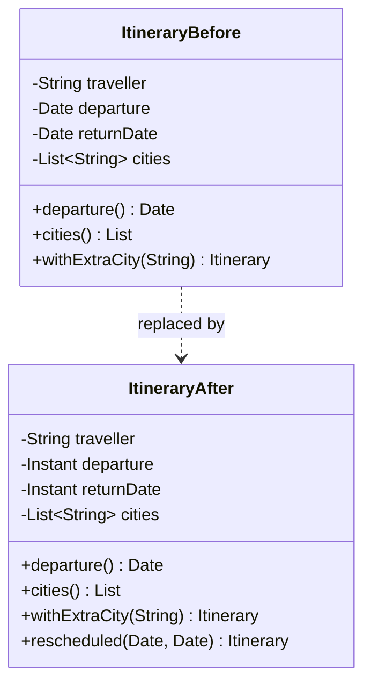

# Task 34 · The itinerary that changed by itself: immutability and defensive copies

| Difficulty | Topics | Time box |
|---|---|---|
| 🟢 Easy | Minimizing mutability · Defensive copies (in and out) · Copy before validating · Why not `clone()` for untrusted input · `List.copyOf` · Final classes | 1 h |

> **Background reading:** *Effective Java* 3rd ed. Item 17 ("Minimize mutability"), Item 50 ("Make defensive copies when needed", the `Period` example), Item 13 ("Override clone judiciously"), Item 15 ("Minimize the accessibility of classes and members"), Item 19 ("Design and document for inheritance or else prohibit it") · *Java Concurrency in Practice* ch. 3.4 ("Immutability", optional)

---

## The situation

Our tour operator has a booking system. Every booking holds an `Itinerary`: who travels, when they leave, when they are back, and which cities they visit. Other teams build itineraries from their own code, and they pass in `java.util.Date`. We cannot change that API, because too many callers depend on it.

Last week customer support saw two bad itineraries:

* **The return date was before the departure date.** The booking screen showed a trip of minus three days.
* **A city appeared that the customer never booked.** Its city list had an extra entry, Reykjavik, which nobody had chosen.

We found both causes in our code, and they are the same bug in two places:

* `Itinerary` **stores the caller's `Date` objects and `List` directly.** One caller builds a `Date`, passes it in, and then calls `setTime()` on the same object in a loop to make the next booking. Every itinerary built in that loop now shares one `Date` object, and that object has the last value of the loop.
* `Itinerary` **hands its own `List` back from `cities()`.** A controller called `cities().add(...)` to add a stop to a booking. That changed the booking without going through `withExtraCity`, and the validation never ran.

The validation itself was fine. It ran once, at construction time, on objects that were still open to change. We need to make the class **immutable behind a `Date`-based API**: nothing a caller does with the objects they passed in or got back may change an itinerary after it has been built.

## The domain

| Term | Meaning |
|---|---|
| **Itinerary** | A traveller, a departure instant, a return instant and a non-empty list of cities. It is a value: two itineraries with the same fields are the same trip. |
| **Immutable** | Its state never changes after the constructor returns. A "changed" itinerary is a new object. |
| **Defensive copy** | A private copy of a mutable object, made so that the outside cannot reach the original. We copy on the way **in** (from parameters) and on the way **out** (from getters). |
| **Wither** | A method such as `withExtraCity` that returns a new object with one field changed, and leaves the old one alone. |
| **Day trip** | An itinerary whose departure and return are the same instant. It is allowed. |
| **Duration in days** | The whole number of days between the two instants, using `ChronoUnit.DAYS`. 23 hours is 0 days. |

### The bug, step by step

```mermaid
sequenceDiagram
    participant Loop as Booking loop
    participant Date as One shared Date object
    participant Trip1 as Itinerary 1
    participant Trip2 as Itinerary 2
    Loop->>Date: setTime to May 1st
    Loop->>Trip1: new Itinerary with the Date
    Trip1->>Date: stores the reference, no copy
    Loop->>Date: setTime to May 9th
    Loop->>Trip2: new Itinerary with the same Date
    Trip2->>Date: stores the same reference again
    Note over Trip1,Date: Trip 1 now has departure May 9th
    Note over Trip2,Date: Both trips share one object that changes
```

Nothing in `Itinerary` is wrong on its own line. The problem is that **the object we store is also owned by someone else**. Our validation ran on May 1st, and the stored value became May 9th afterwards.

### The five rules of an immutable class

*Effective Java* Item 17 lists five rules. Here is what each one means for `Itinerary`:

1. **No mutators.** No method changes the object. `withExtraCity` and `rescheduled` return a new itinerary instead.
2. **The class cannot be extended.** It is `final`, so no subclass can add mutable state or override a getter.
3. **All fields are `final`.** The compiler then guarantees that each field is assigned once, in the constructor.
4. **All fields are `private`.** Callers go through the accessors, so the class decides what leaves it (Item 15).
5. **Exclusive access to mutable components.** If a field refers to something mutable, nobody outside may hold a reference to it: copy on the way in, copy on the way out. This is the rule the legacy class breaks, and the reason for this task.

### The shape of the change



The public methods keep the same names and types. What changes is what sits behind them. The fields become `private final`. `Date` is converted to `Instant` on the way in, and back to a fresh `Date` on the way out. `withExtraCity` returns a new object.

## What I want from you

This task has **no skeleton**. [`Itinerary`](../src/main/java/io/github/chris013/practice/task34/Itinerary.java) in `src` is the legacy class. It compiles, its signatures are the ones other teams use, and it is mutable and leaky. Your job is to fix it, not to fill in TODOs. Keep every public signature, and make the class immutable.

1. **[`Itinerary`](../src/main/java/io/github/chris013/practice/task34/Itinerary.java)`(traveller, departure, returnDate, cities)`** with `java.util.Date` for the two dates and `List<String>` for the cities.
   * `null` for any argument → `NullPointerException`, including a `null` element in `cities`.
   * `traveller` is trimmed (`strip()`) and must not be blank → `IllegalArgumentException`.
   * `departure` must not be after `returnDate`. Equal is allowed (a day trip). A return one millisecond before departure is rejected.
   * `cities` must not be empty. Each city is trimmed and must not be blank.
2. **Accessors:**
   * `String traveller()` returns the trimmed name.
   * `Date departure()` and `Date returnDate()` return a **new** `Date` on every call. A caller who changes the result must not change the itinerary.
   * `List<String> cities()` returns an **unmodifiable** list. Adding to it throws `UnsupportedOperationException`.
3. **`long durationInDays()`**: the whole days between departure and return, `ChronoUnit.DAYS`. Same instant → 0. 23 hours → 0. 24 hours → 1. Three days → 3.
4. **`Itinerary withExtraCity(String city)`** returns a **new** itinerary with the city added. The original does not change. The new city follows the same rules as the constructor (not blank, not null).
5. **`Itinerary rescheduled(Date newDeparture, Date newReturn)`** returns a new itinerary with new dates. The same date rules apply, and the original does not change.
6. **`equals`, `hashCode` and `toString`** cover all four fields. Two itineraries with the same traveller, dates and cities are equal.
7. **The class is `final`, and every field is `private final`.** The tests check this by reflection.

## Constraints & non-goals

* **Keep the public API.** The signatures in the list above are fixed. Other teams pass `java.util.Date`, so that type stays in the public API. Stretch goal 1 is the way to move away from it later.
* **Do not use `clone()`** on the parameters. `Date` is not final, so a caller can pass a subclass that overrides `clone()`; see the `EvilDate` test.
* **No libraries.** Plain Java 25, JUnit and AssertJ for the tests.
* Times come from `Date` and `Instant`. There is no `Clock` in this task, because nothing here depends on "now".

## How I'd approach it

* **Work from the attacks backwards.** Read the test class first. Each `@Nested` group in `Attacks` describes one way the caller can reach into your object. Make each one fail on the starter, then make it pass.
* **Decide the internal types first.** A `Date` is mutable, so do not store one. Store `Instant` or `long` instead. `Instant` is immutable and has `isAfter`, `until` and `Date.from` to go back and forth. Write down why in your PR description.
* **Copy before you validate.** Take the snapshot of each `Date` first, then check the snapshot. If you validate the caller's object and copy it later, another thread (or a `Date` subclass that reports different values on each call) can change it in between. This is the time-of-check/time-of-use problem. It is cheap to avoid: read the value once, then use only that value.
* **Read `getTime()` exactly once per date.** It is a public, overridable method. A `Date` subclass can return one value now and a different value later.
* **Lists.** Copy the list first with `List.copyOf`. That gives you an unmodifiable copy and rejects `null` elements in one call, but it does not trim. Trim the copy, then copy it again if you need to. Compare `List.copyOf` with `Collections.unmodifiableList`, which is only a read-only **view** on the list you were given. If the caller still has the list, they can still change your itinerary through the view. Find that test in `Attacks`.
* **Withers.** `withExtraCity` should build a new list, and then call the constructor. It should not add to the field and return `this`. The constructor already has every rule, so do not repeat them.
* **Final class.** A non-final class can be subclassed, and a subclass can add mutable state or override a getter. A class that is "immutable" but can be subclassed is not immutable. That's why `Itinerary` is `final` (*Effective Java* Item 19 and Item 17).
* **`Date` is the cautionary tale.** It has `setTime`, `getTime` and `clone`, and all of them are public. `java.time` types such as `Instant`, `LocalDate` and `ZonedDateTime` are immutable. In new code, do not use `Date` at all unless an API forces you to.
* **Records.** If you wrote `record Itinerary(...)`, you would still need a compact constructor that copies the list and the dates, because a record's accessor returns whatever was stored. A record does not give you defensive copies for free.

## Tests

Run: `mvn test -Dtest='**/task34/**'`

[`ItineraryTest`](../src/test/java/io/github/chris013/practice/task34/ItineraryTest.java) has five groups. `Validation` checks the rules from the constructor. `Attacks` tries to change an itinerary through every way a caller can reach it. `Values` checks the durations and equality. `Structure` checks the class and its fields by reflection.

The `Attacks` group uses two `Date` subclasses that the test defines itself. One overrides `clone()` to return `this`, which is what an attacker can do to any copy made with `clone()`. The other reports a different time on each `getTime()` call. Both are ordinary Java, and both break a naive implementation.

<details>
<summary>Show the tests</summary>

<!-- embed: src/test/java/io/github/chris013/practice/task34/ItineraryTest.java -->
**[`ItineraryTest.java`](../src/test/java/io/github/chris013/practice/task34/ItineraryTest.java)**

```java
package io.github.chris013.practice.task34;

import static org.assertj.core.api.Assertions.assertThat;
import static org.assertj.core.api.Assertions.assertThatCode;
import static org.assertj.core.api.Assertions.assertThatThrownBy;

import java.lang.reflect.Field;
import java.lang.reflect.Modifier;
import java.time.Instant;
import java.util.ArrayList;
import java.util.Arrays;
import java.util.Date;
import java.util.List;
import org.junit.jupiter.api.Nested;
import org.junit.jupiter.api.Test;
import org.junit.jupiter.params.ParameterizedTest;
import org.junit.jupiter.params.provider.CsvSource;

class ItineraryTest {

    private static final String DEPARTURE = "2026-05-01T10:00:00Z";
    private static final String RETURN = "2026-05-05T18:00:00Z";

    private static Date at(String isoInstant) {
        return Date.from(Instant.parse(isoInstant));
    }

    private static Itinerary trip() {
        return new Itinerary("Anna", at(DEPARTURE), at(RETURN), new ArrayList<>(List.of("Rome")));
    }

    @Nested
    class Validation {

        @Test
        void accepts_a_day_trip_that_starts_and_ends_at_the_same_instant() {
            assertThatCode(() -> new Itinerary("Anna", at(DEPARTURE), at(DEPARTURE), List.of("Rome")))
                    .doesNotThrowAnyException();
        }

        @Test
        void rejects_a_return_one_millisecond_before_departure() {
            Date oneMillisecondBefore = at("2026-05-01T09:59:59.999Z");

            assertThatThrownBy(() -> new Itinerary("Anna", at(DEPARTURE), oneMillisecondBefore, List.of("Rome")))
                    .isInstanceOf(IllegalArgumentException.class);
        }

        @ParameterizedTest
        @CsvSource({"''", "'   '", "'\u2003'"})
        void rejects_a_blank_traveller(String traveller) {
            assertThatThrownBy(() -> new Itinerary(traveller, at(DEPARTURE), at(RETURN), List.of("Rome")))
                    .isInstanceOf(IllegalArgumentException.class);
        }

        @Test
        void rejects_no_cities() {
            assertThatThrownBy(() -> new Itinerary("Anna", at(DEPARTURE), at(RETURN), List.of()))
                    .isInstanceOf(IllegalArgumentException.class);
        }

        @ParameterizedTest
        @CsvSource({"''", "'   '", "'\u2003'"})
        void rejects_a_blank_city(String city) {
            assertThatThrownBy(() -> new Itinerary("Anna", at(DEPARTURE), at(RETURN), List.of("Rome", city)))
                    .isInstanceOf(IllegalArgumentException.class);
        }

        @Test
        void rejects_a_null_city_element() {
            List<String> withNull = Arrays.asList("Rome", null);

            assertThatThrownBy(() -> new Itinerary("Anna", at(DEPARTURE), at(RETURN), withNull))
                    .isInstanceOf(NullPointerException.class);
        }

        @Test
        void rejects_null_arguments() {
            assertThatThrownBy(() -> new Itinerary(null, at(DEPARTURE), at(RETURN), List.of("Rome")))
                    .isInstanceOf(NullPointerException.class);
            assertThatThrownBy(() -> new Itinerary("Anna", null, at(RETURN), List.of("Rome")))
                    .isInstanceOf(NullPointerException.class);
            assertThatThrownBy(() -> new Itinerary("Anna", at(DEPARTURE), null, List.of("Rome")))
                    .isInstanceOf(NullPointerException.class);
            assertThatThrownBy(() -> new Itinerary("Anna", at(DEPARTURE), at(RETURN), null))
                    .isInstanceOf(NullPointerException.class);
        }

        @Test
        void trims_the_traveller_and_every_city() {
            Itinerary trip = new Itinerary("  Anna  ", at(DEPARTURE), at(RETURN), List.of(" Rome ", " Paris"));

            assertThat(trip.traveller()).isEqualTo("Anna");
            assertThat(trip.cities()).containsExactly("Rome", "Paris");
        }
    }

    @Nested
    class Attacks {

        @Test
        void a_date_passed_in_cannot_change_the_itinerary_afterwards() {
            Date departure = at(DEPARTURE);
            Itinerary trip = new Itinerary("Anna", departure, at(RETURN), List.of("Rome"));

            departure.setTime(Instant.parse("2026-06-01T10:00:00Z").toEpochMilli());

            assertThat(trip.departure()).isEqualTo(at(DEPARTURE));
        }

        @Test
        void a_date_returned_by_a_getter_can_be_changed_without_touching_the_itinerary() {
            Itinerary trip = trip();

            trip.departure().setTime(Instant.parse("2026-06-01T10:00:00Z").toEpochMilli());

            assertThat(trip.departure()).isEqualTo(at(DEPARTURE));
        }

        @Test
        void each_getter_call_returns_a_fresh_date() {
            Itinerary trip = trip();

            assertThat(trip.returnDate()).isNotSameAs(trip.returnDate());
        }

        @Test
        void a_list_passed_in_cannot_change_the_itinerary_afterwards() {
            List<String> cities = new ArrayList<>(List.of("Rome"));
            Itinerary trip = new Itinerary("Anna", at(DEPARTURE), at(RETURN), cities);

            cities.add("Paris");

            assertThat(trip.cities()).containsExactly("Rome");
        }

        @Test
        void the_list_returned_by_cities_is_unmodifiable() {
            assertThatThrownBy(() -> trip().cities().add("Paris"))
                    .isInstanceOf(UnsupportedOperationException.class);
        }

        @Test
        void a_date_subclass_that_lies_in_clone_cannot_change_the_itinerary() {
            EvilDate departure = new EvilDate(Instant.parse(DEPARTURE).toEpochMilli());
            Itinerary trip = new Itinerary("Anna", departure, at(RETURN), List.of("Rome"));

            departure.setTime(Instant.parse("2026-06-01T10:00:00Z").toEpochMilli());

            assertThat(trip.departure()).isEqualTo(at(DEPARTURE));
            assertThat(trip.durationInDays()).isEqualTo(4);
        }

        @Test
        void validates_and_stores_the_same_value_even_if_a_date_reports_a_different_time_later() {
            // The first reading (10:00 on May 1st) is valid. Every later reading says May 6th, after the return.
            Date departure = new ChangingDate(at(DEPARTURE).getTime(), at("2026-05-06T20:00:00Z").getTime());

            Itinerary trip = new Itinerary("Anna", departure, at(RETURN), List.of("Rome"));

            assertThat(trip.departure()).isEqualTo(at(DEPARTURE));
            assertThat(trip.durationInDays()).isEqualTo(4);
        }

        @Test
        void with_extra_city_returns_a_new_itinerary_and_leaves_the_original_alone() {
            Itinerary original = trip();

            Itinerary extended = original.withExtraCity("Paris");

            assertThat(extended).isNotSameAs(original);
            assertThat(extended.cities()).containsExactly("Rome", "Paris");
            assertThat(original.cities()).containsExactly("Rome");
        }

        @Test
        void with_extra_city_trims_the_new_city() {
            assertThat(trip().withExtraCity(" Paris ").cities()).containsExactly("Rome", "Paris");
        }

        @Test
        void with_extra_city_checks_the_new_city() {
            assertThatThrownBy(() -> trip().withExtraCity(" "))
                    .isInstanceOf(IllegalArgumentException.class);
            assertThatThrownBy(() -> trip().withExtraCity(null))
                    .isInstanceOf(NullPointerException.class);
        }

        @Test
        void rescheduled_returns_a_new_itinerary_and_leaves_the_original_alone() {
            Itinerary original = trip();

            Itinerary moved = original.rescheduled(at("2026-06-01T10:00:00Z"), at("2026-06-03T10:00:00Z"));

            assertThat(moved).isNotSameAs(original);
            assertThat(moved.durationInDays()).isEqualTo(2);
            assertThat(original.departure()).isEqualTo(at(DEPARTURE));
            assertThat(original.returnDate()).isEqualTo(at(RETURN));
        }

        @Test
        void rescheduled_is_not_affected_by_later_changes_to_the_dates_passed_in() {
            Date newDeparture = at("2026-06-01T10:00:00Z");
            Date newReturn = at("2026-06-03T10:00:00Z");
            Itinerary moved = trip().rescheduled(newDeparture, newReturn);

            newDeparture.setTime(0);
            newReturn.setTime(0);

            assertThat(moved.departure()).isEqualTo(at("2026-06-01T10:00:00Z"));
            assertThat(moved.returnDate()).isEqualTo(at("2026-06-03T10:00:00Z"));
        }

        @Test
        void rescheduled_validates_the_new_dates() {
            assertThatThrownBy(() -> trip().rescheduled(at(RETURN), at(DEPARTURE)))
                    .isInstanceOf(IllegalArgumentException.class);
            assertThatThrownBy(() -> trip().rescheduled(null, at(RETURN)))
                    .isInstanceOf(NullPointerException.class);
        }

        /** A Date whose clone() hands back the same object, so a defensive copy made with clone() is no copy at all. */
        private static final class EvilDate extends Date {

            private static final long serialVersionUID = 1L;

            EvilDate(long millis) {
                super(millis);
            }

            @Override
            public Object clone() {
                return this;
            }
        }

        /** Reports one time on its first getTime() call and another time on every call after that. */
        private static final class ChangingDate extends Date {

            private static final long serialVersionUID = 1L;

            private final long firstReading;
            private final long laterReadings;
            private int reads;

            ChangingDate(long firstReading, long laterReadings) {
                super(firstReading);
                this.firstReading = firstReading;
                this.laterReadings = laterReadings;
            }

            @Override
            public long getTime() {
                reads++;
                return reads == 1 ? firstReading : laterReadings;
            }
        }
    }

    @Nested
    class Values {

        @ParameterizedTest
        @CsvSource({
            "2026-05-01T10:00:00Z, 2026-05-01T10:00:00Z, 0",
            "2026-05-01T10:00:00Z, 2026-05-02T09:00:00Z, 0",
            "2026-05-01T10:00:00Z, 2026-05-02T09:59:59.999Z, 0",
            "2026-05-01T10:00:00Z, 2026-05-02T10:00:00Z, 1",
            "2026-05-01T10:00:00Z, 2026-05-04T10:00:00Z, 3"
        })
        void counts_whole_days_between_departure_and_return(String departure, String returnDate, long days) {
            Itinerary trip = new Itinerary("Anna", at(departure), at(returnDate), List.of("Rome"));

            assertThat(trip.durationInDays()).isEqualTo(days);
        }

        @Test
        void equal_when_every_field_is_equal() {
            Itinerary a = trip();
            Itinerary b = trip();

            assertThat(a).isEqualTo(b);
            assertThat(a.hashCode()).isEqualTo(b.hashCode());
        }

        @Test
        void not_equal_when_any_field_differs() {
            Itinerary base = trip();

            assertThat(base).isNotEqualTo(new Itinerary("Ben", at(DEPARTURE), at(RETURN), List.of("Rome")));
            assertThat(base).isNotEqualTo(new Itinerary("Anna", at("2026-05-01T11:00:00Z"), at(RETURN), List.of("Rome")));
            assertThat(base).isNotEqualTo(new Itinerary("Anna", at(DEPARTURE), at(RETURN), List.of("Paris")));
            assertThat(base).isNotEqualTo(new Itinerary("Anna", at(DEPARTURE), at("2026-05-05T19:00:00Z"), List.of("Rome")));
        }

        @Test
        void to_string_shows_the_traveller_and_the_cities() {
            assertThat(trip().toString()).contains("Anna", "Rome");
        }
    }

    @Nested
    class Structure {

        @Test
        void the_class_is_final() {
            assertThat(Modifier.isFinal(Itinerary.class.getModifiers())).isTrue();
        }

        @Test
        void every_field_is_private_and_final() {
            Field[] fields = Itinerary.class.getDeclaredFields();

            assertThat(fields).isNotEmpty();
            assertThat(fields).allSatisfy(field -> {
                assertThat(Modifier.isPrivate(field.getModifiers())).as(field.getName()).isTrue();
                assertThat(Modifier.isFinal(field.getModifiers())).as(field.getName()).isTrue();
            });
        }
    }
}
```
<!-- /embed -->

</details>

## Definition of done

- [ ] All tests green, and the test class runs in well under a second.
- [ ] `Itinerary` is `final`, and every field is `private final`.
- [ ] A `Date` passed in, a `Date` returned, and a `List` passed in can all be changed without changing the itinerary.
- [ ] The list returned by `cities()` cannot be modified.
- [ ] `withExtraCity` and `rescheduled` return new objects, and the original is unchanged.
- [ ] Every argument is copied before it is validated, and every `getTime()` is read only once.
- [ ] You can explain, in one sentence, why `clone()` is not a defensive copy for a parameter whose type is not final.

## Stretch goals

1. Add a new public API that uses `Instant` (`Itinerary.of(String, Instant, Instant, List)`), and mark the `Date` constructor `@Deprecated` with a Javadoc that names the replacement. What does a caller of the old constructor lose, if anything? Time zones are not part of the data here, so think about what `Date` and `Instant` each mean.
2. Make `cities` a list of a `City` value object (a record with a trimmed, non-blank `name`) instead of `String`. Which rules move into `City`, and which stay in `Itinerary`?
3. Check the immutability with a property-based test. For example, generate random lists of cities and random dates, then check that a change to any copy never affects the original. Write the generator yourself, without a library.
4. Look at the class with `javap -p` and compare it with a `record` of the same fields. Which parts does the compiler generate for you, and which parts are your responsibility?

---

## Reference solution

<details>
<summary>Spoiler: open only after you have made a serious attempt</summary>

### Key decisions

**1. Store `Instant`, not `Date`.** `Date` is mutable, so storing one means storing a value that a caller can change. `Instant` is immutable, has the same precision (milliseconds in this case), and has `isAfter` and `ChronoUnit.DAYS.between`. The alternative was storing a `long`. That also works, but `Instant` keeps the code readable and makes the duration calculation a one-liner.

**2. Snapshot each `Date` once, before validation.** The public constructor converts each `Date` to an `Instant` with `Instant.ofEpochMilli(date.getTime())`, and the private constructor validates those `Instant`s. The `getTime()` call happens exactly once per date, so the value we check is the value we store. The alternative was `new Date(d.getTime())` followed by validation of the copy. It is correct, but the validated copy is still a mutable `Date`, so the "validate what you store" rule depends on nobody touching it later. With `Instant` that rule cannot be broken by construction.

**3. Not `clone()`.** `Date.clone()` is public and overridable, so a `Date` subclass can return `this` (the `EvilDate` test). A copy made with `clone()` is then no copy at all. *Effective Java* Item 50 makes the same point. The constructor-based copy, or here the conversion to `Instant`, always gives a plain `Date` or a value that is not a `Date` at all.

**4. Copy the list first, then validate and trim, then copy again.** `List.copyOf` takes a snapshot and rejects `null` elements. After that we only look at our own copy. We trim each city into a new `ArrayList` and finish with `List.copyOf`, which gives an unmodifiable list that nobody else holds. The alternative, `Collections.unmodifiableList(cities)`, is only a read-only view. The caller can still change the list underneath it.

**5. Two constructors: one for the outside world, one for the inside.** The public constructor takes `Date`, because that is the API we must keep. It converts and delegates to a private constructor that takes `Instant`. The private one holds all the rules, so `withExtraCity` and `rescheduled` reuse them without repeating the checks. The alternative was a static factory method. It would work too, but a private constructor keeps the initialization of the `final` fields in one place.

**6. `withExtraCity` and `rescheduled` return new objects.** Both build a new list or new instants and call the private constructor. There is no mutator and no `return this`. The original is never touched, so a caller who keeps the old itinerary (for a receipt, say) still has the trip that was booked.

**7. `final` class and `private final` fields.** A non-final class can be subclassed, and a subclass could add a mutable field or override `durationInDays`. Making the class `final` closes that door (rule 2 of the five rules above, and Item 19). Making the fields `private final` is rules 3 and 4. Decisions 1 to 4 are rule 5. The reflection test checks both.

### Code

<!-- embed: solutions/src/main/java/io/github/chris013/practice/task34/Itinerary.java -->
**[`Itinerary.java`](../solutions/src/main/java/io/github/chris013/practice/task34/Itinerary.java)**

```java
package io.github.chris013.practice.task34;

import java.time.Instant;
import java.time.temporal.ChronoUnit;
import java.util.ArrayList;
import java.util.Date;
import java.util.List;
import java.util.Objects;

/**
 * A traveller's trip: when they leave, when they are back, and the cities they visit.
 *
 * <p>Immutable. The public constructor and the accessors still speak {@link Date} because other teams use it, but
 * the class never keeps a caller's {@code Date} or {@code List}, and never hands out its own mutable state. Every
 * input is copied before it is checked, and every output is either an unmodifiable list or a fresh {@code Date}.
 */
public final class Itinerary {

    private final String traveller;
    private final Instant departure;
    private final Instant returnDate;
    private final List<String> cities;

    public Itinerary(String traveller, Date departure, Date returnDate, List<String> cities) {
        this(traveller, snapshot(departure, "departure"), snapshot(returnDate, "returnDate"), cities);
    }

    /** Takes {@link Instant}s, which are already immutable, so validation runs on values nobody else can change. */
    private Itinerary(String traveller, Instant departure, Instant returnDate, List<String> cities) {
        Objects.requireNonNull(traveller, "traveller");
        Objects.requireNonNull(cities, "cities");
        // Copy first: from here on we only look at our own list. This also rejects null elements.
        List<String> copied = List.copyOf(cities);

        String name = traveller.strip();
        if (name.isEmpty()) {
            throw new IllegalArgumentException("traveller must not be blank");
        }
        if (departure.isAfter(returnDate)) {
            throw new IllegalArgumentException("departure must not be after the return date: " + departure
                    + " is after " + returnDate);
        }
        if (copied.isEmpty()) {
            throw new IllegalArgumentException("an itinerary needs at least one city");
        }
        List<String> trimmed = new ArrayList<>(copied.size());
        for (String city : copied) {
            trimmed.add(requireCity(city));
        }

        this.traveller = name;
        this.departure = departure;
        this.returnDate = returnDate;
        this.cities = List.copyOf(trimmed);
    }

    public String traveller() {
        return traveller;
    }

    /** A new {@code Date} on every call, so a caller can change it without touching this itinerary. */
    public Date departure() {
        return Date.from(departure);
    }

    /** A new {@code Date} on every call, so a caller can change it without touching this itinerary. */
    public Date returnDate() {
        return Date.from(returnDate);
    }

    public List<String> cities() {
        return cities;
    }

    public long durationInDays() {
        return ChronoUnit.DAYS.between(departure, returnDate);
    }

    /** Returns a new itinerary with one more city. This one does not change. */
    public Itinerary withExtraCity(String city) {
        Objects.requireNonNull(city, "city");
        List<String> extended = new ArrayList<>(cities);
        extended.add(city);
        return new Itinerary(traveller, departure, returnDate, extended);
    }

    /** Returns a new itinerary with new dates, checked by the same rules as the constructor. */
    public Itinerary rescheduled(Date newDeparture, Date newReturn) {
        return new Itinerary(traveller, snapshot(newDeparture, "newDeparture"), snapshot(newReturn, "newReturn"),
                cities);
    }

    /**
     * Reads the millisecond value once and keeps it. Reading it again later could give a different answer if the
     * caller passed a {@code Date} subclass that overrides {@code getTime()}, and then validation and storage would
     * disagree.
     */
    private static Instant snapshot(Date date, String name) {
        Objects.requireNonNull(date, name);
        return Instant.ofEpochMilli(date.getTime());
    }

    private static String requireCity(String city) {
        String trimmed = city.strip();
        if (trimmed.isEmpty()) {
            throw new IllegalArgumentException("a city must not be blank");
        }
        return trimmed;
    }

    @Override
    public boolean equals(Object other) {
        if (this == other) {
            return true;
        }
        if (!(other instanceof Itinerary that)) {
            return false;
        }
        return traveller.equals(that.traveller)
                && departure.equals(that.departure)
                && returnDate.equals(that.returnDate)
                && cities.equals(that.cities);
    }

    @Override
    public int hashCode() {
        return Objects.hash(traveller, departure, returnDate, cities);
    }

    @Override
    public String toString() {
        return "Itinerary[traveller=" + traveller + ", departure=" + departure + ", returnDate=" + returnDate
                + ", cities=" + cities + "]";
    }
}
```
<!-- /embed -->

### What I typically flag in first attempts

| Finding | Why it matters |
|---|---|
| `Collections.unmodifiableList(cities)` in the constructor | It is a view on the caller's list. The caller can still change the itinerary by changing their own list. Use `List.copyOf`. |
| Validating the `Date`s, then copying them | Between the check and the copy, another thread or a `Date` subclass can change the value. Copy first, then check the copy. |
| `date.clone()` on a parameter | `Date` is not final, so `clone()` can be overridden to return `this`. Use `Instant.ofEpochMilli(date.getTime())` or `new Date(date.getTime())`. |
| A "final" design that is not `final` | A class that can be subclassed is not immutable. The subclass can add state or change behaviour. Make the class `final`. |
| Returning the internal `Date` from a getter | The caller changes it with `setTime` and changes the itinerary. Return `Date.from(departure)` instead. |
| `withExtraCity` that adds to the list and returns `this` | The original changes, and validation does not run. A wither returns a new object and runs the constructor rules. |
| Mutator-style `rescheduled` that sets the fields and returns `this` | The same problem as above, plus any existing reference to the old trip now shows the new dates. |

</details>
