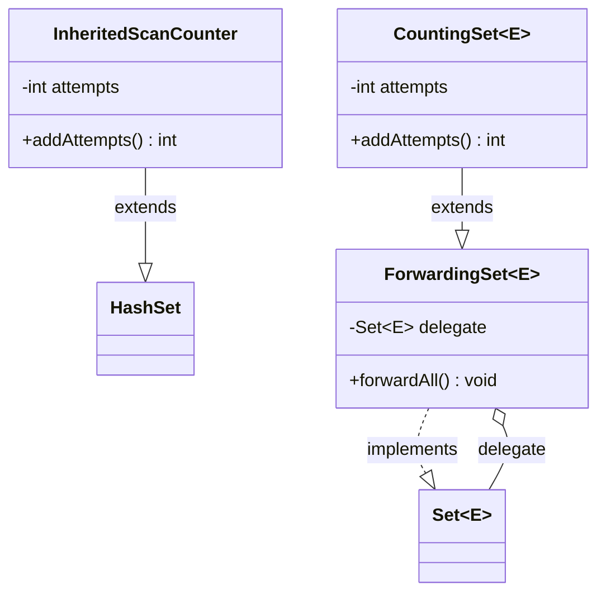
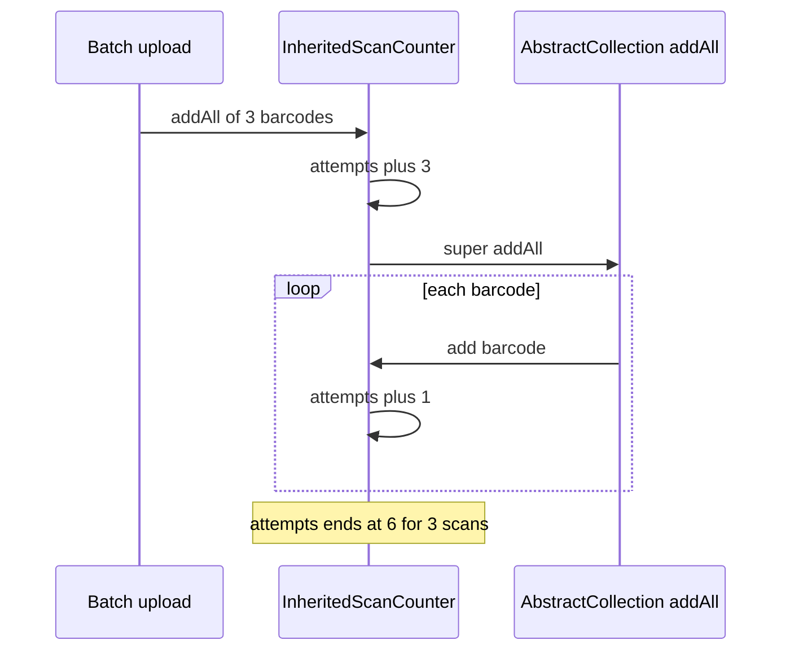

# Task 35 · The scan counter that counted twice: composition over inheritance

| Difficulty | Topics | Time box |
|---|---|---|
| 🟢 Easy | Composition over inheritance · the fragile base class problem · self-use · forwarding (wrapper) classes · the `Set` contract | 1 h |

> **Background reading:** *Effective Java* 3rd ed., Item 18 ("Favor composition over inheritance", the `InstrumentedHashSet` example), Item 19 ("Design and document for inheritance or else prohibit it"), Item 64 ("Refer to objects by their interfaces") · *Design Patterns* (GoF), "Decorator" · Javadoc of `java.util.AbstractCollection#addAll`, the `implSpec` section

---

## The situation

Our warehouse handheld scanners send barcodes to the server. Two numbers go on the operations dashboard: **scans received** and **distinct items**.

A developer built the counter as a subclass of `HashSet<String>`. It overrides `add` to count each call, and `addAll` to count the batch. Single scans look right. Batch uploads do not: a batch of 3 barcodes is counted as **6 scans**. The dashboard has shown inflated scan numbers for months, and nobody noticed, because the numbers looked plausible.

The class is [`InheritedScanCounter`](../src/main/java/io/github/chris013/practice/task35/InheritedScanCounter.java). It is kept in the repo as it was, with a Javadoc that says why it is broken. Your job is to build the replacement and explain why the first attempt went wrong.

The bug is not a typo. It comes from a rule that the author did not know: `HashSet` does not implement `addAll` itself. It inherits `AbstractCollection.addAll`, which calls `add` once for each element. So the batch goes through our `addAll` (+3), and then through our `add` three times (+3 more). The superclass's internal calls are an **implementation detail**, and our class depended on them without knowing it.

## The domain

| Term | Meaning |
|---|---|
| **Scan attempt** | One call to add a barcode to the counter, duplicates included. Dashboard: "scans received". |
| **Distinct item** | A barcode that is in the set at least once. Dashboard: "distinct items". This is the set's `size()`. |
| **Batch upload** | A list of barcodes sent in one request. Each element is one scan attempt. |
| **Delegate** | The set that really stores the barcodes. The wrapper forwards calls to it. |

Two class structures are in play. The legacy one inherits from `HashSet`. The replacement wraps a `Set` and holds it as a field.

Read the first half as **is-a through the superclass**: `InheritedScanCounter` gets every method of `HashSet`, including the ones we did not think about. Read the second half as **has-a**: `CountingSet` is a `Set`, and it holds another `Set` that does the real work. We can change the delegate without touching the counting code.

### What actually happens on a batch upload

The key line is `Base->>Counter: add barcode`. The superclass calls **our** `add`, because `this` is our object, and dynamic dispatch picks our override. Nothing in our code says "count the batch here". The double count happens because two methods of ours are both on the path, and one of them is called by the other.

### Self-use: why the subclass is fragile

A method **uses itself** when it calls another method of the same object, and that call goes through dynamic dispatch. `AbstractCollection.addAll` uses `add`. Its Javadoc has an `implSpec` section that says so: it adds each element "by calling add". That sentence is a promise to subclasses, and it is easy to miss. Our author did not read it, or did not know that the promise was there.

The result is that overriding `add` changes the behaviour of a method we never mentioned. Every subclass that overrides a method has to know which other methods of the superclass call it. Nothing in the code shows that.

### Why "just do not override addAll" is not a fix

A tempting fix is to delete our `addAll` and keep only `add`. Today a batch of 3 then counts 3, which is right. But the count now depends on `HashSet` never changing `addAll` so that it bypasses `add`. If a future JDK or another superclass does that, batch scans are silently counted as 0. The code works by accident, and a reader cannot tell from it why. A correct fix does not depend on what the superclass does internally.

### The SELF problem

Wrapping has a trap of its own. The delegate knows only itself, not the wrapper around it. If the delegate passes `this` to a callback, the callback receives the **inner** set, and any call it makes skips the counter. For example, a set that calls `listener.added(this)` after each change, and a listener that calls `add` on the object it received, adds scans that are never counted. The fix is to pass the wrapper, or to keep callbacks out of the delegate. Watch for this whenever a wrapped object hands out `this`.

### When inheritance is fine

Inheritance is the right tool when all of these hold:

* The subclass really is a more specific kind of the superclass (is-a), so that code written for the superclass also works for the subclass (the Liskov substitution principle).
* The superclass was designed and documented for extension. Its self-use is written down, the way `AbstractCollection` documents `addAll` with `implSpec`. `java.util.AbstractList` is an example of a class built for subclasses.
* The subclass and the superclass change together. Same package, same team, reviewed together.

Our counter fails all three. A counter is not a more specific set, `HashSet` was not designed for counting subclasses, and the dashboard code lives far from the collection code. Composition works here because it does not need any of the three.

## What I want from you

Build the replacement as a **wrapper**. You will write two classes. Both are complete in the Javadoc, and both bodies are `UnsupportedOperationException` in the starter.

1. [`ForwardingSet`](../src/main/java/io/github/chris013/practice/task35/ForwardingSet.java)`<E> implements Set<E>`, constructor `(Set<E> delegate)`.
   * A `null` delegate throws `NullPointerException` with the parameter name.
   * It forwards **every** `Set` method to the delegate. That includes `equals`, `hashCode` and `toString`, so a `ForwardingSet` equals a `HashSet` with the same elements, and the other way round.
   * It is not `final`, because it is designed to be extended. Its Javadoc states the rule that makes extension safe: no method calls another overridable method of the same class (no self-use).
2. [`CountingSet`](../src/main/java/io/github/chris013/practice/task35/CountingSet.java)`<E> extends ForwardingSet<E>`, constructor `(Set<E> delegate)`. It is `final`.
   * `add(e)` counts one attempt, whether or not `e` is new, and returns what the delegate returns.
   * `addAll(c)` counts `c.size()` attempts: one per element, duplicates included. An empty collection counts nothing. The return value is the delegate's `addAll` result.
   * `int addAttempts()` returns the total number of attempted adds since the set was created.
   * `size()` is inherited and counts **distinct** elements.
   * `static <E> CountingSet<E> overHashSet()` returns a counting set over a new, empty `HashSet`. Each call returns a new set.
3. The counting set is a **view** over the delegate, not a copy. Changes made through the wrapper are visible in the delegate, and changes made to the delegate are visible through the wrapper.
4. `addAttempts()` counts adds only. `remove`, `retainAll`, `removeAll` and `clear` do not change it.

## Constraints & non-goals

* No inheritance from a concrete collection class (`HashSet`, `AbstractSet`, `AbstractCollection`) anywhere in the new code. `ForwardingSet` implements the `Set` interface directly.
* No copying. Do not build a new `HashSet` from the input and then count. The wrapper must hold the delegate and forward to it.
* No libraries (no Guava, no Apache Commons). The point is to see the structure, and a library class would hide it.
* No change to `InheritedScanCounter`. It stays as it is so the tests can document the bug.
* No thread safety. The dashboard counter is not shared between threads in this task.

## How I'd approach it

* **Start with `ForwardingSet`.** Write one method per `Set` method, and make each one a one-line call to the delegate. The class is boring on purpose. If you find yourself writing logic in it, stop and ask whether that logic belongs in the subclass.
* **Check each method for self-use before you write it.** For example, `isEmpty()` could return `size() == 0`. That is shorter, but it calls `size()` on `this`. If a subclass overrides `size()`, then `isEmpty()` now runs the subclass code by accident. Ask the delegate instead.
* **Forward every method, including the default ones.** `Set` gets `spliterator()`, `toArray(IntFunction)` and `removeIf` as default methods from `Collection`. The defaults work through `iterator()` or `size()`, so they would also work if you forgot them. Forward them anyway: the delegate can do the job better, and the rule "every method forwards" is simpler to check when there are no exceptions.
* **`CountingSet` only counts.** It overrides `add` and `addAll`, updates a counter, and calls `super`. Ask yourself: does `super.addAll` call `this.add`? If it does, the count doubles. If it does not, the count is right. You can check this by reading the code, but the tests will check it for you.
* **Take the count before or after the delegate runs?** Think about what happens when the delegate throws halfway through a batch. The dashboard wants every scan that reached the server, so count the attempts the caller made. Write the reason in your PR description.
* **`equals` and `hashCode`.** `Set.equals` is specified in terms of the other set's elements, not its class. Forwarding `equals` to the delegate keeps that promise. Be careful that the forwarded call works in both directions: `wrapper.equals(hashSet)` and `hashSet.equals(wrapper)`.
* **`overHashSet()`** is a factory. Its job is to hide the `new HashSet<>()` call from callers who only want a counter.
* Look at [`CountingSetTest`](../src/test/java/io/github/chris013/practice/task35/CountingSetTest.java) and [`ForwardingSetTest`](../src/test/java/io/github/chris013/practice/task35/ForwardingSetTest.java). The forwarding test records every call the wrapper makes to a delegate, so you can see directly which method calls which.

## Tests

Run: `mvn test -Dtest='**/task35/**'`

[`InheritedScanCounterTest`](../src/test/java/io/github/chris013/practice/task35/InheritedScanCounterTest.java) documents the bug and passes on the starter already. [`CountingSetTest`](../src/test/java/io/github/chris013/practice/task35/CountingSetTest.java) and [`ForwardingSetTest`](../src/test/java/io/github/chris013/practice/task35/ForwardingSetTest.java) describe the new behaviour and fail until you implement it.

Show the tests

<!-- embed: src/test/java/io/github/chris013/practice/task35/CountingSetTest.java -->
<!-- /embed -->

<!-- embed: src/test/java/io/github/chris013/practice/task35/ForwardingSetTest.java -->
<!-- /embed -->

## Definition of done

- [ ] `ForwardingSet` forwards every `Set` method, including `equals`, `hashCode` and `toString`
- [ ] `ForwardingSet` rejects a `null` delegate with a `NullPointerException` that names `delegate`
- [ ] `ForwardingSet`'s Javadoc states the no-self-use rule
- [ ] `CountingSet` is `final` and extends `ForwardingSet`, not a concrete collection
- [ ] `add` counts every attempt, duplicates included
- [ ] `addAll` counts one attempt per element, and a batch of 3 barcodes gives `addAttempts()` of 3
- [ ] `size()` counts distinct items, and `retainAll`, `removeAll`, `remove` and `clear` do not change `addAttempts()`
- [ ] `overHashSet()` returns a new counting set on each call
- [ ] `mvn test -Dtest='**/task35/**'` passes all tests in `CountingSetTest`, `ForwardingSetTest` and `InheritedScanCounterTest`
- [ ] No compiler warnings with `-Xlint:all`

## Stretch goals

1. Write a `ForwardingMap<K, V>` with the same rule: no self-use, every method forwarded. Note which `Map` default methods (`getOrDefault`, `merge`, `compute`) would call back into your own methods if you did not override them.
2. Read the source of Guava's `com.google.common.collect.ForwardingSet`. It is abstract, and the subclass implements a `delegate()` method instead of holding a field. Write down one practical difference from our class, and one reason Guava chose it.
3. Extend `CountingSet` so that it also counts removals: `removeAttempts()`. Decide whether a `remove` of an item that is not in the set should count, and write a test that pins your decision.
4. Write an unmodifiable view with `Collections.unmodifiableSet` and a `ForwardingSet` that throws on every mutator. Explain why both are the same pattern, and where they differ.

---

## Reference solution

Spoiler: open only after you have made a serious attempt

### Key decisions

1. **`ForwardingSet` forwards every method and calls no other method of its own.** `isEmpty` asks the delegate, not `size()`, and `addAll` gives the batch to the delegate's `addAll`, not to a loop over `add`. The rejected alternative was to write defaults in terms of other methods, as `AbstractSet` does. That is less code, but a subclass that overrides one method changes the behaviour of others it never mentioned. The Javadoc states the rule, because a class that is open for extension must say which of its methods are safe to override. That is why `ForwardingSet` is not `final`: a subclass is allowed, and the rule is what makes it safe.

2. **`CountingSet` is `final`.** Counting is the whole contract. A subclass could change what an attempt means and make the dashboard lie again. The rejected alternative was to make it open for "flexibility". Nothing in this task needs that flexibility, and an open class would need the same self-use documentation that `ForwardingSet` already has.

3. **The count is taken from the argument's size, before the delegate runs.** A batch that stops half way (an exception in the delegate, a full store) still counted every scan that reached the server. The rejected alternative was to count the elements the delegate actually added, which is the return value of `addAll`. That gives a different number, and it is not what the dashboard wants: a duplicate scan is still a scan.

4. **The wrapper holds the delegate and forwards to it. It does not copy the input.** A copy would drift from the delegate as soon as someone else changed it, and it would cost memory. The view semantics are tested in `Delegation`.

5. **`equals`, `hashCode` and `toString` are forwarded.** `Set` defines equality by elements, not by class. A wrapper that inherited `Object.equals` would be unequal to an equal `HashSet`, and the `SetContract` tests would catch that. The rejected alternative was to rely on `AbstractSet`'s implementation, which is only correct if the wrapper implements every method it uses.

### Code

<!-- embed: solutions/src/main/java/io/github/chris013/practice/task35/InheritedScanCounter.java -->
<!-- /embed -->

<!-- embed: solutions/src/main/java/io/github/chris013/practice/task35/ForwardingSet.java -->
<!-- /embed -->

<!-- embed: solutions/src/main/java/io/github/chris013/practice/task35/CountingSet.java -->
<!-- /embed -->

### What I typically flag in first attempts

| Finding | Why it matters |
|---|---|
| `class CountingSet extends HashSet` (or `AbstractSet`) | You inherit `addAll` from the superclass, and that calls `add`. The batch double-counts again, and the next superclass upgrade can change the count. |
| Extending a concrete collection, even `AbstractSet` | Every method of the base class is now part of your class, and you must know its self-use to be safe. The wrapper needs only the `Set` interface. |
| Overriding only `add` and leaving `addAll` alone | The count is right today by accident. If the superclass ever stops calling `add` from `addAll`, batches are silently counted as 0. |
| `addAll` counted by the return value of `super.addAll` | `addAll` returns a boolean, not a count. Counting by the return value counts only new items and drops every duplicate scan. |
| `isEmpty` as `size() == 0` in the wrapper | It calls `this.size()`. A subclass that overrides `size` now changes `isEmpty` too. Forward to the delegate. |
| `equals` or `hashCode` not forwarded | A wrapper equal to a `HashSet` on one side and unequal on the other breaks the `Set` contract, and it breaks `HashMap` keys. |
| A non-final wrapper with no documented self-use | The next developer overrides one method and gets double counts, and nothing in the code says which calls are safe. |
| Copying the input into a new `HashSet` | Changes through the wrapper do not reach the caller's set, and changes to the caller's set do not reach the counter. The "view" contract breaks silently. |

