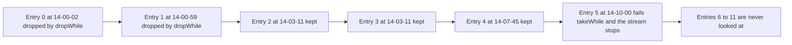

# Task 36 · Reading a sorted access log with streams

| Difficulty | Topics | Time box |
|---|---|---|
| 🟢 Easy | Streams on sorted data: `takeWhile` and `dropWhile` · `flatMap` · `Stream.iterate` with a predicate · `partitioningBy` · `LongSummaryStatistics` · side-effect-free stream functions | 1–1.5 h |

> **Background reading:** *Modern Java in Action* ch. 4 ("Introducing streams"), ch. 5 ("Working with streams": slicing with `takeWhile`/`dropWhile`, mapping with `flatMap`, finding and matching, numeric streams, building streams), ch. 6 ("Collecting data with streams": partitioning) · *Effective Java* 3rd ed. Item 45 ("Use streams judiciously"), Item 46 ("Prefer side-effect-free functions in streams"), Item 47 ("Prefer `Collection` to `Stream` as a return type")

---

## The situation

The ops team asks questions about one day's access log of the shop backend:

* "What happened between 14:00 and 14:15?"
* "What was the first 5xx of the day?"
* "How slow were we?"

The log is written in time order, so the file is already sorted. The script the team uses today has two problems. It uses `forEach` with mutable counters that are changed from inside the loop. And it filters the whole day for every time window, even though the data is sorted and the answer for a window is a contiguous block in the middle of the file.

Streams fit this problem well, but only if we use them for the right things. Some operations are only correct because the data is sorted. Some are only clean if the lambdas are free of side effects. This task is about both.

## The domain

| Term | Meaning |
|---|---|
| **Log entry** | One request: time, user, method, path, status, duration in milliseconds. [`LogEntry`](../src/main/java/io/github/chris013/practice/task36/LogEntry.java) is given and complete. |
| **Access log** | One day's entries, sorted by time. [`AccessLog`](../src/main/java/io/github/chris013/practice/task36/AccessLog.java) is the class you implement. |
| **Half-open window** | `[from, to)`: the start is included and the end is excluded. Two adjacent windows never count the same entry twice. |
| **Server error** | Status 500 to 599. |
| **Client error** | Status 400 to 499. |

The shape of a question about a window is always the same: skip everything before the window, take everything inside it, and stop. The picture below shows the query `between(14:03:11, 14:10:00)` on the sorted log from the tests.



`dropWhile` moves past the entries that are too early. `takeWhile` takes entries until the first one that is too late, and then it stops. Both only work if "too early" is followed by "in the window" and then by "too late", with nothing in between. That is what sorting guarantees.

## What I want from you

Implement [`AccessLog`](../src/main/java/io/github/chris013/practice/task36/AccessLog.java). `LogEntry` is complete. Read it first, because the parsing rules and the validation are part of the contract.

1. **`of(List<LogEntry> entries)`** copies the list. Equal times are allowed. If an entry is earlier than the entry before it, throw `IllegalArgumentException`. The message must name the index of the first entry that is out of order.
2. **`parse(List<String> lines)`** skips blank lines and lines that start with `#`. It parses every other line with `LogEntry.parse`. A malformed line fails the whole call (the `IllegalArgumentException` from `LogEntry.parse` is passed through).
3. **`between(Instant fromInclusive, Instant toExclusive)`** returns the entries with `from <= time < to`, in log order. It uses `dropWhile` and `takeWhile`. If `from` is after `to`, throw `IllegalArgumentException`. If `from` equals `to`, the result is empty.
4. **`firstServerError()`** returns the first entry with a 5xx status, or `Optional.empty()`.
5. **`usersSeen()`** returns the distinct user names in the order they first appear.
6. **`pathSegments()`** returns every distinct non-empty segment of every path, split on `/`. `/api/orders/42` contributes `api`, `orders` and `42`. The result is a `SortedSet` that cannot be modified. Use `flatMap`.
7. **`partitionByError()`** returns a `Map<Boolean, List<LogEntry>>`. The key `true` holds the entries with status 400 and up, and the key `false` holds the rest. Both keys are always present, even when one list is empty. The lists cannot be modified.
8. **`durations()`** returns the `LongSummaryStatistics` of `durationMs` over all entries.
9. **`countSlowerThan(Duration threshold)`** counts the entries whose `durationMs` is strictly greater than the threshold, in whole milliseconds.
10. **`requestsPerWindow(Instant start, Instant end, Duration window)`** returns one count for each window `[start + i*window, start + (i+1)*window)`. Windows are produced while the window start is before `end`. Only entries before `end` are counted, even in a last window that runs past `end`. The window must be positive, otherwise throw `IllegalArgumentException`. If `start` is after `end`, throw `IllegalArgumentException`. If `start` equals `end`, the result is empty. Build the window starts with `Stream.iterate(start, t -> t.isBefore(end), t -> t.plus(window))`.
11. Every returned `List` is immutable. Do not use `forEach` with side effects, and do not keep mutable counters outside of collectors.

## Constraints & non-goals

* **No mutable state inside lambdas.** A counter updated by a `forEach` is the thing we are removing. Collectors and reductions are fine, because they are designed for it.
* **No file I/O in `AccessLog`.** The log is passed in as lines. Reading from a file is a stretch goal.
* **No new public methods** beyond the signatures above. Private helpers are welcome.
* **Do not change `LogEntry`.** It is part of the contract for this task, and the tests for it must pass on your starter as they are.
* Keep the log immutable. A query never changes the object.

## How I'd approach it

* **Start with `of` and `parse`.** They are the only place where the sortedness is checked. Everything after them can rely on the sortedness. That is why the check must happen once, in one place. A plain `for` loop with an index is fine here. Item 45 is not a rule against loops. A stream is a good choice when the stream expresses the question ("the first index where the order breaks"), and a loop is a good choice when the code is about the procedure. Choose what reads better to you and be ready to say why.
* **Why `takeWhile` and `dropWhile` only work on sorted data.** Take the unsorted list `14:00 (anna)`, `15:00 (ben)`, `14:30 (cara)` and the query `between(14:00, 15:00)`. With `takeWhile`, you get `[anna]`. The stream stops at `ben`, because `ben` is at 15:00 and is not before `to`. The `cara` entry at 14:30 is inside the window, but it is never seen. With `filter`, you get `[anna, cara]`, which is correct. The `takeWhile` version looks right on sorted input, and it fails quietly on unsorted input. That is why the sortedness check exists.
* **`filter` versus `takeWhile`.** `filter` must look at every entry of the day, every time. `takeWhile` stops at the first entry after the window, so the lines after the window are never read. The saving depends on where the window is. Take a day of 500 000 lines spread evenly over 24 hours, and the window 14:00 to 14:15. `filter` reads all 500 000 lines. `dropWhile` and `takeWhile` together read the lines up to 14:15, about 300 000 of them, and then stop. `dropWhile` still walks every line before the window, so a late window still costs most of the day. A binary search would find the start in logarithmic time. That is an idea for later, not for this task. You can measure the difference with `peek` if you like, but it is not part of the tests.
* **Early stopping is not tested.** Laziness is an implementation detail, and a test would need a counting predicate to check it. The behaviour is what matters: the result is the same either way. Verify the early stop yourself with a `peek` that counts how many entries it sees.
* **`flatMap` for path segments.** `path.split("/")` returns an array for each path. `map(path -> path.split("/"))` gives a `Stream<String[]>`, which is a stream of arrays. `flatMap(path -> Arrays.stream(path.split("/")))` gives one flat `Stream<String>`. Then `filter` out the empty strings that come from the leading slash.
* **`Stream.iterate` with three arguments.** The two-argument form makes an infinite stream, and you would need `limit`, which needs a count. The three-argument form (Java 9) stops by itself when the predicate fails. Use it to produce window starts, and then map each start to a count. Think about what the last window looks like when `end` is not a multiple of the window length. The window still starts before `end`, so it is produced. Its count must still include only entries before `end`.
* **`partitioningBy` versus `groupingBy`.** `partitioningBy` always has both keys, and a `groupingBy` only has the keys that occur. For a yes/no question like "error or not", you want both keys every time, so the caller never has to write `map.getOrDefault(true, List.of())`.
* **Numeric streams.** `mapToLong(LogEntry::durationMs)` gives a `LongStream`. The `summaryStatistics()` call returns a `LongSummaryStatistics` with count, sum, min, max and average in one pass. `map(LogEntry::durationMs)` would box every value into a `Long` first, and a stream of boxed numbers does more work than it needs to.
* **Side effects.** Item 46: the only correct use of `forEach` is at the very end of a pipeline, to report or print. It is not for building a result. If you find yourself writing `list.add(...)` inside a `forEach`, use `collect` or `toList()`.
* **Return `List`, not `Stream`.** Item 47. A `Stream` can only be consumed once, and a getter that returns a `Stream` pushes the work onto every caller. Returning an immutable `List` is cheap here, and it lets the caller use it again.
* **Timing of `between` in `requestsPerWindow`.** Each window calls `between`, which starts again from the beginning of the day. That makes the work O(windows x entries). It is good enough for one day, and it reads clearly. A stretch goal asks you to do better.
* **Work the boundaries by hand before you run anything.** Take the day from the tests. `requestsPerWindow(14:00, 14:05, 5 min)` gives one window, and it counts the four entries before 14:05. The window that would start at 14:05 is not produced, because 14:05 is not before 14:05. Now take `requestsPerWindow(14:00, 14:12, 5 min)`. The last window starts at 14:10 and runs to 14:15, but only entries before 14:12 count, so the 14:12:30 entry is left out. Write the expected lists down first, then check them against the tests.
* **From loops to streams.** Most of the old script maps directly onto one stream operation each. The table shows the translation. Read it as a list of questions to ask about each loop, not as a rule that every loop must become a stream.

| Imperative loop | Stream operation |
|---|---|
| a loop that skips early entries, then copies until the time is too late | `dropWhile` followed by `takeWhile` |
| `count++` inside an `if` in a loop | `filter(...).count()` or `mapToLong(...).filter(...).count()` |
| `out.add(user)` only if `!seen.contains(user)` | `map(LogEntry::user).distinct().toList()` |
| nested loops that call `set.add(segment)` for every path | `flatMap(path -> Arrays.stream(path.split("/")))` and `collect(toCollection(TreeSet::new))` |
| two lists filled by one `if` (`errors.add` and `ok.add`) | `partitioningBy(...)` with a collector for each side |
| running `sum`, `min` and `max` variables | `mapToLong(...).summaryStatistics()` |
| `while (t.isBefore(end)) { ...; t = t.plus(window); }` | `Stream.iterate(start, t -> t.isBefore(end), t -> t.plus(window))` |
| `for` loop that returns the first 5xx, else `Optional.empty()` | `filter(LogEntry::isServerError).findFirst()` |

* **The parsing contract is strict on purpose.** `LogEntry.parse` splits on single spaces, so a double space makes a field empty and the line is rejected. That is what the tests check. A tolerant parser would hide a broken log export, and the ops team would only find out from wrong numbers. Strictness is cheaper to debug than silent bad data.

## Tests

Run: `mvn test -Dtest='**/task36/**'`

[`LogEntryTest`](../src/test/java/io/github/chris013/practice/task36/LogEntryTest.java) is already green on your starter, because `LogEntry` is complete. It shows the parsing rules you must respect. [`AccessLogTest`](../src/test/java/io/github/chris013/practice/task36/AccessLogTest.java) runs every method against a fixed 12-entry log. It has the boundary cases: an entry exactly at `from`, an entry exactly at `to`, a window that ends on a boundary, and a last window that runs past the end.

<details>
<summary>Show the tests</summary>

<!-- embed: src/test/java/io/github/chris013/practice/task36/AccessLogTest.java -->
**[`AccessLogTest.java`](../src/test/java/io/github/chris013/practice/task36/AccessLogTest.java)**

```java
package io.github.chris013.practice.task36;

import static org.assertj.core.api.Assertions.assertThat;
import static org.assertj.core.api.Assertions.assertThatThrownBy;

import java.time.Duration;
import java.time.Instant;
import java.util.ArrayList;
import java.util.List;
import org.junit.jupiter.api.Nested;
import org.junit.jupiter.api.Test;
import org.junit.jupiter.params.ParameterizedTest;
import org.junit.jupiter.params.provider.CsvSource;

class AccessLogTest {

    private static final String LOG = """
            # shop backend access log, 2026-03-02
            2026-03-02T14:00:02Z anna GET /api/products 200 41

            2026-03-02T14:00:59Z ben POST /api/cart/items 201 120
            2026-03-02T14:03:11Z anna GET /api/orders/42 200 87
            2026-03-02T14:03:11Z cara GET /api/orders/7 404 15
            2026-03-02T14:07:45Z ben GET /api/orders/42 500 1530
            2026-03-02T14:10:00Z dan GET /api/products/9 200 640
            2026-03-02T14:12:30Z anna POST /api/orders 503 2210
            2026-03-02T14:14:59Z cara GET /api/products 200 38
            2026-03-02T14:15:00Z dan GET /api/orders/42 200 95
            2026-03-02T14:16:20Z ben GET /api/orders/99 401 12
            2026-03-02T14:20:00Z eve GET /health 200 3
            2026-03-02T14:20:00Z anna GET /api/orders/42 200 402
            """;

    private final AccessLog day = AccessLog.parse(LOG.lines().toList());

    private static Instant at(String time) {
        return Instant.parse("2026-03-02T" + time + "Z");
    }

    private static LogEntry entry(String time, int status) {
        return new LogEntry(at(time), "anna", "GET", "/api/orders/42", status, 10);
    }

    @Nested
    class Parsing {

        @Test
        void skips_blank_lines_and_comments() {
            assertThat(day.durations().getCount()).isEqualTo(12);
        }

        @Test
        void a_log_with_only_comments_is_empty() {
            assertThat(AccessLog.parse(List.of("# nothing today", ""))
                    .durations().getCount()).isZero();
        }

        @Test
        void a_malformed_line_fails_and_the_message_names_it() {
            List<String> lines = List.of("2026-03-02T14:00:00Z anna GET /x 200 10", "2026-03-02T14:00:01Z broken");

            assertThatThrownBy(() -> AccessLog.parse(lines))
                    .isInstanceOf(IllegalArgumentException.class)
                    .hasMessageContaining("broken");
        }
    }

    @Nested
    class Of {

        @Test
        void accepts_equal_times() {
            AccessLog log = AccessLog.of(List.of(entry("14:00:00", 200), entry("14:00:00", 200)));

            assertThat(log.durations().getCount()).isEqualTo(2);
        }

        @Test
        void rejects_unsorted_entries_and_names_the_first_bad_index() {
            List<LogEntry> unsorted = List.of(
                    entry("14:00:00", 200),
                    entry("14:05:00", 200),
                    entry("14:01:00", 200),
                    entry("14:02:00", 200));

            assertThatThrownBy(() -> AccessLog.of(unsorted))
                    .isInstanceOf(IllegalArgumentException.class)
                    .hasMessageContaining("index 2");
        }

        @Test
        void copies_its_input() {
            List<LogEntry> input = new ArrayList<>(List.of(entry("14:00:00", 200)));
            AccessLog log = AccessLog.of(input);

            input.clear();

            assertThat(log.durations().getCount()).isEqualTo(1);
        }

        @Test
        void rejects_null() {
            assertThatThrownBy(() -> AccessLog.of(null)).isInstanceOf(NullPointerException.class);
        }
    }

    @Nested
    class Between {

        @Test
        void includes_the_entries_at_from_and_excludes_the_entries_at_to() {
            List<LogEntry> window = day.between(at("14:03:11"), at("14:10:00"));

            assertThat(window).extracting(LogEntry::user).containsExactly("anna", "cara", "ben");
        }

        @Test
        void includes_the_first_entry_when_from_is_its_time() {
            assertThat(day.between(at("14:00:02"), at("14:00:03")))
                    .singleElement()
                    .satisfies(entry -> assertThat(entry.durationMs()).isEqualTo(41L));
        }

        @Test
        void an_empty_range_gives_nothing() {
            assertThat(day.between(at("14:15:00"), at("14:15:00"))).isEmpty();
            assertThat(day.between(at("13:00:00"), at("14:00:02"))).isEmpty();
        }

        @Test
        void a_range_ending_at_the_last_time_leaves_out_that_time() {
            assertThat(day.between(at("14:16:20"), at("14:20:00")))
                    .extracting(LogEntry::user)
                    .containsExactly("ben");
        }

        @Test
        void a_range_covering_the_tail_of_the_day_returns_the_tail() {
            assertThat(day.between(at("14:20:00"), at("23:59:59")))
                    .extracting(LogEntry::user)
                    .containsExactly("eve", "anna");
        }

        @Test
        void rejects_a_range_that_ends_before_it_starts() {
            assertThatThrownBy(() -> day.between(at("14:10:00"), at("14:00:00")))
                    .isInstanceOf(IllegalArgumentException.class);
        }

        @Test
        void returns_an_unmodifiable_list() {
            List<LogEntry> window = day.between(at("14:00:00"), at("14:01:00"));

            assertThatThrownBy(() -> window.add(entry("14:00:30", 200)))
                    .isInstanceOf(UnsupportedOperationException.class);
        }
    }

    @Nested
    class FirstServerError {

        @Test
        void returns_the_first_5xx_entry_in_time_order() {
            assertThat(day.firstServerError()).hasValueSatisfying(entry -> {
                assertThat(entry.time()).isEqualTo(at("14:07:45"));
                assertThat(entry.status()).isEqualTo(500);
            });
        }

        @Test
        void is_empty_when_only_4xx_and_2xx_entries_exist() {
            AccessLog log = AccessLog.of(List.of(entry("14:00:00", 404), entry("14:00:01", 200)));

            assertThat(log.firstServerError()).isEmpty();
        }
    }

    @Nested
    class UsersAndPaths {

        @Test
        void lists_each_user_once_in_order_of_first_appearance() {
            assertThat(day.usersSeen()).containsExactly("anna", "ben", "cara", "dan", "eve");
        }

        @Test
        void users_list_is_unmodifiable() {
            assertThatThrownBy(() -> day.usersSeen().add("zoe")).isInstanceOf(UnsupportedOperationException.class);
        }

        @Test
        void collects_every_distinct_path_segment_in_sorted_order() {
            assertThat(day.pathSegments()).containsExactly(
                    "42", "7", "9", "99", "api", "cart", "health", "items", "orders", "products");
        }

        @Test
        void path_segments_are_unmodifiable() {
            assertThatThrownBy(() -> day.pathSegments().add("x")).isInstanceOf(UnsupportedOperationException.class);
        }

        @Test
        void ignores_empty_segments_so_the_root_path_contributes_nothing() {
            AccessLog log = AccessLog.of(List.of(new LogEntry(at("14:00:00"), "anna", "GET", "/", 200, 1)));

            assertThat(log.pathSegments()).isEmpty();
        }
    }

    @Nested
    class Statistics {

        @Test
        void partitions_by_error_keeping_log_order() {
            assertThat(day.partitionByError().get(true))
                    .extracting(LogEntry::status)
                    .containsExactly(404, 500, 503, 401);
            assertThat(day.partitionByError().get(false)).hasSize(8);
        }

        @ParameterizedTest(name = "status {0} is an error: {1}")
        @CsvSource({"399, false", "400, true", "599, true"})
        void partitions_at_the_400_boundary(int status, boolean error) {
            AccessLog log = AccessLog.of(List.of(entry("14:00:00", status)));

            assertThat(log.partitionByError().get(error)).hasSize(1);
            assertThat(log.partitionByError().get(!error)).isEmpty();
        }

        @Test
        void both_partition_keys_exist_even_without_errors() {
            AccessLog log = AccessLog.of(List.of(entry("14:00:00", 200)));

            assertThat(log.partitionByError()).containsOnlyKeys(true, false);
            assertThat(log.partitionByError().get(true)).isEmpty();
        }

        @Test
        void partition_lists_are_unmodifiable() {
            assertThatThrownBy(() -> day.partitionByError().get(true).add(entry("14:00:00", 500)))
                    .isInstanceOf(UnsupportedOperationException.class);
        }

        @Test
        void summarises_the_durations() {
            var stats = day.durations();

            assertThat(stats.getCount()).isEqualTo(12);
            assertThat(stats.getSum()).isEqualTo(5193L);
            assertThat(stats.getMin()).isEqualTo(3L);
            assertThat(stats.getMax()).isEqualTo(2210L);
        }

        @ParameterizedTest(name = "slower than {0} ms: {1} entries")
        @CsvSource({"0, 12", "500, 3", "640, 2", "2210, 0"})
        void counts_entries_strictly_slower_than_the_threshold(long thresholdMs, long expected) {
            assertThat(day.countSlowerThan(Duration.ofMillis(thresholdMs))).isEqualTo(expected);
        }

        @Test
        void an_empty_log_has_no_requests() {
            AccessLog empty = AccessLog.of(List.of());

            assertThat(empty.durations().getCount()).isZero();
            assertThat(empty.countSlowerThan(Duration.ZERO)).isZero();
        }
    }

    @Nested
    class RequestsPerWindow {

        @Test
        void counts_requests_in_each_five_minute_window() {
            assertThat(day.requestsPerWindow(at("14:00:00"), at("14:20:00"), Duration.ofMinutes(5)))
                    .containsExactly(4L, 1L, 3L, 2L);
        }

        @Test
        void the_last_window_counts_only_entries_before_the_end() {
            assertThat(day.requestsPerWindow(at("14:00:00"), at("14:12:00"), Duration.ofMinutes(5)))
                    .containsExactly(4L, 1L, 1L);
        }

        @Test
        void an_end_on_a_window_boundary_adds_no_extra_window() {
            assertThat(day.requestsPerWindow(at("14:00:00"), at("14:05:00"), Duration.ofMinutes(5)))
                    .containsExactly(4L);
        }

        @Test
        void a_window_starting_mid_hour_includes_entries_at_its_start_time() {
            assertThat(day.requestsPerWindow(at("14:03:11"), at("14:08:00"), Duration.ofMinutes(5)))
                    .containsExactly(3L);
        }

        @Test
        void quiet_windows_count_as_zero() {
            AccessLog log = AccessLog.of(List.of(entry("14:00:00", 200), entry("14:12:00", 200)));

            assertThat(log.requestsPerWindow(at("14:00:00"), at("14:15:00"), Duration.ofMinutes(5)))
                    .containsExactly(1L, 0L, 1L);
        }

        @Test
        void equal_start_and_end_gives_no_windows() {
            assertThat(day.requestsPerWindow(at("14:00:00"), at("14:00:00"), Duration.ofMinutes(5))).isEmpty();
        }

        @Test
        void an_empty_log_gives_zero_per_window() {
            assertThat(AccessLog.of(List.of()).requestsPerWindow(at("14:00:00"), at("14:10:00"), Duration.ofMinutes(5)))
                    .containsExactly(0L, 0L);
        }

        @Test
        void rejects_a_start_after_the_end() {
            assertThatThrownBy(() -> day.requestsPerWindow(at("14:10:00"), at("14:00:00"), Duration.ofMinutes(5)))
                    .isInstanceOf(IllegalArgumentException.class);
        }

        @ParameterizedTest
        @CsvSource({"PT0S", "PT-1S"})
        void rejects_a_window_that_is_not_positive(String window) {
            assertThatThrownBy(() -> day.requestsPerWindow(at("14:00:00"), at("14:10:00"), Duration.parse(window)))
                    .isInstanceOf(IllegalArgumentException.class);
        }
    }
}
```
<!-- /embed -->

<!-- embed: src/test/java/io/github/chris013/practice/task36/LogEntryTest.java -->
**[`LogEntryTest.java`](../src/test/java/io/github/chris013/practice/task36/LogEntryTest.java)**

```java
package io.github.chris013.practice.task36;

import static org.assertj.core.api.Assertions.assertThat;
import static org.assertj.core.api.Assertions.assertThatCode;
import static org.assertj.core.api.Assertions.assertThatThrownBy;

import java.time.Instant;
import org.junit.jupiter.api.Nested;
import org.junit.jupiter.api.Test;
import org.junit.jupiter.params.ParameterizedTest;
import org.junit.jupiter.params.provider.CsvSource;

class LogEntryTest {

    @Test
    void parses_a_well_formed_line() {
        LogEntry entry = LogEntry.parse("2026-03-02T14:03:11Z anna GET /api/orders/42 200 87");

        assertThat(entry.time()).isEqualTo(Instant.parse("2026-03-02T14:03:11Z"));
        assertThat(entry.user()).isEqualTo("anna");
        assertThat(entry.method()).isEqualTo("GET");
        assertThat(entry.path()).isEqualTo("/api/orders/42");
        assertThat(entry.status()).isEqualTo(200);
        assertThat(entry.durationMs()).isEqualTo(87L);
    }

    @ParameterizedTest(name = "{0}")
    @CsvSource(delimiter = '|', value = {
        "too few fields | 2026-03-02T14:03:11Z anna GET /api/orders/42 200",
        "double space | 2026-03-02T14:03:11Z  anna GET /api/orders/42 200 87",
        "bad time | yesterday anna GET /api/orders/42 200 87",
        "bad status | 2026-03-02T14:03:11Z anna GET /api/orders/42 OK 87",
        "status 600 | 2026-03-02T14:03:11Z anna GET /api/orders/42 600 87",
        "negative duration | 2026-03-02T14:03:11Z anna GET /api/orders/42 200 -1",
        "path without slash | 2026-03-02T14:03:11Z anna GET api/orders/42 200 87"
    })
    void rejects_a_malformed_line_and_names_the_line(String caseName, String line) {
        assertThatThrownBy(() -> LogEntry.parse(line))
                .isInstanceOf(IllegalArgumentException.class)
                .hasMessageContaining(line);
    }

    @Nested
    class Construction {

        @Test
        void accepts_the_edges_of_the_status_range_and_a_zero_duration() {
            Instant time = Instant.parse("2026-03-02T14:03:11Z");

            assertThatCode(() -> new LogEntry(time, "anna", "GET", "/", 100, 0)).doesNotThrowAnyException();
            assertThatCode(() -> new LogEntry(time, "anna", "GET", "/", 599, 0)).doesNotThrowAnyException();
        }

        @Test
        void rejects_null_fields() {
            assertThatThrownBy(() -> new LogEntry(null, "anna", "GET", "/", 200, 1))
                    .isInstanceOf(NullPointerException.class);
            assertThatThrownBy(() -> new LogEntry(Instant.EPOCH, null, "GET", "/", 200, 1))
                    .isInstanceOf(NullPointerException.class);
        }
    }

    @Nested
    class Classification {

        @ParameterizedTest
        @CsvSource({"399, false", "400, false", "499, false", "500, true", "599, true"})
        void server_errors_are_500_to_599(int status, boolean expected) {
            assertThat(entryWithStatus(status).isServerError()).isEqualTo(expected);
        }

        @ParameterizedTest
        @CsvSource({"399, false", "400, true", "499, true", "500, false"})
        void client_errors_are_400_to_499(int status, boolean expected) {
            assertThat(entryWithStatus(status).isClientError()).isEqualTo(expected);
        }

        private static LogEntry entryWithStatus(int status) {
            return new LogEntry(Instant.parse("2026-03-02T14:03:11Z"), "anna", "GET", "/", status, 1);
        }
    }
}
```
<!-- /embed -->

</details>

## Definition of done

- [ ] `mvn test -Dtest='**/task36/**'` is green.
- [ ] Every method in `AccessLog` is implemented, with no `TODO` left.
- [ ] No `forEach` with side effects and no mutable counters.
- [ ] `between` uses `dropWhile` and `takeWhile`, and it is correct for `from` equal to `to`.
- [ ] Every window count respects the half-open rule, including the last window.
- [ ] Every returned list is immutable.
- [ ] You can explain, in one sentence, why `takeWhile` gives the wrong answer on unsorted data.

## Stretch goals

1. Write a `Collector` that computes the 95th percentile of `durationMs`. Sort the durations inside a collector finisher, not with a mutable list you pass around.
2. Read the log from a file. Add a static method that takes a `Path`, uses `Files.lines` in a try-with-resources block, and never loads the whole file into memory. Which of your methods can work on a stream directly, and which need a list?
3. Group the entries by hour into a `TreeMap<Integer, List<LogEntry>>`. Use `Collectors.groupingBy` with a `TreeMap::new` supplier. Why is a `TreeMap` the right map for this?
4. Make `requestsPerWindow` a single pass over the entries, not one pass per window. Hint: the entries are sorted, so you can walk the window boundaries and the entries together. Is the result still easy to read?

---

## Reference solution

<details>
<summary>Spoiler: open only after you have made a serious attempt</summary>

### Key decisions

**1. The sortedness check lives in `of`, and every query relies on it.** The copy is made first, so the caller cannot change the list later. The check is an `IntStream` that finds the first index where the order breaks. Everything after `of` assumes sorted data, which is why it is worth checking once. The alternative, checking in every query, costs time and still lets a bad log produce wrong answers.

**2. `between` is `dropWhile` followed by `takeWhile`.** It is the direct expression of "skip the early entries, take the window, stop". The alternative, `filter` with two conditions, reads the whole day every time. The price is that the method is only correct on sorted data, and the class guarantees that.

**3. `requestsPerWindow` builds the windows with the three-argument `Stream.iterate`, and each window reuses `between`.** The predicate stops the stream at `end`, so there is no trailing empty window. Reusing `between` keeps the half-open rule in one place. The price is O(windows x entries). That is acceptable for a day of logs, and a stretch goal removes it.

**4. `partitionByError` uses `partitioningBy` with `toUnmodifiableList`.** Both keys always exist, and the lists are immutable without a second copy. `groupingBy` would drop a key that has no entries, which forces every caller to handle a missing key.

**5. `pathSegments` uses `flatMap` into a `TreeSet`, then wraps it as unmodifiable.** The natural ordering of `TreeSet` gives the sorted result. The alternative, a `HashSet` followed by a sort, works, but it needs two steps and an extra list.

**6. `durations` returns `LongSummaryStatistics` directly.** Callers get count, sum, min, max and average from one pass, and `mapToLong` keeps the values primitive. The alternative, a custom summary record, adds code without adding information.

**7. `LogEntry.parse` wraps every failure with the line.** Field-count errors, bad numbers and the constructor's own checks all produce an `IllegalArgumentException` whose message names the line. The caller sees one kind of error and can find the bad input from the message alone.

### Code

<!-- embed: solutions/src/main/java/io/github/chris013/practice/task36/AccessLog.java -->
**[`AccessLog.java`](../solutions/src/main/java/io/github/chris013/practice/task36/AccessLog.java)**

```java
package io.github.chris013.practice.task36;

import java.time.Duration;
import java.time.Instant;
import java.util.Arrays;
import java.util.Collections;
import java.util.List;
import java.util.LongSummaryStatistics;
import java.util.Map;
import java.util.Objects;
import java.util.Optional;
import java.util.OptionalInt;
import java.util.SortedSet;
import java.util.TreeSet;
import java.util.stream.Collectors;
import java.util.stream.IntStream;
import java.util.stream.Stream;

/**
 * One day's access log, sorted by time, and the questions the ops team asks of it.
 *
 * <p>The log is immutable. Every query returns a new value and changes nothing.
 */
public final class AccessLog {

    private final List<LogEntry> entries;

    private AccessLog(List<LogEntry> entries) {
        this.entries = entries;
    }

    /**
     * Copies the entries. Equal times are allowed, but the list must be sorted by time.
     *
     * @throws IllegalArgumentException if an entry is earlier than the one before it; the message names its index
     */
    public static AccessLog of(List<LogEntry> entries) {
        List<LogEntry> copy = List.copyOf(Objects.requireNonNull(entries, "entries"));
        // Sortedness is checked once, here. Every query after this relies on it, so the check cannot be skipped.
        OptionalInt firstOutOfOrder = IntStream.range(1, copy.size())
                .filter(i -> copy.get(i).time().isBefore(copy.get(i - 1).time()))
                .findFirst();
        if (firstOutOfOrder.isPresent()) {
            throw new IllegalArgumentException(
                    "entries must be sorted by time, but the entry at index %d is earlier than the one before it"
                            .formatted(firstOutOfOrder.getAsInt()));
        }
        return new AccessLog(copy);
    }

    /** Parses the lines. Blank lines and lines that start with {@code #} are skipped. */
    public static AccessLog parse(List<String> lines) {
        Objects.requireNonNull(lines, "lines");
        List<LogEntry> entries = lines.stream()
                .filter(line -> !line.isBlank() && !line.startsWith("#"))
                .map(LogEntry::parse)
                .toList();
        return of(entries);
    }

    /**
     * Entries with {@code fromInclusive <= time < toExclusive}, in log order.
     *
     * <p>{@code dropWhile} and {@code takeWhile} are only correct because the log is sorted. {@code dropWhile}
     * skips the early entries. {@code takeWhile} stops at the first entry at or after {@code toExclusive}, so the
     * rest of the day is never looked at. A {@code filter} would examine every entry.
     *
     * @throws IllegalArgumentException if {@code fromInclusive} is after {@code toExclusive}
     */
    public List<LogEntry> between(Instant fromInclusive, Instant toExclusive) {
        Objects.requireNonNull(fromInclusive, "fromInclusive");
        Objects.requireNonNull(toExclusive, "toExclusive");
        if (fromInclusive.isAfter(toExclusive)) {
            throw new IllegalArgumentException("from %s is after to %s".formatted(fromInclusive, toExclusive));
        }
        return entries.stream()
                .dropWhile(entry -> entry.time().isBefore(fromInclusive))
                .takeWhile(entry -> entry.time().isBefore(toExclusive))
                .toList();
    }

    /** The first entry with a 5xx status, if there is one. */
    public Optional<LogEntry> firstServerError() {
        return entries.stream()
                .filter(LogEntry::isServerError)
                .findFirst();
    }

    /** Distinct user names, in the order they first appear. {@code distinct} keeps the first occurrence. */
    public List<String> usersSeen() {
        return entries.stream()
                .map(LogEntry::user)
                .distinct()
                .toList();
    }

    /**
     * Every distinct non-empty segment of every path, sorted. {@code flatMap} turns each path into a stream of
     * segments and merges them into one stream. A plain {@code map} would give a stream of arrays.
     */
    public SortedSet<String> pathSegments() {
        SortedSet<String> segments = entries.stream()
                .map(LogEntry::path)
                .flatMap(path -> Arrays.stream(path.split("/")))
                .filter(segment -> !segment.isEmpty())
                .collect(Collectors.toCollection(TreeSet::new));
        return Collections.unmodifiableSortedSet(segments);
    }

    /**
     * Splits the entries by error. {@code partitioningBy} always gives both keys, even when one side is empty.
     * {@code toUnmodifiableList} makes the two lists immutable.
     */
    public Map<Boolean, List<LogEntry>> partitionByError() {
        return entries.stream()
                .collect(Collectors.partitioningBy(
                        entry -> entry.isClientError() || entry.isServerError(),
                        Collectors.toUnmodifiableList()));
    }

    /**
     * Count, sum, min, max and average of the durations. {@code mapToLong} keeps the values primitive, so nothing
     * is boxed. For an empty log, count is 0 and min and max carry the usual {@code LongSummaryStatistics} defaults.
     */
    public LongSummaryStatistics durations() {
        return entries.stream()
                .mapToLong(LogEntry::durationMs)
                .summaryStatistics();
    }

    /** How many entries took strictly longer than {@code threshold}, compared in whole milliseconds. */
    public long countSlowerThan(Duration threshold) {
        Objects.requireNonNull(threshold, "threshold");
        long thresholdMs = threshold.toMillis();
        return entries.stream()
                .mapToLong(LogEntry::durationMs)
                .filter(durationMs -> durationMs > thresholdMs)
                .count();
    }

    /**
     * Counts entries per window {@code [start + i*window, start + (i+1)*window)} for every window that starts
     * before {@code end}. {@code Stream.iterate} with a predicate stops at {@code end}, so no empty trailing window
     * is produced. Each window reuses {@link #between}, which also keeps the early-stopping behaviour.
     *
     * @throws IllegalArgumentException if {@code window} is not positive or {@code start} is after {@code end}
     */
    public List<Long> requestsPerWindow(Instant start, Instant end, Duration window) {
        Objects.requireNonNull(start, "start");
        Objects.requireNonNull(end, "end");
        Objects.requireNonNull(window, "window");
        if (!window.isPositive()) {
            throw new IllegalArgumentException("window must be positive, was " + window);
        }
        if (start.isAfter(end)) {
            throw new IllegalArgumentException("start %s is after end %s".formatted(start, end));
        }
        return Stream.iterate(start, windowStart -> windowStart.isBefore(end), windowStart -> windowStart.plus(window))
                .map(windowStart -> (long) between(windowStart, earlier(windowStart.plus(window), end)).size())
                .toList();
    }

    private static Instant earlier(Instant a, Instant b) {
        return a.isBefore(b) ? a : b;
    }
}
```
<!-- /embed -->

<!-- embed: solutions/src/main/java/io/github/chris013/practice/task36/LogEntry.java -->
**[`LogEntry.java`](../solutions/src/main/java/io/github/chris013/practice/task36/LogEntry.java)**

```java
package io.github.chris013.practice.task36;

import java.time.Instant;
import java.time.format.DateTimeParseException;
import java.util.Objects;

/**
 * One request in the shop backend's access log.
 *
 * <p>Lines look like {@code 2026-03-02T14:03:11Z anna GET /api/orders/42 200 87}: time, user, method, path,
 * HTTP status and duration in milliseconds, separated by single spaces.
 */
public record LogEntry(Instant time, String user, String method, String path, int status, long durationMs) {

    public LogEntry {
        Objects.requireNonNull(time, "time");
        Objects.requireNonNull(user, "user");
        Objects.requireNonNull(method, "method");
        Objects.requireNonNull(path, "path");
        if (!path.startsWith("/")) {
            throw new IllegalArgumentException("path must start with '/', was " + path);
        }
        if (status < 100 || status > 599) {
            throw new IllegalArgumentException("status must be between 100 and 599, was " + status);
        }
        if (durationMs < 0) {
            throw new IllegalArgumentException("durationMs must not be negative, was " + durationMs);
        }
    }

    /** Parses one log line. Any malformed line is rejected, and the message contains the line. */
    public static LogEntry parse(String line) {
        Objects.requireNonNull(line, "line");
        String[] fields = line.split(" ", -1);
        if (fields.length != 6) {
            throw new IllegalArgumentException("expected 6 fields in log line: " + line);
        }
        try {
            return new LogEntry(
                    Instant.parse(fields[0]),
                    fields[1],
                    fields[2],
                    fields[3],
                    Integer.parseInt(fields[4]),
                    Long.parseLong(fields[5]));
        } catch (DateTimeParseException | IllegalArgumentException e) {
            throw new IllegalArgumentException("malformed log line: " + line, e);
        }
    }

    public boolean isServerError() {
        return status >= 500;
    }

    public boolean isClientError() {
        return status >= 400 && status < 500;
    }
}
```
<!-- /embed -->

### What I typically flag in first attempts

| Finding | Why it matters |
|---|---|
| `filter` for `between` | Reads the whole day each time, and only works by accident of order. `takeWhile` stops early and says what you mean. |
| `takeWhile` with no sortedness check anywhere | Silently drops entries when the input is not sorted. Check once in `of`. |
| `forEach` that adds to an outer list | A side effect in a stream pipeline. It is also not safe if someone adds `parallel()` later. |
| `map(line -> line.split("/"))` followed by `flatMap(Arrays::stream)` on the wrong level | Produces stream-of-stream confusion. One `flatMap` with a function that returns a stream is enough. |
| `map(LogEntry::durationMs)` before `summaryStatistics()` | Boxes each `long` for no reason. Use `mapToLong`. |
| `durations()` returning a `Stream` | The caller gets a stream they can use once, and every query repeats the work. Return the result, not the pipeline. |
| Counting windows with `between(...).size()` but forgetting the cap at `end` | The last window counts entries after `end`. Cap the window end with the earlier of the two instants. |

</details>
