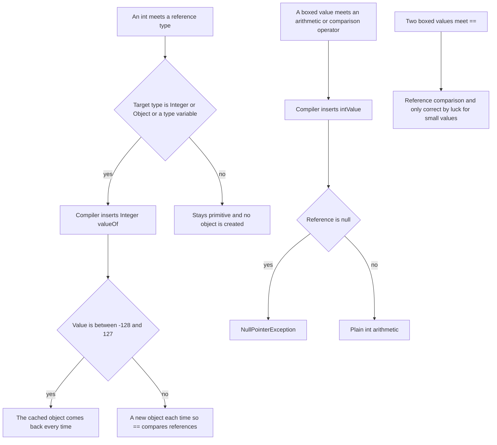
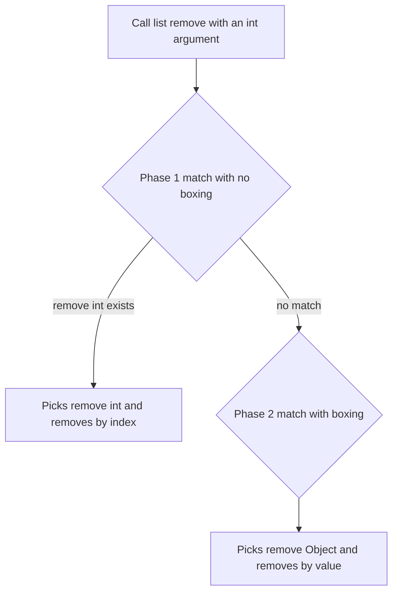

# Task 37 · Why bin 200 was never found: boxed primitive traps

| Difficulty | Topics | Time box |
|---|---|---|
| 🟢 Easy | `==` on boxed types and the Integer cache · Auto-unboxing `null` · Overload resolution with boxing (`List.remove(int)` vs `remove(Object)`) · Comparators on boxed values · Unnecessary boxing cost | 45 min–1 h |

> **Background reading:** *Effective Java* 3rd ed., Item 61 ("Prefer primitive types to boxed primitives"), Item 6 ("Avoid creating unnecessary objects"), Item 52 ("Use overloading judiciously") · JLS §5.1.7 (boxing conversion, and the cache of -128 to 127) · JLS §15.12.2 (how the compiler chooses a method) · the Javadoc of `Integer.valueOf(int)`

---

## The situation

The warehouse runs on a `StockLedger`. It keeps the units on hand for each SKU, and it keeps the list of bins that pickers may take items from. The class passed all of its tests. The tests used bins 1 to 12 and quantities in the single digits, and nobody noticed anything.

Then production started to show the problems:

* Bin 200 is never "the same bin" as bin 200, so any code that compares bin numbers with `sameBin` gets the wrong answer.
* Picking from an SKU that we never received crashes the picking screen with a `NullPointerException`.
* Closing bin 3 closed whatever sat at **index** 3 of the open list. Sometimes it closed another bin, and sometimes it threw an `IndexOutOfBoundsException`.
* Sorting the quantities for the morning report sometimes fails with `Comparison method violates its general contract!`.
* The nightly total is slow.

Each of these is a small, local mistake, and each comes from the same root cause: **a primitive `int` and its boxed twin `Integer` behave differently**, and the compiler makes silent choices for you. Your task is to find those choices, and to understand them well enough that you stop making the mistake yourself.

## The domain

| Term | Meaning |
|---|---|
| **SKU** | Stock keeping unit. Our product id, a `String`. |
| **Bin** | A numbered storage location. Its number is an `int` in our API. |
| **Open bin** | A bin that pickers may take from. The opening order decides the pick route. |
| **Boxing** | Turning an `int` into an `Integer` object, e.g. when you put it in a `List<Integer>`. |
| **Unboxing** | Turning an `Integer` back into an `int`. If the reference is `null`, this throws a `NullPointerException`. |
| **Integer cache** | `Integer.valueOf` returns the same object for every value from -128 to 127. Outside that range, each call creates a new object. |

### What the compiler does for you

Every boxing or unboxing you do not see in the source is a decision the compiler makes. This diagram shows the decisions that caused the bugs in this task.



Boxing has a cost too, and it is easy to miss because the code looks the same. Every boxing outside the cache allocates an object, and every unboxing reads a reference and a field. Item 6 of *Effective Java* shows the classic case: `Long sum = 0L` and then `sum += i` in a loop. Each `+=` unboxes the old value, adds, and boxes the result into a new `Long`. The loop allocates billions of objects that nobody ever reads, and the answer is the same as with a `long`. The JIT can sometimes remove that work, but you cannot count on it.

The second decision that matters is which overload gets called. With `List<Integer> bins` and an `int` argument, `bins.remove(3)` calls `remove(int index)`. The compiler looks for a match **without** boxing first, and it finds one, so it never considers `remove(Object o)`.



## What I want from you

**First, a word about this starter.** `StockLedger` is legacy code. It passes its tests, but it has **five bugs**: four of them are testable and show up with unknown SKUs, bin numbers above 127, and large lists, and the fifth is a performance bug. The bug tests fail on the starter. Before you change anything, run them and, for each failing test, write down in one or two sentences what it expects, what the code actually does, and why. Only then fix the code. If you cannot explain a failure, you have not understood the bug yet.

Here are the symptoms the support team reported. Finding the causes is your job:

| # | Symptom in production |
|---|---|
| 1 | Picking an unknown SKU throws `NullPointerException` |
| 2 | Bin 200 is not the same bin as bin 200 |
| 3 | Closing bin 3 closes the bin at index 3, or throws `IndexOutOfBoundsException` |
| 4 | Sorting throws `Comparison method violates its general contract!` for some lists of 32 or more quantities |
| 5 | The nightly total is slow (**performance only**: the result is already correct) |

The contract of the class, in numbered rules:

1. In [`StockLedger`](../src/main/java/io/github/chris013/practice/task37/StockLedger.java), `quantityOf(sku)` returns the units on hand, and **0 for an SKU we have never received**. It must not throw.
2. `static sameBin(Integer binA, Integer binB)` compares bin numbers **by value**, for every value, not only for the cached ones. Two missing bins (`null`) are the same bin. A missing bin is not the same as any number.
3. `closeBin(binNumber)` removes the bin **with that number** from the open bins. The other bins keep their order. Closing a bin that is not open does nothing and does not throw.
4. `static BY_QUANTITY` is the natural order of the quantities, smallest first. Two equal values compare as 0, whatever their size. `sortedQuantities()` uses it and returns a new list.
5. `totalUnits()` returns the sum as a `long`, and it does not box the running total. The result is already correct in the starter, so **no test can fail on this rule**. You fix it anyway, because the cost is paid on every nightly run, and a benchmark would show the difference (see the stretch goals). The test suite cannot tell you about this bug, so the review and the bytecode are your only evidence.
6. Characterization rules, which already hold in the starter and must keep holding: `receive(sku, quantity)` adds to the units of that SKU and throws `IllegalArgumentException` for a quantity of 0 or less. `openBin` appends to the open bins. `openBins()` returns them in opening order, as an immutable copy.

## Constraints & non-goals

* **Do not redesign the class.** Keep the `HashMap` and the `ArrayList`, keep every signature, and make the smallest idiomatic change that removes each bug. The reference solution does exactly that, and you should be able to read the diff in one screen.
* No new dependencies, and no `Integer` to `int` conversions that throw on `null` by accident.
* Do not make the map store `int` values. Generics need reference types, so `Map<String, Integer>` stays. The point of this task is to know where boxing is still needed and where it is not.
* No ArchUnit, no JMH and no benchmark in the main task. They are stretch goals.

## How I'd approach it

* **Reproduce each bug before you fix it.** A `jshell` session with `Integer.valueOf(200) == Integer.valueOf(200)` takes thirty seconds, and it is worth more than any explanation I could write here.
* **Explain why the old tests passed.** The cache makes `==` look correct for every value from -128 to 127, and the old tests never went above that. A test suite that uses only small numbers can give you false confidence. The `isNotSameAs` assertion in the tests is there to prove that the precondition of the bug is true.
* **What does `==` compare on two `Integer`s?** Answer that first. Then check your fix against rule 2: a fix that unboxes both sides throws a `NullPointerException` for `null`. Look for a JDK method that compares values and handles `null` in one call.
* **Find the overload that is chosen.** Ask yourself which `remove` the compiler picks for `int` and for `Integer`. The JLS answer is in §15.12.2, phase 1 is "no boxing". Then ask how you can make the compiler pick the other overload, in a way that a reader understands at a glance.
* **Look at the comparator's contract.** A comparator must be consistent: if `compare(a, b)` is 1, then `compare(b, a)` must be -1, and equal values must compare as 0. Your lambda says 1 for two equal distinct objects in both directions. That is a broken contract, and `TimSort` only checks it when it merges runs, which starts at 32 elements. Below that size, the bug can stay hidden, which is why the small tests pass.
* **For `totalUnits`,** find every place where a boxed type is used as a variable. `Long total = 0L` is one of them, and `for (Integer quantity : ...)` is another. You can keep the loop, but the accumulator must be a `long`.
* You do not have to trust the reading above for bug 5. Compile the starter and run `javap -c -p` on `StockLedger.class`. Look at `totalUnits`: you should see `Long.valueOf` and `Long.longValue` calls inside the loop. Then do the same with your fix and count them again.
* A common mistake is to think that the cache is a language feature you can rely on. It is a guarantee for -128 to 127 only (JLS §5.1.7). The upper bound can be raised with `-XX:AutoBoxCacheMax`, and that changes the results of `==` for your JVM, not for the Java language. Never write code that depends on it.
* **Write the failure down before you fix it.** For each failing test, write one sentence on what it expects and one on what the code does. For example, for `closing_a_bin_removes_the_bin_with_that_number`: which bin is missing from the starter's result, and why that one? If your sentence says "the test is wrong", check the spec again first.
* **Test the edges of the cache, not the middle.** The numbers 127 and 128 are the upper edge, and -128 and -129 are the lower edge. The value 5 and the value 6 behave the same in the old code, so a test with them proves nothing about boxing. The tests in this task that matter use at least one of the edge values, or 200.

## Tests

Run: `mvn test -Dtest='**/task37/**'`

[`StockLedgerTest`](../src/test/java/io/github/chris013/practice/task37/StockLedgerTest.java) has one `@Nested` group per bug. On the starter, 11 of the 34 tests fail and 23 pass. The four testable bugs each have failing tests. The `Totals` group passes completely on the starter, because bug 5 changes the speed, not the answer. The passing tests describe the behaviour that must keep working, and they are there so that your fixes do not break it.

<details>
<summary>Show the tests</summary>

<!-- embed: src/test/java/io/github/chris013/practice/task37/StockLedgerTest.java -->
**[`StockLedgerTest.java`](../src/test/java/io/github/chris013/practice/task37/StockLedgerTest.java)**

```java
package io.github.chris013.practice.task37;

import static org.assertj.core.api.Assertions.assertThat;
import static org.assertj.core.api.Assertions.assertThatThrownBy;

import java.util.ArrayList;
import java.util.List;
import org.junit.jupiter.api.Nested;
import org.junit.jupiter.api.Test;
import org.junit.jupiter.params.ParameterizedTest;
import org.junit.jupiter.params.provider.CsvSource;

class StockLedgerTest {

    private final StockLedger ledger = new StockLedger();

    @Nested
    class Receiving {

        @Test
        void adds_up_the_quantities_received_for_each_sku() {
            ledger.receive("MUG-WHITE", 5);
            ledger.receive("MUG-WHITE", 3);
            ledger.receive("PLATE-BLUE", 2);

            assertThat(ledger.quantityOf("MUG-WHITE")).isEqualTo(8);
            assertThat(ledger.quantityOf("PLATE-BLUE")).isEqualTo(2);
        }

        @ParameterizedTest
        @CsvSource({"0", "-1", "-1000"})
        void rejects_quantities_that_are_not_positive(int quantity) {
            ledger.receive("MUG-WHITE", 4);

            assertThatThrownBy(() -> ledger.receive("MUG-WHITE", quantity))
                    .isInstanceOf(IllegalArgumentException.class);
            assertThat(ledger.totalUnits()).isEqualTo(4L);
        }
    }

    @Nested
    class UnknownSku {

        // Bug 1: quantityOf unboxes the null that Map.get returns, so this throws NullPointerException.
        @Test
        void an_sku_we_never_received_has_zero_units() {
            assertThat(ledger.quantityOf("NEVER-SEEN")).isZero();
        }

        @Test
        void a_received_sku_is_no_longer_unknown() {
            ledger.receive("NEVER-SEEN", 1);

            assertThat(ledger.quantityOf("NEVER-SEEN")).isOne();
        }
    }

    @Nested
    class BinIdentity {

        @Test
        void the_boxed_values_used_below_are_different_objects_outside_the_cache() {
            // The precondition of the bugs: Integer.valueOf caches only -128..127.
            assertThat(Integer.valueOf(128)).isNotSameAs(Integer.valueOf(128));
            assertThat(Integer.valueOf(200)).isNotSameAs(Integer.valueOf(200));
            assertThat(Integer.valueOf(1000)).isNotSameAs(Integer.valueOf(1000));
            assertThat(Integer.valueOf(-129)).isNotSameAs(Integer.valueOf(-129));
            assertThat(Integer.valueOf(127)).isSameAs(Integer.valueOf(127));
            assertThat(Integer.valueOf(-128)).isSameAs(Integer.valueOf(-128));
        }

        // Bug 2: sameBin compares references with ==, so 200 and 200 are "different" bins.
        @ParameterizedTest
        @CsvSource({
            "1,1,true",
            "127,127,true",
            "128,128,true",
            "200,200,true",
            "-129,-129,true",
            "200,201,false",
        })
        void compares_bin_numbers_by_value(int binA, int binB, boolean expected) {
            Integer a = Integer.valueOf(binA);
            Integer b = Integer.valueOf(binB);

            assertThat(StockLedger.sameBin(a, b)).isEqualTo(expected);
        }

        @Test
        void two_missing_bins_are_the_same_and_a_missing_bin_is_not_any_number() {
            assertThat(StockLedger.sameBin(null, null)).isTrue();
            assertThat(StockLedger.sameBin(null, 3)).isFalse();
            assertThat(StockLedger.sameBin(3, null)).isFalse();
        }
    }

    @Nested
    class OpenBins {

        @Test
        void lists_the_open_bins_in_the_order_they_were_opened() {
            openBins(5, 3, 9, 4);

            assertThat(ledger.openBins()).containsExactly(5, 3, 9, 4);
        }

        @Test
        void the_list_of_open_bins_cannot_be_changed_from_outside() {
            openBins(5, 3);

            assertThatThrownBy(() -> ledger.openBins().clear()).isInstanceOf(UnsupportedOperationException.class);
        }

        // Bug 3: closeBin calls remove(int), which removes by index. Closing 3 removes the bin at index 3.
        @Test
        void closing_a_bin_removes_the_bin_with_that_number() {
            openBins(5, 3, 9, 4);

            ledger.closeBin(3);

            assertThat(ledger.openBins()).containsExactly(5, 9, 4);
        }

        @Test
        void closing_another_bin_removes_only_that_number() {
            openBins(5, 3, 9, 4);

            ledger.closeBin(9);

            assertThat(ledger.openBins()).containsExactly(5, 3, 4);
        }

        @Test
        void closing_a_bin_that_is_not_open_changes_nothing() {
            openBins(5, 3, 9, 4);

            ledger.closeBin(42);

            assertThat(ledger.openBins()).containsExactly(5, 3, 9, 4);
        }

        private void openBins(int... bins) {
            for (int bin : bins) {
                ledger.openBin(bin);
            }
        }
    }

    @Nested
    class Comparison {

        // Bug 4: the hand-written lambda compares the references of two equal boxed values above 127.
        @Test
        void equal_quantities_above_127_compare_as_equal() {
            assertThat(StockLedger.BY_QUANTITY.compare(Integer.valueOf(1000), Integer.valueOf(1000))).isZero();
        }

        @ParameterizedTest
        @CsvSource({
            "1,2,-1",
            "2,1,1",
            "127,128,-1",
            "128,127,1",
            "-129,-128,-1",
            "200,200,0",
            "1000,1000,0",
        })
        void orders_boxed_quantities_by_value(int a, int b, int expectedSign) {
            int result = StockLedger.BY_QUANTITY.compare(Integer.valueOf(a), Integer.valueOf(b));

            assertThat(Integer.signum(result)).isEqualTo(expectedSign);
        }

        // Characterization: passes on the starter too, because TimSort never merges a list this short.
        @Test
        void sorts_a_short_list_correctly_even_with_the_broken_comparator() {
            ledger.receive("A", 1000);
            ledger.receive("B", 5);
            ledger.receive("C", 1000);
            ledger.receive("D", 200);
            ledger.receive("E", 127);
            ledger.receive("F", 128);

            assertThat(ledger.sortedQuantities()).containsExactly(5, 127, 128, 200, 1000, 1000);
        }

        // Bug 4 at production size: TimSort uses insertion sort below 32 elements and merges from 32 on. Only the
        // merge checks the comparator's contract, so the broken lambda throws "Comparison method violates its
        // general contract!" for some lists of 32 or more values, including this one of exactly 32.
        @Test
        void sorts_many_quantities_that_include_repeated_large_values() {
            List<Integer> expected = new ArrayList<>();
            for (int sku = 0; sku < 32; sku++) {
                int quantity = sku % 3 == 0 ? 1000 : sku;
                ledger.receive("SKU-" + sku, quantity);
                expected.add(quantity);
            }

            assertThat(ledger.sortedQuantities()).containsExactlyElementsOf(expected.stream().sorted().toList());
        }

        @Test
        void sorted_quantities_are_a_new_list_each_time() {
            ledger.receive("A", 7);

            List<Integer> first = ledger.sortedQuantities();

            assertThat(first).containsExactly(7);
            assertThat(ledger.sortedQuantities()).isNotSameAs(first);
        }
    }

    @Nested
    class Totals {

        @Test
        void an_empty_ledger_holds_zero_units() {
            assertThat(ledger.totalUnits()).isZero();
        }

        @Test
        void adds_the_units_of_all_skus() {
            ledger.receive("MUG-WHITE", 5);
            ledger.receive("PLATE-BLUE", 2);
            ledger.receive("MUG-WHITE", 3);

            assertThat(ledger.totalUnits()).isEqualTo(10L);
        }

        @Test
        void the_total_is_not_limited_to_the_int_range() {
            ledger.receive("A", 1_000_000_000);
            ledger.receive("B", 1_000_000_000);
            ledger.receive("C", 1_000_000_000);

            assertThat(ledger.totalUnits()).isEqualTo(3_000_000_000L);
        }

        // Bug 5 (performance only): the boxed Long total gives the same answer, so no test can fail on it.
        // The fix is in the reference solution, and the md explains why a benchmark would show it.
        @Test
        void sums_many_skus_correctly() {
            for (int sku = 0; sku < 1_000; sku++) {
                ledger.receive("SKU-" + sku, 1_000);
            }

            assertThat(ledger.totalUnits()).isEqualTo(1_000_000L);
        }
    }
}
```
<!-- /embed -->

</details>

## Definition of done

- [ ] You wrote down, for each failing test on the starter, what it expected and why the code failed.
- [ ] All tests of the task are green, and the test run takes well under a second.
- [ ] `sameBin` gives the right answer for 200 and for `null`, and it never unboxes.
- [ ] `closeBin` closes by bin number, and it does nothing for a bin that is not open.
- [ ] `BY_QUANTITY` is consistent: equal values compare as 0, for every size.
- [ ] `totalUnits` uses a primitive `long` accumulator.
- [ ] The build has no compiler warnings with `-Xlint:all`.
- [ ] You can explain, without looking, which `remove` overload `List<Integer>` picks for an `int`, and why.

## Stretch goals

1. Write an ArchUnit test, or a small regex check over the source tree, that flags `==` between two variables of type `Integer`. Which false positives do you get? Is `x == null` a problem?
2. The same trap with a `Set<Short>`: `shorts.remove(i - 1)` boxes an `int` to `Integer`, which is never equal to a `Short`, so nothing is removed, and no exception is thrown. Reproduce it, explain it with the same reasoning as bug 3, and fix it with `(short) (i - 1)`.
3. Measure the difference between the `Long` loop and the `long` loop with JMH. Does the JIT remove some of the boxing on its own? Your numbers should decide whether the fix was worth a line of code in a nightly job.
4. `openBin` of a bin that is already open currently adds it a second time. Decide what should happen: an error, a no-op, or a second entry. Then write the test for your decision.
5. Run the tests with `-XX:AutoBoxCacheMax=1000` and say which of your `sameBin` tests now pass, and why. Then explain why a passing test under that flag is not a fix.

---

## Reference solution

<details>
<summary>Spoiler: open only after you have made a serious attempt</summary>

### The five bugs

| # | Symptom in production | Cause | Fix |
|---|---|---|---|
| 1 | Picking an unknown SKU throws `NullPointerException` | `int q = stock.get(sku)` unboxes the `null` that `get` returns | `stock.getOrDefault(sku, 0)` |
| 2 | Bin 200 is not the same bin as bin 200 | `binA == binB` compares references, and 200 is not in the Integer cache | `Objects.equals(binA, binB)` |
| 3 | Closing bin 3 closes the bin at index 3, or throws `IndexOutOfBoundsException` | `openBins.remove(binNumber)` with an `int` calls `remove(int index)` | `openBins.remove(Integer.valueOf(binNumber))` |
| 4 | Sorting throws `Comparison method violates its general contract!` for some lists of 32 or more quantities | The hand-written comparator compares equal boxed values with `==`, so two equal 1000s do not compare as equal | `Comparator.naturalOrder()` |
| 5 | The nightly total is slow (**performance only**: the result is already correct) | `Long total` is unboxed and reboxed on every iteration | `long total` |

### Key decisions

**1. `getOrDefault` instead of a `null` check.** One lookup, and the default is expressed in the call. The alternatives are `containsKey` followed by `get` (two lookups, and a race between them in a shared map), or `Optional.ofNullable(stock.get(sku)).orElse(0)` (an extra object for a value we read once).

**2. `Objects.equals` in `sameBin`.** It compares values, and it returns `true` for two `null`s and `false` when only one is `null`. Unboxing both sides would fail for `null`. Comparing with `==` would be the bug again.

**3. `Integer.valueOf` at the call site, not a new data structure.** The fix for bug 3 is one call in `closeBin`. The rejected alternative was to change the field to a `Set<Integer>`. That is a redesign: it would lose the opening order that the pick route needs, and it would change rule 6.

**4. `Comparator.naturalOrder()` for `BY_QUANTITY`.** The JDK comparator is correct for every value, and it says what it means. `Integer::compare` would work too, and it has the same semantics. The hand-written lambda should not exist at all: a comparison that is already in the library is a bug waiting to happen.

**5. A primitive `long` accumulator in `totalUnits`.** The loop unboxes each `Integer` from the map, which is the cost that the map forces on us, and nothing more. The rejected alternative was a stream, `stock.values().stream().mapToLong(Integer::longValue).sum()`. It is also correct and short, and it is a fine choice in a team that writes streams everywhere. This class is a plain loop, so I kept it plain.

**6. When boxed types are required, and when to prefer primitives.** A `Map<String, Integer>` must box, because generics only take reference types. A `List<Integer>` must box for the same reason. Those are the places where boxing is the price of the API. A local variable, a method parameter that is never `null`, or a running total should be `int` or `long`. Use a boxed type when the value can be absent: a `null` means "unknown", and the type tells the reader that. Then handle the `null` at the boundary, not in every expression.

### Code

<!-- embed: solutions/src/main/java/io/github/chris013/practice/task37/StockLedger.java -->
**[`StockLedger.java`](../solutions/src/main/java/io/github/chris013/practice/task37/StockLedger.java)**

```java
package io.github.chris013.practice.task37;

import java.util.ArrayList;
import java.util.Comparator;
import java.util.HashMap;
import java.util.List;
import java.util.Map;
import java.util.Objects;

/**
 * Keeps track of how many units of each SKU we hold, and which warehouse bins are open for picking.
 *
 * <p>Task 37: the reference fixes are marked where they happen. Each one is the smallest change that removes
 * the bug. The class is otherwise unchanged.
 */
public final class StockLedger {

    private final Map<String, Integer> stock = new HashMap<>();
    private final List<Integer> openBins = new ArrayList<>();

    public StockLedger() {
    }

    /** Adds {@code quantity} units of {@code sku} to the stock. The quantity must be positive. */
    public void receive(String sku, int quantity) {
        if (quantity <= 0) {
            throw new IllegalArgumentException("quantity must be positive, was " + quantity);
        }
        stock.merge(sku, quantity, Integer::sum);
    }

    /** Returns the units on hand for {@code sku}, or 0 when we have never received that SKU. */
    public int quantityOf(String sku) {
        // Fix 1: getOrDefault instead of unboxing a null that get() returns for an unknown SKU.
        return stock.getOrDefault(sku, 0);
    }

    /** Two bin numbers are the same bin when their values are equal. Two missing bins are the same. */
    public static boolean sameBin(Integer binA, Integer binB) {
        // Fix 2: Objects.equals compares the values. == compares references, and only -128..127 are cached.
        return Objects.equals(binA, binB);
    }

    /** Opens a bin for picking. */
    public void openBin(int binNumber) {
        openBins.add(binNumber);
    }

    /** Closes the bin with this number. Closing a bin that is not open does nothing. */
    public void closeBin(int binNumber) {
        // Fix 3: Integer.valueOf picks remove(Object). A plain int would pick remove(int), which takes an index.
        openBins.remove(Integer.valueOf(binNumber));
    }

    /** The open bins, in the order they were opened. The list cannot be changed. */
    public List<Integer> openBins() {
        return List.copyOf(openBins);
    }

    /** Orders quantities by their numeric value, smallest first. */
    // Fix 4: the natural order of Integer is correct for every value. The hand-written lambda was not.
    public static final Comparator<Integer> BY_QUANTITY = Comparator.naturalOrder();

    /** All quantities we hold, sorted by {@link #BY_QUANTITY}. */
    public List<Integer> sortedQuantities() {
        List<Integer> quantities = new ArrayList<>(stock.values());
        quantities.sort(BY_QUANTITY);
        return quantities;
    }

    /** The total number of units across all SKUs. */
    public long totalUnits() {
        // Fix 5: a primitive long. The boxed Long was unboxed and boxed again on every iteration.
        long total = 0L;
        for (int quantity : stock.values()) {
            total += quantity;
        }
        return total;
    }
}
```
<!-- /embed -->

### What I typically flag in first attempts

| Finding | Why it matters |
|---|---|
| Bug 1: `int q = map.get(key)` unboxes a `null` | Every unknown SKU throws an NPE in production, and the tests never ask for one. |
| Bug 2: `==` on `Integer` "fixed" with `.equals` plus a `null` check written by hand | Works, but `Objects.equals` is the one-line version, and the hand-written check is the place where people forget a case. |
| Bug 3: `remove(binNumber)` on a `List<Integer>` | The compiler chooses `remove(int index)` silently. The code compiles, looks right, and removes the wrong element. |
| Bug 4: a comparator written with `==` and `<` on boxed values | Equal values above 127 are distinct objects, so the comparator is inconsistent, and the sort fails only on larger lists. |
| Bug 5: `Long total = 0L` in a loop | The result is correct, so nothing in review or in the tests points at it. It needs a benchmark or a reading of the bytecode to see the cost. |
| Tests only with small numbers | Bins 1 to 12 and quantities under 10 never leave the cache, so every `==` test passes. Add boundary values (127, 128, -128, -129) to every test on boxed values. |

</details>
