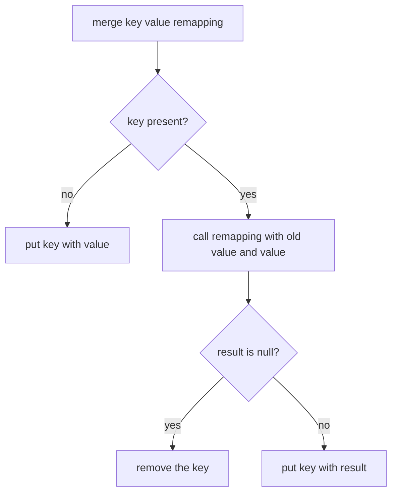

# Task 38 · A loyalty points ledger with the modern Map API

| Difficulty | Topics | Time box |
|---|---|---|
| 🟢 Easy | `Map.merge`, `compute`, `computeIfPresent`, `computeIfAbsent`, `getOrDefault` · `removeIf` and `replaceAll` on views · `Map.copyOf` and the collection factories · immutable factories vs. unmodifiable views · `EnumMap` | 1 h |

> **Background reading:** *Modern Java in Action* (Urma, Fusco, Mycroft), ch. 8 "Collection API enhancements" (collection factories, working with `List` and `Set`, working with `Map`) · *Effective Java* 3rd ed., Item 17 "Minimize mutability", Item 54 "Return empty collections or arrays, not nulls", Item 36 "Use `EnumSet` instead of bit fields", Item 37 "Use `EnumMap` instead of ordinal indexing" · the Javadoc of `Map.merge` and `Map.compute` (returning `null` removes the mapping).

---

## The situation

Our café chain runs a loyalty program. Members earn points on every coffee and redeem them for free drinks. The points live in one class, `PointsLedger`, which was written years ago. Its core is this:

```java
public void addPoints(String member, int points) {
    if (map.containsKey(member)) {
        map.put(member, map.get(member) + points);
    } else {
        map.put(member, points);
    }
}
```

That code works, but it has three problems that matter to the business:

* **Dead members.** A member who redeems their last point keeps a `0` entry forever. The monthly export lists **40 000 dead members**, and nobody can tell them apart from the active ones without a filter that somebody has to remember.
* **Leaking internals.** The ledger once handed its internal `Map` to a reporting job, which called `clear()` on it and wiped the balances.
* **Two lookups for one update.** `containsKey`, `get` and `put` look up the same key up to three times. It is slower, easy to get subtly wrong, and it hides the intent.

Your job is to rewrite `PointsLedger` with the Map API that has been in the JDK since Java 8 and was extended in Java 9 and later. The result should be shorter, correct by construction, and safe to return to other code.

Legacy idiom to modern method:

| Legacy idiom | Modern method | Why it is better |
|---|---|---|
| `if (containsKey(k)) put(k, get(k) + v) else put(k, v)` | `merge(k, v, Integer::sum)` | One lookup, and the "absent" branch is built in |
| `put(k, get(k) == null ? 0 : get(k))` or `containsKey ? get : 0` | `getOrDefault(k, 0)` | Reads a default without writing anything |
| `if (get(k) == null) put(k, new ArrayList<>()); get(k).add(x)` | `computeIfAbsent(k, t -> new ArrayList<>()).add(x)` | Creates the list once, and returns it for the `add` |
| `if (containsKey(k)) { v = get(k) - n; if (v == 0) remove(k) else put(k, v) }` | `computeIfPresent(k, (key, v) -> v - n == 0 ? null : v - n)` | Returning `null` removes the entry |
| `for (Iterator it = map.values().iterator(); ...) if (...) it.remove()` | `map.values().removeIf(...)` | Shorter, and no iterator to get wrong |
| `for (Map.Entry e : map.entrySet()) e.setValue(f(e.getValue()))` | `map.replaceAll((k, v) -> f(v))` | Says what it does: a transformation of every value |
| `return new HashMap<>(map)` or `return map` | `Map.copyOf(map)` | Immutable, and nobody can reach the original |

## The domain

| Term | Meaning |
|---|---|
| **Member** | A customer with a name. A member is someone with a balance above zero. |
| **Balance** | The points a member can still spend. Never negative. |
| **Tier** | `BRONZE` below 1 000 points, `SILVER` from 1 000 to 4 999, `GOLD` from 5 000. Derived from the balance. |
| **Expiry** | At the end of the year, members below a threshold lose their points and are removed. |
| **Bonus** | A campaign that adds a percentage of every balance, rounded down to whole points. |

The most important rule is the one the legacy code broke: **a member with 0 points is not a member**. The map must hold exactly the members with a positive balance. That makes `memberCount()` and the export correct without any extra filtering.

`Map.merge` is the heart of the earn operation, so it is worth being precise about what it does:



Two things follow from this picture. First, the "absent" branch of your old `if` is the first arrow: `merge` does it for you. Second, the `null` branch is what makes removing a zero balance cheap: the remapping function does not need a second map call to remove the key, it just returns `null`.

## What I want from you

Two classes are given and complete: [`Tier`](../src/main/java/io/github/chris013/practice/task38/Tier.java) and [`InsufficientPointsException`](../src/main/java/io/github/chris013/practice/task38/InsufficientPointsException.java). Read them first. Then implement [`PointsLedger`](../src/main/java/io/github/chris013/practice/task38/PointsLedger.java). It is `final`, not thread-safe, and says so in its Javadoc.

1. **`earn(String member, int points)`**
   * `points` must be positive, otherwise `IllegalArgumentException`.
   * `member` is trimmed. A null member is a `NullPointerException`. A blank member (empty after trimming) is an `IllegalArgumentException`.
   * Use `merge`, not `containsKey` and `put`.
   * If the new balance does not fit in an `int`, the `ArithmeticException` from `Math.addExact` propagates, and the old balance stays.
2. **`balance(String member)`**: the balance, or `0` for a name the ledger does not know. Use `getOrDefault`. The same name rules as `earn` apply.
3. **`redeem(String member, int points)`**
   * `points` must be positive, otherwise `IllegalArgumentException`.
   * If the balance is lower than `points` (an unknown member has 0), throw `InsufficientPointsException(member, balance, points)`. The message is `anna has 120 points, cannot redeem 200`. **Nothing changes.**
   * If the balance becomes exactly 0, the member is removed from the map. Use `computeIfPresent` and return `null`.
4. **`isMember(String member)`**: `true` if the ledger holds an entry for the member. Because of the invariant, that means a balance above 0.
5. **`expireBelow(int threshold)`**: removes every member whose balance is **strictly** below `threshold`. A balance equal to the threshold stays. `threshold` must be positive. Use `removeIf` on a view of the map.
6. **`applyBonusPercent(int percent)`**
   * `percent` must be between 1 and 100 (both included), otherwise `IllegalArgumentException`.
   * Every balance grows by `balance × percent / 100`, rounded down, with integer arithmetic. Example: 10 % of 1 005 adds 100 (100.5 rounded down), so the balance becomes 1 105. 1 % of 99 adds 0, so it stays 99.
   * Use `replaceAll`.
   * If any new balance would not fit in an `int`, throw `ArithmeticException` **and change no balance at all**.
7. **`membersByTier()`**: returns `Map<Tier, List<String>>`.
   * Build an `EnumMap`, so the tiers come out in enum order.
   * Use `computeIfAbsent(tier, t -> new ArrayList<>()).add(member)`.
   * Only tiers with at least one member appear.
   * Names in each list are sorted alphabetically (natural `String` order).
   * The returned map and every list in it are unmodifiable. Copy them at the end.
8. **`snapshot()`**: an immutable copy of all balances, built with `Map.copyOf`. Later changes to the ledger must not show up in it, and `put` on it throws `UnsupportedOperationException`.
9. **`memberCount()`**: the number of members, which is the number of entries in the map.

Validation: every method that takes a member name rejects a null name with `NullPointerException` and a blank one with `IllegalArgumentException`. Every method that takes a number checks its range as described above.

## Constraints & non-goals

* **Not thread-safe.** Say so in the Javadoc, as the class does. Thread safety is a stretch goal, not part of the contract.
* No persistence, no clock, no currency. The ledger is a pure in-memory object.
* Only the JDK. No libraries.
* Do not change `Tier` or `InsufficientPointsException`. They are the contract the rest of the café code already uses.
* Do not return the internal map from any method.

## How I'd approach it

* **Start with `earn`.** It has the most rules and it shows the `merge` idea. Once `merge` clicks, the other methods are short.
* **Know which methods write and which only read.** `getOrDefault` reads and never writes. `computeIfAbsent` writes when the key is absent, which is exactly what you want when building `membersByTier`, and exactly what you do *not* want from a `balance` query. Querying a stranger's balance must not add a stranger to the map.
* **Why does returning `null` remove the mapping?** The `compute*` and `merge` methods need one value that means "there is no value any more". In a `Map`, `null` already means "no mapping", so these methods reuse it: a `null` result is a request to remove the key. The Javadoc of `Map.compute` says so explicitly. You do not need a separate remove call, and the decision "keep or remove" sits next to the arithmetic that causes it.
* **`redeem` has to decide before it writes.** Throwing from inside a remapping function is legal, and the map stays unchanged when it happens, but a plain check first reads better: read the balance, check it, then write. The write is still a single `computeIfPresent` call.
* **`removeIf` works on views.** `balances.values().removeIf(...)` removes the matching entries from the map itself. Do not copy the map first.
* **`replaceAll` is not all-or-nothing.** If the function throws halfway, the entries already visited have changed and the rest have not. So check the risky case *before* you call it. Think about which balance produces the largest bonus. This is the kind of detail that separates a correct method from one that is correct on the happy path.
* **Three kinds of "immutable".** `List.of` and `Map.copyOf` build a new immutable collection that does not change when its source changes. `Collections.unmodifiableMap(m)` is a *view*: a read-only window onto `m`, so changes to `m` show through. `Arrays.asList` is a third kind: fixed size, but `set` works. `CollectionFactoriesTest` shows each one. Pick the one whose behaviour you want to promise to callers. For `snapshot()` that is a copy. For `membersByTier()` it is a view over a map you never let escape, which is also fine.
* **`EnumMap` for enum keys.** It is an array indexed by ordinal under the hood. It is smaller and faster than a `HashMap`, and iterates in declaration order, which is the order you want for tiers in a report. *Effective Java* Item 37 explains why using `ordinal()` yourself is worse.
* **Floating point is not an option for points.** Do the bonus in integers. If you find yourself writing `balance * 0.1`, stop and read the Flag table.

## Tests

Run: `mvn test -Dtest='**/task38/**'`

Three test classes:

* [`TierTest`](../src/test/java/io/github/chris013/practice/task38/TierTest.java): the tier boundaries. It passes on the starter, because `Tier` is given.
* [`PointsLedgerTest`](../src/test/java/io/github/chris013/practice/task38/PointsLedgerTest.java): the behaviour of the ledger, grouped in `@Nested` classes. Most tests fail on the starter until you implement the methods.
* [`CollectionFactoriesTest`](../src/test/java/io/github/chris013/practice/task38/CollectionFactoriesTest.java): a learning test that documents how the JDK collections really behave. It passes on the starter and on the solution. Read it before you write `snapshot()` and `membersByTier()`.

<details>
<summary>Show the tests</summary>

<!-- embed: src/test/java/io/github/chris013/practice/task38/PointsLedgerTest.java -->
<!-- /embed -->

<!-- embed: src/test/java/io/github/chris013/practice/task38/CollectionFactoriesTest.java -->
<!-- /embed -->

</details>

## Definition of done

- [ ] `mvn test -Dtest='**/task38/**'` is green.
- [ ] `earn`, `balance`, `redeem`, `expireBelow`, `applyBonusPercent`, `membersByTier` and `snapshot` each use one Map method for their core operation, with no `containsKey` followed by `get` and `put`.
- [ ] No member with a balance of 0 is ever in the map.
- [ ] No method returns the internal map or one of its lists.
- [ ] The bonus uses integer arithmetic only.
- [ ] A rejected operation changes nothing, and a test proves it.
- [ ] You can explain, without looking, why `compute*` returning `null` removes the entry.

## Stretch goals

1. Make the ledger thread-safe with a `ConcurrentHashMap`. `merge` and `compute*` are atomic on it, so `earn` needs no lock. What still is not atomic? Think about `redeem`, which reads the balance and then changes it, and about `applyBonusPercent`. Can a concurrent `earn` slip in between? Write a test with two threads and a `CountDownLatch`, and keep it under a second.
2. Add an audit trail: a `List<Transaction>` where each `earn`, `redeem`, `expire` and bonus appends a small record. Which methods need to know the old balance to write the record? Could `merge` or `compute` give you that without a second lookup?
3. Rewrite `membersByTier()` with streams: `Collectors.groupingBy(..., () -> new EnumMap<>(Tier.class), Collectors.mapping(...))`. Is the code clearer than the loop? Does the result still need `Collections.unmodifiableMap`?

---

## Reference solution

<details>
<summary>Spoiler: open only after you have made a serious attempt</summary>

### Key decisions

**1. `merge` with a lambda for `earn`, not `Integer::sum`.** `Integer::sum` silently wraps around on overflow. The lambda calls `Math.addExact`, so an overflow throws and leaves the old balance in place. `HashMap` only writes the result after the remapping function returns, so the exception means no write.

**2. `getOrDefault` for reads, never `computeIfAbsent`.** `balance` must not create entries. `computeIfAbsent` on a read would add every name anyone ever asked about, and the dead-member problem would come back through the back door.

**3. `redeem` checks, then calls `computeIfPresent`.** The check needs the current balance, and it also produces the right exception for an unknown member (balance 0). The write is one line that returns `null` at exactly zero, so the removal rule lives next to the arithmetic.

**4. `applyBonusPercent` precomputes the risky case.** The bonus is monotonic, so the largest balance gives the largest result. If that one fits in an `int`, every entry does, and `replaceAll` cannot fail halfway. The arithmetic is done in `long` so the check itself cannot overflow.

**5. `membersByTier` sorts with a `TreeMap` copy and fills an `EnumMap`.** Iterating a sorted copy means each list is sorted as it fills, with no extra sort step. The `EnumMap` gives enum order. At the end `replaceAll` makes each list immutable, and `Collections.unmodifiableMap` wraps the map. The `EnumMap` itself never leaves the method.

**6. `snapshot` is `Map.copyOf`.** It copies, so later changes do not leak in, and its result rejects writes. Null keys or values would throw, but the ledger never stores them.

### Code

<!-- embed: solutions/src/main/java/io/github/chris013/practice/task38/PointsLedger.java -->
<!-- /embed -->

### What I typically flag in first attempts

| Finding | Why it matters |
|---|---|
| `containsKey`, then `get`, then `put` | Three lookups and three chances to get the branches wrong. `merge` or `compute` says it in one call. |
| Leaving zero balances in the map | Your count, your export and your campaigns now include people with nothing. Return `null` from the remapping function. |
| Returning `map` or `map.values()` from a getter | The caller can `clear()` it, the way the reporting job did. Return a copy or an unmodifiable view. |
| `HashMap` for enum keys | Works, but it allocates, hashes and loses the order. `EnumMap` is the right tool, as Item 37 explains. |
| `Map.of` with user data | `Map.of` throws `IllegalArgumentException` on a duplicate key. User input has duplicates, so build a map in a loop or use `merge`. |
| `double` or `0.1` for the bonus | Points are whole numbers. Rounding `100.5` in floating point is a bug waiting to show up on a receipt. |
| `balance` using `computeIfAbsent` | A read that writes. Every name anyone queries becomes a dead member. |

</details>
