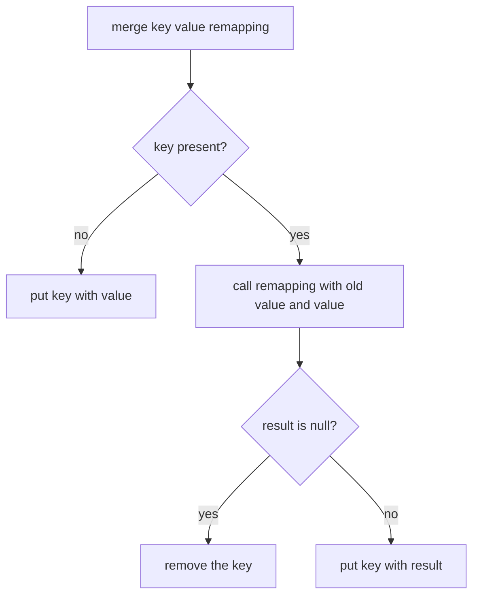

# Task 38 · A loyalty points ledger with the modern Map API

| Difficulty | Topics | Time box |
|---|---|---|
| 🟢 Easy | `Map.merge`, `compute`, `computeIfPresent`, `computeIfAbsent`, `getOrDefault` · `removeIf` and `replaceAll` on views · `Map.copyOf` and the collection factories · immutable factories vs. unmodifiable views · `EnumMap` | 1 h |

> **Background reading:** *Modern Java in Action* (Urma, Fusco, Mycroft), ch. 8 "Collection API enhancements" (collection factories, working with `List` and `Set`, working with `Map`) · *Effective Java* 3rd ed., Item 17 "Minimize mutability", Item 54 "Return empty collections or arrays, not nulls", Item 36 "Use `EnumSet` instead of bit fields", Item 37 "Use `EnumMap` instead of ordinal indexing" · the Javadoc of `Map.merge` and `Map.compute` (returning `null` removes the mapping).

---

## The situation

Our café chain runs a loyalty program. Members earn points on every coffee and redeem them for free drinks. The points live in one class, `PointsLedger`, which was written years ago. Its core is this:

```java
public void addPoints(String member, int points) {
    if (map.containsKey(member)) {
        map.put(member, map.get(member) + points);
    } else {
        map.put(member, points);
    }
}
```

That code works, but it has three problems that matter to the business:

* **Dead members.** A member who redeems their last point keeps a `0` entry forever. The monthly export lists **40 000 dead members**, and nobody can tell them apart from the active ones without a filter that somebody has to remember.
* **Leaking internals.** The ledger once handed its internal `Map` to a reporting job, which called `clear()` on it and wiped the balances.
* **Two lookups for one update.** `containsKey`, `get` and `put` look up the same key up to three times. It is slower, easy to get subtly wrong, and it hides the intent.

Your job is to rewrite `PointsLedger` with the Map API that has been in the JDK since Java 8 and was extended in Java 9 and later. The result should be shorter, correct by construction, and safe to return to other code.

Legacy idiom to modern method:

| Legacy idiom | Modern method | Why it is better |
|---|---|---|
| `if (containsKey(k)) put(k, get(k) + v) else put(k, v)` | `merge(k, v, Integer::sum)` | One lookup, and the "absent" branch is built in |
| `put(k, get(k) == null ? 0 : get(k))` or `containsKey ? get : 0` | `getOrDefault(k, 0)` | Reads a default without writing anything |
| `if (get(k) == null) put(k, new ArrayList<>()); get(k).add(x)` | `computeIfAbsent(k, t -> new ArrayList<>()).add(x)` | Creates the list once, and returns it for the `add` |
| `if (containsKey(k)) { v = get(k) - n; if (v == 0) remove(k) else put(k, v) }` | `computeIfPresent(k, (key, v) -> v - n == 0 ? null : v - n)` | Returning `null` removes the entry |
| `for (Iterator it = map.values().iterator(); ...) if (...) it.remove()` | `map.values().removeIf(...)` | Shorter, and no iterator to get wrong |
| `for (Map.Entry e : map.entrySet()) e.setValue(f(e.getValue()))` | `map.replaceAll((k, v) -> f(v))` | Says what it does: a transformation of every value |
| `return new HashMap<>(map)` or `return map` | `Map.copyOf(map)` | Immutable, and nobody can reach the original |

## The domain

| Term | Meaning |
|---|---|
| **Member** | A customer with a name. A member is someone with a balance above zero. |
| **Balance** | The points a member can still spend. Never negative. |
| **Tier** | `BRONZE` below 1 000 points, `SILVER` from 1 000 to 4 999, `GOLD` from 5 000. Derived from the balance. |
| **Expiry** | At the end of the year, members below a threshold lose their points and are removed. |
| **Bonus** | A campaign that adds a percentage of every balance, rounded down to whole points. |

The most important rule is the one the legacy code broke: **a member with 0 points is not a member**. The map must hold exactly the members with a positive balance. That makes `memberCount()` and the export correct without any extra filtering.

`Map.merge` is the heart of the earn operation, so it is worth being precise about what it does:



Two things follow from this picture. First, the "absent" branch of your old `if` is the first arrow: `merge` does it for you. Second, the `null` branch is what makes removing a zero balance cheap: the remapping function does not need a second map call to remove the key, it just returns `null`.

## What I want from you

Two classes are given and complete: [`Tier`](../src/main/java/io/github/chris013/practice/task38/Tier.java) and [`InsufficientPointsException`](../src/main/java/io/github/chris013/practice/task38/InsufficientPointsException.java). Read them first. Then implement [`PointsLedger`](../src/main/java/io/github/chris013/practice/task38/PointsLedger.java). It is `final`, not thread-safe, and says so in its Javadoc.

1. **`earn(String member, int points)`**
   * `points` must be positive, otherwise `IllegalArgumentException`.
   * `member` is trimmed. A null member is a `NullPointerException`. A blank member (empty after trimming) is an `IllegalArgumentException`.
   * Use `merge`, not `containsKey` and `put`.
   * If the new balance does not fit in an `int`, the `ArithmeticException` from `Math.addExact` propagates, and the old balance stays.
2. **`balance(String member)`**: the balance, or `0` for a name the ledger does not know. Use `getOrDefault`. The same name rules as `earn` apply.
3. **`redeem(String member, int points)`**
   * `points` must be positive, otherwise `IllegalArgumentException`.
   * If the balance is lower than `points` (an unknown member has 0), throw `InsufficientPointsException(member, balance, points)`. The message is `anna has 120 points, cannot redeem 200`. **Nothing changes.**
   * If the balance becomes exactly 0, the member is removed from the map. Use `computeIfPresent` and return `null`.
4. **`isMember(String member)`**: `true` if the ledger holds an entry for the member. Because of the invariant, that means a balance above 0.
5. **`expireBelow(int threshold)`**: removes every member whose balance is **strictly** below `threshold`. A balance equal to the threshold stays. `threshold` must be positive. Use `removeIf` on a view of the map.
6. **`applyBonusPercent(int percent)`**
   * `percent` must be between 1 and 100 (both included), otherwise `IllegalArgumentException`.
   * Every balance grows by `balance × percent / 100`, rounded down, with integer arithmetic. Example: 10 % of 1 005 adds 100 (100.5 rounded down), so the balance becomes 1 105. 1 % of 99 adds 0, so it stays 99.
   * Use `replaceAll`.
   * If any new balance would not fit in an `int`, throw `ArithmeticException` **and change no balance at all**.
7. **`membersByTier()`**: returns `Map<Tier, List<String>>`.
   * Build an `EnumMap`, so the tiers come out in enum order.
   * Use `computeIfAbsent(tier, t -> new ArrayList<>()).add(member)`.
   * Only tiers with at least one member appear.
   * Names in each list are sorted alphabetically (natural `String` order).
   * The returned map and every list in it are unmodifiable. Copy them at the end.
8. **`snapshot()`**: an immutable copy of all balances, built with `Map.copyOf`. Later changes to the ledger must not show up in it, and `put` on it throws `UnsupportedOperationException`.
9. **`memberCount()`**: the number of members, which is the number of entries in the map.

Validation: every method that takes a member name rejects a null name with `NullPointerException` and a blank one with `IllegalArgumentException`. Every method that takes a number checks its range as described above.

## Constraints & non-goals

* **Not thread-safe.** Say so in the Javadoc, as the class does. Thread safety is a stretch goal, not part of the contract.
* No persistence, no clock, no currency. The ledger is a pure in-memory object.
* Only the JDK. No libraries.
* Do not change `Tier` or `InsufficientPointsException`. They are the contract the rest of the café code already uses.
* Do not return the internal map from any method.

## How I'd approach it

* **Start with `earn`.** It has the most rules and it shows the `merge` idea. Once `merge` clicks, the other methods are short.
* **Know which methods write and which only read.** `getOrDefault` reads and never writes. `computeIfAbsent` writes when the key is absent, which is exactly what you want when building `membersByTier`, and exactly what you do *not* want from a `balance` query. Querying a stranger's balance must not add a stranger to the map.
* **Why does returning `null` remove the mapping?** The `compute*` and `merge` methods need one value that means "there is no value any more". In a `Map`, `null` already means "no mapping", so these methods reuse it: a `null` result is a request to remove the key. The Javadoc of `Map.compute` says so explicitly. You do not need a separate remove call, and the decision "keep or remove" sits next to the arithmetic that causes it.
* **`redeem` has to decide before it writes.** Throwing from inside a remapping function is legal, and the map stays unchanged when it happens, but a plain check first reads better: read the balance, check it, then write. The write is still a single `computeIfPresent` call.
* **`removeIf` works on views.** `balances.values().removeIf(...)` removes the matching entries from the map itself. Do not copy the map first.
* **`replaceAll` is not all-or-nothing.** If the function throws halfway, the entries already visited have changed and the rest have not. So check the risky case *before* you call it. Think about which balance produces the largest bonus. This is the kind of detail that separates a correct method from one that is correct on the happy path.
* **Three kinds of "immutable".** `List.of` and `Map.copyOf` build a new immutable collection that does not change when its source changes. `Collections.unmodifiableMap(m)` is a *view*: a read-only window onto `m`, so changes to `m` show through. `Arrays.asList` is a third kind: fixed size, but `set` works. `Map.copyOf` and `List.copyOf` return their argument unchanged when it is already an immutable collection from the factories, so that copy is free; copying only costs something for a mutable source such as the ledger's `HashMap`. `CollectionFactoriesTest` shows each one. Pick the one whose behaviour you want to promise to callers. For `snapshot()` that is a copy. For `membersByTier()` it is a view over a map you never let escape, which is also fine.
* **`EnumMap` for enum keys.** It is an array indexed by ordinal under the hood. It is smaller and faster than a `HashMap`, and iterates in declaration order, which is the order you want for tiers in a report. *Effective Java* Item 37 explains why using `ordinal()` yourself is worse.
* **Floating point is not an option for points.** Do the bonus in integers. If you find yourself writing `balance * 0.1`, stop and read the Flag table.

## Tests

Run: `mvn test -Dtest='**/task38/**'`

Three test classes:

* [`TierTest`](../src/test/java/io/github/chris013/practice/task38/TierTest.java): the tier boundaries. It passes on the starter, because `Tier` is given.
* [`PointsLedgerTest`](../src/test/java/io/github/chris013/practice/task38/PointsLedgerTest.java): the behaviour of the ledger, grouped in `@Nested` classes. Most tests fail on the starter until you implement the methods.
* [`CollectionFactoriesTest`](../src/test/java/io/github/chris013/practice/task38/CollectionFactoriesTest.java): a learning test that documents how the JDK collections really behave. It passes on the starter and on the solution. Read it before you write `snapshot()` and `membersByTier()`.

<details>
<summary>Show the tests</summary>

<!-- embed: src/test/java/io/github/chris013/practice/task38/PointsLedgerTest.java -->
**[`PointsLedgerTest.java`](../src/test/java/io/github/chris013/practice/task38/PointsLedgerTest.java)**

```java
package io.github.chris013.practice.task38;

import static org.assertj.core.api.Assertions.assertThat;
import static org.assertj.core.api.Assertions.assertThatThrownBy;
import static org.assertj.core.api.Assertions.entry;

import java.util.List;
import java.util.Map;
import org.junit.jupiter.api.Nested;
import org.junit.jupiter.api.Test;
import org.junit.jupiter.params.ParameterizedTest;
import org.junit.jupiter.params.provider.CsvSource;
import org.junit.jupiter.params.provider.ValueSource;

class PointsLedgerTest {

    private final PointsLedger ledger = new PointsLedger();

    @Nested
    class NameValidation {

        @ParameterizedTest
        @ValueSource(strings = {"", "   "})
        void every_method_rejects_a_blank_name(String blank) {
            assertThatThrownBy(() -> ledger.balance(blank)).isInstanceOf(IllegalArgumentException.class);
            assertThatThrownBy(() -> ledger.isMember(blank)).isInstanceOf(IllegalArgumentException.class);
            assertThatThrownBy(() -> ledger.redeem(blank, 1)).isInstanceOf(IllegalArgumentException.class);
        }

        @Test
        void every_method_rejects_a_null_name() {
            assertThatThrownBy(() -> ledger.balance(null)).isInstanceOf(NullPointerException.class);
            assertThatThrownBy(() -> ledger.isMember(null)).isInstanceOf(NullPointerException.class);
            assertThatThrownBy(() -> ledger.redeem(null, 1)).isInstanceOf(NullPointerException.class);
        }

        @Test
        void redeem_trims_the_name() {
            ledger.earn("anna", 50);

            ledger.redeem("  anna ", 20);

            assertThat(ledger.balance("anna")).isEqualTo(30);
        }
    }

    @Nested
    class Earn {

        @Test
        void gives_a_new_member_the_points() {
            ledger.earn("anna", 120);

            assertThat(ledger.balance("anna")).isEqualTo(120);
        }

        @Test
        void adds_points_to_an_existing_balance() {
            ledger.earn("anna", 120);
            ledger.earn("anna", 30);

            assertThat(ledger.balance("anna")).isEqualTo(150);
            assertThat(ledger.memberCount()).isEqualTo(1);
        }

        @Test
        void ignores_surrounding_whitespace_in_the_name() {
            ledger.earn("  anna ", 10);

            assertThat(ledger.balance("anna")).isEqualTo(10);
            assertThat(ledger.isMember(" anna")).isTrue();
        }

        @Test
        void refuses_to_overflow_and_keeps_the_old_balance() {
            ledger.earn("anna", Integer.MAX_VALUE);

            assertThatThrownBy(() -> ledger.earn("anna", 1)).isInstanceOf(ArithmeticException.class);
            assertThat(ledger.balance("anna")).isEqualTo(Integer.MAX_VALUE);
        }

        @ParameterizedTest
        @CsvSource({"0", "-5"})
        void rejects_points_that_are_not_positive(int points) {
            assertThatThrownBy(() -> ledger.earn("anna", points)).isInstanceOf(IllegalArgumentException.class);
            assertThat(ledger.memberCount()).isZero();
        }

        @ParameterizedTest
        @ValueSource(strings = {"", "   "})
        void rejects_a_blank_member_name(String member) {
            assertThatThrownBy(() -> ledger.earn(member, 10)).isInstanceOf(IllegalArgumentException.class);
        }

        @Test
        void rejects_a_null_member_name() {
            assertThatThrownBy(() -> ledger.earn(null, 10)).isInstanceOf(NullPointerException.class);
        }
    }

    @Nested
    class Membership {

        @Test
        void an_unknown_member_has_zero_points_and_is_not_a_member() {
            assertThat(ledger.balance("nobody")).isZero();
            assertThat(ledger.isMember("nobody")).isFalse();
        }

        @Test
        void counts_only_members_with_a_balance() {
            ledger.earn("anna", 10);
            ledger.earn("ben", 20);

            assertThat(ledger.memberCount()).isEqualTo(2);
        }
    }

    @Nested
    class Redeem {

        @Test
        void reduces_the_balance() {
            ledger.earn("anna", 500);

            ledger.redeem("anna", 200);

            assertThat(ledger.balance("anna")).isEqualTo(300);
        }

        @Test
        void removes_the_member_when_the_balance_reaches_exactly_zero() {
            ledger.earn("anna", 200);

            ledger.redeem("anna", 200);

            assertThat(ledger.isMember("anna")).isFalse();
            assertThat(ledger.memberCount()).isZero();
        }

        @Test
        void keeps_the_member_when_one_point_is_left() {
            ledger.earn("anna", 200);

            ledger.redeem("anna", 199);

            assertThat(ledger.isMember("anna")).isTrue();
            assertThat(ledger.balance("anna")).isEqualTo(1);
        }

        @Test
        void rejects_redeeming_more_than_the_balance_with_a_clear_message() {
            ledger.earn("anna", 120);

            assertThatThrownBy(() -> ledger.redeem("anna", 200))
                    .isInstanceOf(InsufficientPointsException.class)
                    .hasMessage("anna has 120 points, cannot redeem 200");
        }

        @Test
        void the_insufficient_points_exception_carries_the_numbers() {
            ledger.earn("anna", 120);

            assertThatThrownBy(() -> ledger.redeem("anna", 200))
                    .isInstanceOfSatisfying(InsufficientPointsException.class, ex -> {
                        assertThat(ex.member()).isEqualTo("anna");
                        assertThat(ex.balance()).isEqualTo(120);
                        assertThat(ex.requested()).isEqualTo(200);
                    });
        }

        @Test
        void leaves_the_ledger_unchanged_when_the_redemption_is_rejected() {
            ledger.earn("anna", 120);
            ledger.earn("ben", 50);

            assertThatThrownBy(() -> ledger.redeem("anna", 200)).isInstanceOf(InsufficientPointsException.class);

            assertThat(ledger.balance("anna")).isEqualTo(120);
            assertThat(ledger.balance("ben")).isEqualTo(50);
            assertThat(ledger.memberCount()).isEqualTo(2);
        }

        @Test
        void rejects_redeeming_from_an_unknown_member() {
            assertThatThrownBy(() -> ledger.redeem("ben", 10))
                    .isInstanceOf(InsufficientPointsException.class)
                    .hasMessage("ben has 0 points, cannot redeem 10");
            assertThat(ledger.isMember("ben")).isFalse();
        }

        @ParameterizedTest
        @CsvSource({"0", "-1"})
        void rejects_points_that_are_not_positive(int points) {
            ledger.earn("anna", 100);

            assertThatThrownBy(() -> ledger.redeem("anna", points)).isInstanceOf(IllegalArgumentException.class);
            assertThat(ledger.balance("anna")).isEqualTo(100);
        }
    }

    @Nested
    class Expire {

        @Test
        void removes_members_strictly_below_the_threshold() {
            ledger.earn("anna", 120);
            ledger.earn("ben", 500);
            ledger.earn("cy", 1000);

            ledger.expireBelow(500);

            assertThat(ledger.isMember("anna")).isFalse();
            assertThat(ledger.isMember("ben")).isTrue();
            assertThat(ledger.isMember("cy")).isTrue();
            assertThat(ledger.memberCount()).isEqualTo(2);
        }

        @Test
        void keeps_a_member_whose_balance_equals_the_threshold() {
            ledger.earn("ben", 500);

            ledger.expireBelow(500);

            assertThat(ledger.balance("ben")).isEqualTo(500);
        }

        @ParameterizedTest
        @CsvSource({"0", "-1"})
        void rejects_a_threshold_that_is_not_positive(int threshold) {
            assertThatThrownBy(() -> ledger.expireBelow(threshold)).isInstanceOf(IllegalArgumentException.class);
        }
    }

    @Nested
    class Bonus {

        @ParameterizedTest
        @CsvSource({
            "1005, 10, 1105",
            "99, 1, 99",
            "2000, 1, 2020",
            "1, 1, 1",
            "100, 100, 200"
        })
        void adds_the_percentage_rounded_down(int start, int percent, int expected) {
            ledger.earn("anna", start);

            ledger.applyBonusPercent(percent);

            assertThat(ledger.balance("anna")).isEqualTo(expected);
        }

        @Test
        void applies_the_bonus_to_every_member() {
            ledger.earn("anna", 1000);
            ledger.earn("ben", 2000);

            ledger.applyBonusPercent(10);

            assertThat(ledger.balance("anna")).isEqualTo(1100);
            assertThat(ledger.balance("ben")).isEqualTo(2200);
        }

        @ParameterizedTest
        @CsvSource({"0", "101"})
        void rejects_a_percentage_outside_1_to_100(int percent) {
            ledger.earn("anna", 1000);

            assertThatThrownBy(() -> ledger.applyBonusPercent(percent)).isInstanceOf(IllegalArgumentException.class);
            assertThat(ledger.balance("anna")).isEqualTo(1000);
        }

        @Test
        void refuses_to_overflow_and_changes_no_balance() {
            ledger.earn("anna", Integer.MAX_VALUE);
            ledger.earn("ben", 1);

            assertThatThrownBy(() -> ledger.applyBonusPercent(1)).isInstanceOf(ArithmeticException.class);

            assertThat(ledger.balance("anna")).isEqualTo(Integer.MAX_VALUE);
            assertThat(ledger.balance("ben")).isEqualTo(1);
        }
    }

    @Nested
    class Tiers {

        @Test
        void groups_members_by_tier_with_names_sorted_and_tiers_in_enum_order() {
            ledger.earn("dora", 999);
            ledger.earn("anna", 5000);
            ledger.earn("ben", 1000);
            ledger.earn("cy", 120);
            ledger.earn("aaron", 6000);

            assertThat(ledger.membersByTier()).containsExactly(
                    entry(Tier.BRONZE, List.of("cy", "dora")),
                    entry(Tier.SILVER, List.of("ben")),
                    entry(Tier.GOLD, List.of("aaron", "anna")));
        }

        @Test
        void leaves_out_tiers_without_members() {
            ledger.earn("cy", 120);

            assertThat(ledger.membersByTier().keySet()).containsExactly(Tier.BRONZE);
        }

        @Test
        void is_empty_for_an_empty_ledger() {
            assertThat(ledger.membersByTier()).isEmpty();
        }

        @Test
        void returns_an_unmodifiable_map() {
            ledger.earn("cy", 120);
            Map<Tier, List<String>> byTier = ledger.membersByTier();

            assertThatThrownBy(() -> byTier.put(Tier.GOLD, List.of())).isInstanceOf(UnsupportedOperationException.class);
        }

        @Test
        void returns_unmodifiable_member_lists() {
            ledger.earn("cy", 120);
            List<String> bronze = ledger.membersByTier().get(Tier.BRONZE);

            assertThatThrownBy(() -> bronze.add("mallory")).isInstanceOf(UnsupportedOperationException.class);
        }

        @Test
        void is_a_copy_that_does_not_follow_later_changes() {
            ledger.earn("cy", 120);
            Map<Tier, List<String>> before = ledger.membersByTier();

            ledger.earn("dora", 10);

            assertThat(before.get(Tier.BRONZE)).containsExactly("cy");
        }
    }

    @Nested
    class Snapshot {

        @Test
        void copies_every_balance() {
            ledger.earn("anna", 120);
            ledger.earn("ben", 50);

            assertThat(ledger.snapshot()).containsExactlyInAnyOrderEntriesOf(Map.of("anna", 120, "ben", 50));
        }

        @Test
        void is_independent_of_later_changes() {
            ledger.earn("anna", 120);
            Map<String, Integer> before = ledger.snapshot();

            ledger.earn("anna", 30);
            ledger.earn("ben", 50);
            ledger.redeem("anna", 150);

            assertThat(before).containsExactly(entry("anna", 120));
        }

        @Test
        void cannot_be_modified() {
            Map<String, Integer> snapshot = ledger.snapshot();

            assertThatThrownBy(() -> snapshot.put("mallory", 1_000_000))
                    .isInstanceOf(UnsupportedOperationException.class);
        }
    }
}
```
<!-- /embed -->

<!-- embed: src/test/java/io/github/chris013/practice/task38/CollectionFactoriesTest.java -->
**[`CollectionFactoriesTest.java`](../src/test/java/io/github/chris013/practice/task38/CollectionFactoriesTest.java)**

```java
package io.github.chris013.practice.task38;

import static org.assertj.core.api.Assertions.assertThat;
import static org.assertj.core.api.Assertions.assertThatThrownBy;

import java.util.ArrayList;
import java.util.Arrays;
import java.util.Collections;
import java.util.HashMap;
import java.util.List;
import java.util.Map;
import org.junit.jupiter.api.Nested;
import org.junit.jupiter.api.Test;

/**
 * Learning tests: they document what the JDK collection factories and wrappers really do.
 * They pass on the starter and on the solution.
 */
class CollectionFactoriesTest {

    @Nested
    class ImmutableFactories {

        @Test
        void map_copy_of_returns_the_same_instance_when_the_map_is_already_immutable() {
            Map<String, Integer> copy = Map.copyOf(new HashMap<>(Map.of("anna", 1)));

            assertThat(Map.copyOf(copy)).isSameAs(copy);
        }

        @Test
        void list_of_rejects_null_elements() {
            assertThatThrownBy(() -> List.of("anna", null)).isInstanceOf(NullPointerException.class);
        }

        @Test
        void list_of_throws_when_asked_whether_it_contains_null() {
            List<String> names = List.of("anna");

            assertThatThrownBy(() -> names.contains(null)).isInstanceOf(NullPointerException.class);
        }

        @Test
        void map_of_rejects_duplicate_keys() {
            assertThatThrownBy(() -> Map.of("anna", 1, "anna", 2)).isInstanceOf(IllegalArgumentException.class);
        }

        @Test
        void map_copy_of_is_unmodifiable() {
            Map<String, Integer> copy = Map.copyOf(new HashMap<>(Map.of("anna", 1)));

            assertThatThrownBy(() -> copy.put("ben", 2)).isInstanceOf(UnsupportedOperationException.class);
        }
    }

    @Nested
    class Wrappers {

        @Test
        void arrays_as_list_allows_set_but_not_add() {
            List<String> names = Arrays.asList("anna", "ben");

            names.set(0, "cy");

            assertThat(names).containsExactly("cy", "ben");
            assertThatThrownBy(() -> names.add("dora")).isInstanceOf(UnsupportedOperationException.class);
        }

        @Test
        void unmodifiable_list_is_a_view_that_follows_its_backing_list() {
            List<String> backing = new ArrayList<>(List.of("anna"));
            List<String> view = Collections.unmodifiableList(backing);

            backing.add("ben");

            assertThat(view).containsExactly("anna", "ben");
            assertThatThrownBy(() -> view.add("cy")).isInstanceOf(UnsupportedOperationException.class);
        }
    }
}
```
<!-- /embed -->

</details>

## Definition of done

- [ ] `mvn test -Dtest='**/task38/**'` is green.
- [ ] `earn`, `balance`, `redeem`, `expireBelow`, `applyBonusPercent`, `membersByTier` and `snapshot` each use one Map method for their core operation, with no `containsKey` followed by `get` and `put`.
- [ ] No member with a balance of 0 is ever in the map.
- [ ] No method returns the internal map or one of its lists.
- [ ] The bonus uses integer arithmetic only.
- [ ] A rejected operation changes nothing, and a test proves it.
- [ ] You can explain, without looking, why `compute*` returning `null` removes the entry.

## Stretch goals

1. Make the ledger thread-safe with a `ConcurrentHashMap`. `merge` and `compute*` are atomic on it, so `earn` needs no lock. What still is not atomic? Think about `redeem`, which reads the balance and then changes it, and about `applyBonusPercent`. Can a concurrent `earn` slip in between? Write a test with two threads and a `CountDownLatch`, and keep it under a second.
2. Add an audit trail: a `List<Transaction>` where each `earn`, `redeem`, `expire` and bonus appends a small record. Which methods need to know the old balance to write the record? Could `merge` or `compute` give you that without a second lookup?
3. Rewrite `membersByTier()` with streams: `Collectors.groupingBy(..., () -> new EnumMap<>(Tier.class), Collectors.mapping(...))`. Is the code clearer than the loop? Does the result still need `Collections.unmodifiableMap`?

---

## Reference solution

<details>
<summary>Spoiler: open only after you have made a serious attempt</summary>

### Key decisions

**1. `merge` with `Math::addExact` for `earn`, not `Integer::sum`.** `Integer::sum` silently wraps around on overflow. `Math::addExact` has the same shape but throws, so an overflow leaves the old balance in place. `HashMap` only writes the result after the remapping function returns, so the exception means no write.

**2. `getOrDefault` for reads, never `computeIfAbsent`.** `balance` must not create entries. `computeIfAbsent` on a read would add every name anyone ever asked about, and the dead-member problem would come back through the back door.

**3. `redeem` checks, then calls `computeIfPresent`.** The check needs the current balance, and it also produces the right exception for an unknown member (balance 0). The write is one line that returns `null` at exactly zero, so the removal rule lives next to the arithmetic.

**4. `applyBonusPercent` precomputes the risky case.** The bonus is monotonic, so the largest balance gives the largest result. If that one fits in an `int`, every entry does, and `replaceAll` cannot fail halfway. The arithmetic is done in `long` so the check itself cannot overflow.

**5. `membersByTier` sorts with a `TreeMap` copy and fills an `EnumMap`.** Iterating a sorted copy means each list is sorted as it fills, with no extra sort step. The `EnumMap` gives enum order. At the end `replaceAll` makes each list immutable, and `Collections.unmodifiableMap` wraps the map. The `EnumMap` itself never leaves the method.

**6. `snapshot` is `Map.copyOf`.** It copies, so later changes do not leak in, and its result rejects writes. Null keys or values would throw, but the ledger never stores them. Calling `Map.copyOf` again on the snapshot would cost nothing: it returns the same instance.

### Code

<!-- embed: solutions/src/main/java/io/github/chris013/practice/task38/PointsLedger.java -->
**[`PointsLedger.java`](../solutions/src/main/java/io/github/chris013/practice/task38/PointsLedger.java)**

```java
package io.github.chris013.practice.task38;

import java.util.ArrayList;
import java.util.Collections;
import java.util.EnumMap;
import java.util.HashMap;
import java.util.List;
import java.util.Map;
import java.util.Objects;
import java.util.TreeMap;

/**
 * The loyalty points of our café members, keyed by member name.
 *
 * <p>Not thread-safe: a {@code PointsLedger} must not be used from several threads at once
 * without external synchronization.
 *
 * <p>Invariant: every balance in the map is positive. A member with no points has no entry,
 * so {@link #memberCount()} and the monthly export never list dead members.
 *
 * <p>Task 38: read {@code tasks/38-loyalty-points-map-api.md} first.
 */
public final class PointsLedger {

    private final Map<String, Integer> balances = new HashMap<>();

    /**
     * Adds points to a member, who becomes a member if they were not one yet.
     *
     * @throws IllegalArgumentException if {@code points} is not positive or the name is blank
     * @throws NullPointerException if {@code member} is null
     * @throws ArithmeticException if the new balance would not fit in an {@code int}
     */
    public void earn(String member, int points) {
        String name = normalise(member);
        requirePositive(points, "points");
        // merge calls the remapping function only when the key is present. If addExact throws,
        // HashMap leaves the old mapping in place, so the balance is unchanged.
        balances.merge(name, points, Math::addExact);
    }

    /** Returns the balance of a member, or 0 for a name the ledger does not know. */
    public int balance(String member) {
        return balances.getOrDefault(normalise(member), 0);
    }

    /**
     * Removes points from a member. A member whose balance reaches exactly 0 is removed from the ledger.
     *
     * @throws InsufficientPointsException if the balance is lower than {@code points}; nothing changes
     * @throws IllegalArgumentException if {@code points} is not positive
     */
    public void redeem(String member, int points) {
        String name = normalise(member);
        requirePositive(points, "points");
        int available = balances.getOrDefault(name, 0);
        if (available < points) {
            throw new InsufficientPointsException(name, available, points);
        }
        // Returning null from the remapping function removes the mapping.
        balances.computeIfPresent(name, (key, held) -> held == points ? null : held - points);
    }

    /** Returns whether the ledger holds a balance for this member. */
    public boolean isMember(String member) {
        return balances.containsKey(normalise(member));
    }

    /**
     * Removes every member whose balance is strictly below {@code threshold}.
     *
     * @throws IllegalArgumentException if {@code threshold} is not positive
     */
    public void expireBelow(int threshold) {
        requirePositive(threshold, "threshold");
        balances.values().removeIf(points -> points < threshold);
    }

    /**
     * Adds {@code percent} of every balance, rounded down to whole points.
     *
     * @throws IllegalArgumentException if {@code percent} is not between 1 and 100
     * @throws ArithmeticException if any new balance would not fit in an {@code int}; nothing changes
     */
    public void applyBonusPercent(int percent) {
        if (percent < 1 || percent > 100) {
            throw new IllegalArgumentException("percent must be between 1 and 100: " + percent);
        }
        // The bonus only grows with the balance, so checking the largest balance covers them all.
        // replaceAll would otherwise stop halfway and leave the ledger half-updated.
        long largest = balances.values().stream().mapToLong(Integer::longValue).max().orElse(0L);
        if (withBonus(largest, percent) > Integer.MAX_VALUE) {
            throw new ArithmeticException("bonus would overflow the balance of a member");
        }
        balances.replaceAll((member, points) -> (int) withBonus(points, percent));
    }

    /**
     * Groups the members by tier. Only tiers with at least one member appear, in enum order.
     * Names are sorted alphabetically. The returned map and lists are unmodifiable copies.
     */
    public Map<Tier, List<String>> membersByTier() {
        Map<Tier, List<String>> byTier = new EnumMap<>(Tier.class);
        // TreeMap sorts the names, so each list is sorted as it fills up.
        for (Map.Entry<String, Integer> entry : new TreeMap<>(balances).entrySet()) {
            Tier tier = Tier.forBalance(entry.getValue());
            byTier.computeIfAbsent(tier, t -> new ArrayList<>()).add(entry.getKey());
        }
        byTier.replaceAll((tier, names) -> List.copyOf(names));
        return Collections.unmodifiableMap(byTier);
    }

    /** Returns an unmodifiable copy of all balances that does not change when the ledger changes. */
    public Map<String, Integer> snapshot() {
        return Map.copyOf(balances);
    }

    /** Returns the number of members, that is, the entries with a balance. */
    public int memberCount() {
        return balances.size();
    }

    private static String normalise(String member) {
        String name = Objects.requireNonNull(member, "member").strip();
        if (name.isEmpty()) {
            throw new IllegalArgumentException("member name must not be blank");
        }
        return name;
    }

    private static void requirePositive(int value, String name) {
        if (value <= 0) {
            throw new IllegalArgumentException("%s must be positive: %d".formatted(name, value));
        }
    }

    private static long withBonus(long points, int percent) {
        return points + points * percent / 100;
    }
}
```
<!-- /embed -->

### What I typically flag in first attempts

| Finding | Why it matters |
|---|---|
| `containsKey`, then `get`, then `put` | Three lookups and three chances to get the branches wrong. `merge` or `compute` says it in one call. |
| Leaving zero balances in the map | Your count, your export and your campaigns now include people with nothing. Return `null` from the remapping function. |
| Returning `map` or `map.values()` from a getter | The caller can `clear()` it, the way the reporting job did. Return a copy or an unmodifiable view. |
| `HashMap` for enum keys | Works, but it allocates, hashes and loses the order. `EnumMap` is the right tool, as Item 37 explains. |
| `Map.of` with user data | `Map.of` throws `IllegalArgumentException` on a duplicate key. User input has duplicates, so build a map in a loop or use `merge`. |
| `double` or `0.1` for the bonus | Points are whole numbers. Rounding `100.5` in floating point is a bug waiting to show up on a receipt. |
| `balance` using `computeIfAbsent` | A read that writes. Every name anyone queries becomes a dead member. |

</details>
