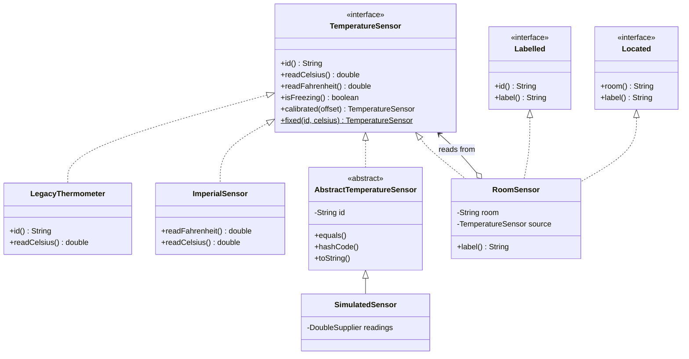
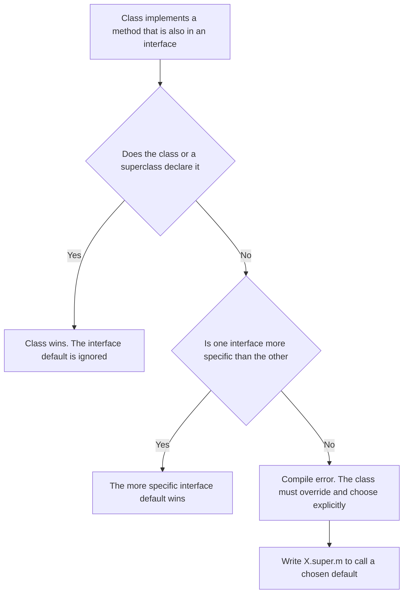

# Task 39 · Evolving a published interface with default methods

| Difficulty | Topics | Time box |
|---|---|---|
| 🟢 Easy | Default methods · Static interface methods · The three resolution rules · Interface evolution without breaking implementers · Skeletal implementations | 1 h |

> **Background reading:** *Modern Java in Action* ch. 13 ("Default methods": evolving APIs, usage patterns, resolution rules) · *Effective Java* 3rd ed. Item 20 ("Prefer interfaces to abstract classes", skeletal implementations) and Item 21 ("Design interfaces for posterity") · JLS §9.4.1 (inheritance and overriding of interface methods)

---

## The situation

The smart-building platform publishes the interface `TemperatureSensor`. Three other teams have written adapters that implement it for their hardware. We cannot change those adapters, and we cannot make those teams recompile in lockstep with us.

Product now wants three things on **every** sensor:

* a Fahrenheit reading for the US sites,
* a freezing check, for the pipe-protection alarms,
* calibration offsets, so a facilities engineer can correct a sensor that reads 0.5 degrees too high.

The obvious move is to add abstract methods to the interface: `readFahrenheit()`, `isFreezing()`, `calibrated(...)`. That breaks every implementer that we do not control. The build of each adapter team fails the next time they compile against our new jar, and the old binaries crash at runtime. Default methods let us add all three without touching a single implementer.

A second problem appears in the same task. A room sensor is both a `Labelled` thing (for the dashboard) and a `Located` thing (for the floor plan). Both interfaces define `label()`, and the compiler forces us to decide what a room sensor's label is.

## The domain

| Term | Meaning |
|---|---|
| **Temperature sensor** | Something that can report a reading in Celsius. The platform's published contract. |
| **Given implementer** | A class written by another team. We may read it, but not change it. |
| **Default method** | An interface method with a body. Implementers inherit it unless they override it. |
| **Skeletal implementation** | An abstract class that implements most of an interface, so that implementers write only the rest. |
| **Calibration offset** | A constant added to the raw reading, e.g. `+0.5` degrees. |

### The interfaces and the given implementers



`LegacyThermometer` was written against the first version of the interface, which had only `id()` and `readCelsius()`. It must keep compiling and working, and it gets all the new behaviour for free. `ImperialSensor` overrides one of the new defaults, and that is legal and useful.

### The three resolution rules

When a class inherits the same method from more than one place, the JVM must pick one. The rules in JLS §9.4.1 are:



### Why an abstract method breaks people

Java checks compatibility at two levels. **Source compatibility**: code that compiled against the old interface must still compile. An adapter that lacks a new abstract method is a compile error the next time its team builds. **Binary compatibility**: a `LegacyThermometer.class` compiled last year must still run against the new jar. It has no `readFahrenheit()` method, so when a caller invokes it, the JVM finds no body and throws `AbstractMethodError`. That happens at runtime, often in production, far away from the change that caused it.

### Default methods as the evolution tool

Java 8 added default methods for exactly this problem. `Collection.removeIf` and `List.sort` were added to interfaces with a huge number of implementations, including ones outside the JDK. Their bodies are written in terms of methods that already exist, such as `iterator()`, so every existing class got them without a change.

### The risk: a default assumes something about the implementation

A default method only knows the public contract. It cannot know that an implementation holds a lock, caches a value or has a faster path. Once published, a default is part of the API forever (*Effective Java* Item 21). Apache Commons Collections had to override the default `removeIf` in its synchronized wrappers, because the default does not take the wrapper's lock. Before you add a default, ask which invariant it silently assumes.

### The three rules, in code

```java
interface A { default String name() { return "A"; } }
interface B { default String name() { return "B"; } }
interface Sub extends A { @Override default String name() { return "Sub"; } }

class Base { public String name() { return "Base"; } }
class D extends Base implements A { }      // rule 1: the class method wins, D.name() is "Base"
class E implements A, Sub { }              // rule 2: Sub is more specific than A, E.name() is "Sub"
class C implements A, B {                  // rule 3: neither is more specific, so the class must choose
    @Override public String name() { return A.super.name(); }   // "A"
}
```

Without the override in `C` the compiler stops with an error: `C inherits unrelated defaults for name()`. `X.super.m()` only works when `X` is a direct superinterface of the class, and it lets you reuse a default without copying its body. `RoomSensor` does exactly this for `label()`.

### Interfaces, abstract classes and skeletons

An interface is the right tool for a contract, because a class can implement many of them. An abstract class can hold state and helpers, but it uses up the single superclass slot. The pattern in between is the one from *Effective Java* Item 20: a public interface plus a skeletal abstract class that implements the contract on top of a few primitive methods. `AbstractList` and `AbstractMap` in the JDK work this way. Implementers who can extend the skeleton get the rest for free. Everyone else implements the interface directly.

### Why there is no default `equals`

A default method cannot override a method of `Object`, so `default boolean equals(Object o)` is a compile error. The reason goes deeper than syntax: identity, equality and hashing belong to a class that owns state. That is why `AbstractTemperatureSensor` has them and the interface does not.

## What I want from you

Implement the evolution of `TemperatureSensor` and the three classes that show the rules. The given classes (`LegacyThermometer`, `ImperialSensor`, `Labelled`, `Located`) are complete and you must not change them.

1. **[`TemperatureSensor`](../src/main/java/io/github/chris013/practice/task39/TemperatureSensor.java)** keeps its two abstract methods `id()` and `readCelsius()`. Add these:
   * `default double readFahrenheit()`: `celsius × 9 / 5 + 32`.
   * `default boolean isFreezing()`: `readCelsius() <= 0.0`. The boundary is inclusive.
   * `default TemperatureSensor calibrated(double offsetCelsius)`: returns a sensor with the **same id** whose `readCelsius()` is this sensor's reading plus the offset. It **reads through** on every call. It is not a snapshot.
   * `static TemperatureSensor fixed(String id, double celsius)`: a sensor that always reports the same value. A `null` id gives `NullPointerException`, a blank id gives `IllegalArgumentException`.
   * `calibrated` rejects a non-finite offset (`NaN` or infinity) with `IllegalArgumentException`.
2. **[`RoomSensor`](../src/main/java/io/github/chris013/practice/task39/RoomSensor.java)** `(String id, String room, TemperatureSensor source)` implements `TemperatureSensor`, `Labelled` and `Located`.
   * Its readings come from `source`.
   * It **overrides `label()`** and returns `room + " (" + Labelled.super.label() + ")"`, so a room `Kitchen` with sensor `t-7` gets the label `Kitchen (Sensor t-7)`. Without the override the code does not compile.
   * `null` arguments give `NullPointerException`.
3. **[`AbstractTemperatureSensor`](../src/main/java/io/github/chris013/practice/task39/AbstractTemperatureSensor.java)** `(String id)` is a skeletal implementation:
   * `id()` returns the id. A `null` id gives `NullPointerException`, a blank id gives `IllegalArgumentException`.
   * Two sensors are `equal` when they are of the **same class** and have the **same id**. `hashCode` is consistent with `equals`.
   * `toString()` returns `SimpleClassName[id]`, for example `SimulatedSensor[t-1]`.
4. **[`SimulatedSensor`](../src/main/java/io/github/chris013/practice/task39/SimulatedSensor.java)** `(String id, DoubleSupplier readings)` extends `AbstractTemperatureSensor`. Each call to `readCelsius()` asks the supplier again. Tests use this class to change readings over time.

## Constraints & non-goals

* **Do not change the given classes.** The point of the exercise is that `LegacyThermometer` works without a change. If you feel you must edit it, you have misread the task.
* **Do not put `equals`, `hashCode` or `toString` in `TemperatureSensor` as defaults.** This is a compile error, and it would not help anyway: see below.
* No `sealed` interface. The set of implementers is open: other teams write them.
* No mocking framework. Use `SimulatedSensor` and small lambdas.
* No logging, no persistence, no thread safety beyond what the tests need.

## How I'd approach it

* **Start with `TemperatureSensor`.** Write `readFahrenheit` and `isFreezing` first. They are one line each, and `LegacyThermometer` shows you immediately that they work for an implementer that knows nothing about them.
* **Read `ImperialSensor` before you write `readFahrenheit`.** It already overrides the default. Ask yourself which method the call `sensor.readFahrenheit()` runs, and why.
* **`calibrated` must read through.** The simplest version copies the reading once. That is a snapshot, and it will silently stop following the hardware. Keep a reference to `this` and call `readCelsius()` on it inside the new sensor's method. An anonymous class is fine here. A named class is the stretch goal.
* **`RoomSensor` does not compile until you override `label()`.** Read the compiler error carefully. It tells you which two interfaces disagree. Then write the one line that chooses, and use `Labelled.super.label()` to reuse the default instead of copying its text.
* **`AbstractTemperatureSensor` is a skeletal implementation.** Its job is to hold the id and the identity rules, so that each concrete sensor writes only `readCelsius()`. Think about why `equals` compares `getClass()` and not `instanceof`. What goes wrong with `instanceof` when a subclass adds state later?
* **Watch the boundary.** `0.0` is freezing. `0.1` is not. Test it in your head before you run the tests.
* Compare doubles with a tolerance (`within(1e-9)`). Double arithmetic is not exact for Fahrenheit: 36.6 Celsius is 97.88 Fahrenheit, but not bit for bit.

## Tests

Run: `mvn test -Dtest='**/task39/**'`

* [`TemperatureSensorTest`](../src/test/java/io/github/chris013/practice/task39/TemperatureSensorTest.java): Fahrenheit table, the freezing boundary, read-through calibration, validation of `fixed`.
* [`ResolutionRulesTest`](../src/test/java/io/github/chris013/practice/task39/ResolutionRulesTest.java): the legacy implementer gets the defaults, the class method beats the default, the room label conflict.
* [`AbstractTemperatureSensorTest`](../src/test/java/io/github/chris013/practice/task39/AbstractTemperatureSensorTest.java): equality by class and id, `toString`, validation of the id.

<details>
<summary>Show the tests</summary>

<!-- embed: src/test/java/io/github/chris013/practice/task39/TemperatureSensorTest.java -->
**[`TemperatureSensorTest.java`](../src/test/java/io/github/chris013/practice/task39/TemperatureSensorTest.java)**

```java
package io.github.chris013.practice.task39;

import static org.assertj.core.api.Assertions.assertThat;
import static org.assertj.core.api.Assertions.assertThatThrownBy;
import static org.assertj.core.api.Assertions.within;

import java.util.concurrent.atomic.AtomicReference;
import org.junit.jupiter.api.Nested;
import org.junit.jupiter.api.Test;
import org.junit.jupiter.params.ParameterizedTest;
import org.junit.jupiter.params.provider.CsvSource;
import org.junit.jupiter.params.provider.ValueSource;

class TemperatureSensorTest {

    @Nested
    class Fahrenheit {

        @ParameterizedTest
        @CsvSource({"-40, -40", "0, 32", "100, 212", "36.6, 97.88"})
        void converts_celsius_to_fahrenheit(double celsius, double expectedFahrenheit) {
            TemperatureSensor sensor = TemperatureSensor.fixed("t-1", celsius);

            assertThat(sensor.readFahrenheit()).isCloseTo(expectedFahrenheit, within(1e-9));
        }
    }

    @Nested
    class Freezing {

        @ParameterizedTest
        @CsvSource({"0.0, true", "0.1, false", "-0.1, true", "-40, true", "25, false"})
        void treats_zero_and_below_as_freezing(double celsius, boolean expected) {
            assertThat(TemperatureSensor.fixed("t-1", celsius).isFreezing()).isEqualTo(expected);
        }
    }

    @Nested
    class Calibration {

        @Test
        void reads_through_to_the_source_on_every_call() {
            AtomicReference<Double> reading = new AtomicReference<>(20.0);
            TemperatureSensor source = new SimulatedSensor("t-1", reading::get);
            TemperatureSensor calibrated = source.calibrated(1.5);

            assertThat(calibrated.readCelsius()).isCloseTo(21.5, within(1e-9));

            reading.set(22.0);

            assertThat(calibrated.readCelsius()).isCloseTo(23.5, within(1e-9));
        }

        @Test
        void keeps_the_id_of_the_source() {
            assertThat(TemperatureSensor.fixed("t-1", 20.0).calibrated(-2.0).id()).isEqualTo("t-1");
        }

        @Test
        void calibrating_a_calibrated_sensor_adds_the_offsets() {
            TemperatureSensor twice = TemperatureSensor.fixed("t-1", 20.0).calibrated(1.0).calibrated(-0.5);

            assertThat(twice.readCelsius()).isCloseTo(20.5, within(1e-9));
        }

        @Test
        void the_default_methods_see_the_calibrated_reading() {
            TemperatureSensor sensor = TemperatureSensor.fixed("t-1", 0.5).calibrated(-1.0);

            assertThat(sensor.isFreezing()).isTrue();
            assertThat(sensor.readFahrenheit()).isCloseTo(31.1, within(1e-9));
        }

        @ParameterizedTest
        @ValueSource(doubles = {Double.NaN, Double.POSITIVE_INFINITY, Double.NEGATIVE_INFINITY})
        void rejects_an_offset_that_is_not_finite(double offset) {
            TemperatureSensor sensor = TemperatureSensor.fixed("t-1", 20.0);

            assertThatThrownBy(() -> sensor.calibrated(offset)).isInstanceOf(IllegalArgumentException.class);
        }
    }

    @Nested
    class Fixed {

        @Test
        void reports_the_given_value_and_id() {
            TemperatureSensor sensor = TemperatureSensor.fixed("t-1", 21.25);

            assertThat(sensor.id()).isEqualTo("t-1");
            assertThat(sensor.readCelsius()).isEqualTo(21.25);
        }

        @ParameterizedTest
        @ValueSource(strings = {"", "   "})
        void rejects_a_blank_id(String id) {
            assertThatThrownBy(() -> TemperatureSensor.fixed(id, 20.0)).isInstanceOf(IllegalArgumentException.class);
        }

        @Test
        void rejects_a_null_id() {
            assertThatThrownBy(() -> TemperatureSensor.fixed(null, 20.0)).isInstanceOf(NullPointerException.class);
        }
    }
}
```
<!-- /embed -->

<!-- embed: src/test/java/io/github/chris013/practice/task39/ResolutionRulesTest.java -->
**[`ResolutionRulesTest.java`](../src/test/java/io/github/chris013/practice/task39/ResolutionRulesTest.java)**

```java
package io.github.chris013.practice.task39;

import static org.assertj.core.api.Assertions.assertThat;
import static org.assertj.core.api.Assertions.assertThatThrownBy;
import static org.assertj.core.api.Assertions.within;

import org.junit.jupiter.api.Nested;
import org.junit.jupiter.api.Test;

class ResolutionRulesTest {

    @Nested
    class LegacyImplementers {

        @Test
        void legacy_thermometer_gets_the_new_defaults_without_any_change() {
            LegacyThermometer thermometer = new LegacyThermometer("t-2", -3.0);

            assertThat(thermometer.readFahrenheit()).isCloseTo(26.6, within(1e-9));
            assertThat(thermometer.isFreezing()).isTrue();
        }

        @Test
        void legacy_thermometer_calibration_follows_its_updates() {
            LegacyThermometer thermometer = new LegacyThermometer("t-2", 10.0);
            TemperatureSensor calibrated = thermometer.calibrated(2.0);

            thermometer.update(-5.0);

            assertThat(calibrated.readCelsius()).isCloseTo(-3.0, within(1e-9));
            assertThat(calibrated.isFreezing()).isTrue();
        }
    }

    @Nested
    class ClassWinsOverDefault {

        @Test
        void the_class_method_replaces_the_interface_default() {
            // 1.1 degrees Fahrenheit round-trips to 1.1000000000000014 through the default formula,
            // so an exact comparison proves that the class method is the one being called.
            ImperialSensor sensor = new ImperialSensor("t-3", 1.1);

            assertThat(sensor.readFahrenheit()).isEqualTo(1.1);
        }

        @Test
        void the_class_still_converts_its_celsius_reading() {
            ImperialSensor sensor = new ImperialSensor("t-3", 212.0);

            assertThat(sensor.readCelsius()).isCloseTo(100.0, within(1e-9));
            assertThat(sensor.isFreezing()).isFalse();
        }
    }

    @Nested
    class ConflictingLabels {

        @Test
        void a_room_sensor_resolves_the_label_conflict_itself() {
            RoomSensor sensor = new RoomSensor("t-7", "Kitchen", TemperatureSensor.fixed("t-7", 19.0));

            assertThat(sensor.label()).isEqualTo("Kitchen (Sensor t-7)");
        }

        @Test
        void a_room_sensor_rejects_null_arguments() {
            TemperatureSensor source = TemperatureSensor.fixed("t-7", 19.0);

            assertThatThrownBy(() -> new RoomSensor(null, "Kitchen", source)).isInstanceOf(NullPointerException.class);
            assertThatThrownBy(() -> new RoomSensor("t-7", null, source)).isInstanceOf(NullPointerException.class);
            assertThatThrownBy(() -> new RoomSensor("t-7", "Kitchen", null)).isInstanceOf(NullPointerException.class);
        }

        @Test
        void a_room_sensor_reads_from_its_source() {
            RoomSensor sensor = new RoomSensor("t-7", "Kitchen", TemperatureSensor.fixed("t-7", -1.0));

            assertThat(sensor.id()).isEqualTo("t-7");
            assertThat(sensor.room()).isEqualTo("Kitchen");
            assertThat(sensor.readCelsius()).isCloseTo(-1.0, within(1e-9));
            assertThat(sensor.isFreezing()).isTrue();
        }
    }
}
```
<!-- /embed -->

<!-- embed: src/test/java/io/github/chris013/practice/task39/AbstractTemperatureSensorTest.java -->
**[`AbstractTemperatureSensorTest.java`](../src/test/java/io/github/chris013/practice/task39/AbstractTemperatureSensorTest.java)**

```java
package io.github.chris013.practice.task39;

import static org.assertj.core.api.Assertions.assertThat;
import static org.assertj.core.api.Assertions.assertThatThrownBy;

import org.junit.jupiter.api.Nested;
import org.junit.jupiter.api.Test;

class AbstractTemperatureSensorTest {

    /** A second subclass with the same id as a {@link SimulatedSensor}: equal ids are not enough to be equal. */
    private static final class OtherSensor extends AbstractTemperatureSensor {

        OtherSensor(String id) {
            super(id);
        }

        @Override
        public double readCelsius() {
            return 0.0;
        }
    }

    @Nested
    class Identity {

        @Test
        void two_sensors_of_the_same_class_and_id_are_equal() {
            SimulatedSensor first = new SimulatedSensor("t-1", () -> 20.0);
            SimulatedSensor second = new SimulatedSensor("t-1", () -> 35.0);

            assertThat(first).isEqualTo(second);
            assertThat(first.hashCode()).isEqualTo(second.hashCode());
        }

        @Test
        void sensors_with_different_ids_are_not_equal() {
            assertThat(new SimulatedSensor("t-1", () -> 20.0)).isNotEqualTo(new SimulatedSensor("t-2", () -> 20.0));
        }

        @Test
        void sensors_of_different_classes_are_not_equal_even_with_the_same_id() {
            assertThat(new SimulatedSensor("t-1", () -> 20.0)).isNotEqualTo(new OtherSensor("t-1"));
        }

        @Test
        void a_sensor_is_not_equal_to_null_or_to_a_plain_object() {
            SimulatedSensor sensor = new SimulatedSensor("t-1", () -> 20.0);

            assertThat(sensor).isNotEqualTo(null);
            assertThat(sensor).isNotEqualTo("t-1");
        }
    }

    @Nested
    class Text {

        @Test
        void to_string_shows_the_class_and_the_id() {
            assertThat(new SimulatedSensor("t-1", () -> 20.0)).hasToString("SimulatedSensor[t-1]");
        }
    }

    @Nested
    class Construction {

        @Test
        void rejects_a_blank_id() {
            assertThatThrownBy(() -> new OtherSensor(" ")).isInstanceOf(IllegalArgumentException.class);
        }

        @Test
        void rejects_a_null_id() {
            assertThatThrownBy(() -> new OtherSensor(null)).isInstanceOf(NullPointerException.class);
        }

        @Test
        void keeps_the_id_it_was_given() {
            assertThat(new OtherSensor("t-9").id()).isEqualTo("t-9");
        }
    }
}
```
<!-- /embed -->

</details>

## Definition of done

- [ ] All tests green, and the whole test class runs in well under a second.
- [ ] `LegacyThermometer` and `ImperialSensor` are unchanged, and the defaults work for `LegacyThermometer`.
- [ ] `RoomSensor` overrides `label()` and calls `Labelled.super.label()`.
- [ ] `calibrated` reads through: a change to the source shows up on the next call.
- [ ] `equals`, `hashCode` and `toString` live in `AbstractTemperatureSensor`, not in the interface.
- [ ] You can explain in one sentence why adding an abstract method breaks the adapters of the other teams.

## Stretch goals

1. Add `static double average(Collection<? extends TemperatureSensor> sensors)` to `TemperatureSensor`. What should it return for an empty collection, and why?
2. Replace the anonymous class in `calibrated` with a named, package-private class that has a `toString` such as `Calibrated[t-1 +0.5]`. Is the named class more useful for debugging, and what does it cost?
3. Could `TemperatureSensor` be a `sealed` interface? Explain why `sealed` does not fit here, even though the set of implementers is a closed list in your head.

---

## Reference solution

<details>
<summary>Spoiler: open only after you have made a serious attempt</summary>

### Key decisions

**1. Defaults for everything that can be derived, abstract only for what must come from the implementer.** `id()` and `readCelsius()` stay abstract because no interface can know them. `readFahrenheit()` and `isFreezing()` are computed from `readCelsius()`. Making them abstract would force every adapter to add two methods it does not need. The alternative, a separate `FahrenheitSensor` interface, splits the concept in two for no benefit.

**2. `calibrated` returns an anonymous class that captures `this`.** The source is captured in a local variable named `source`, because inside the anonymous class `this` means the anonymous class itself. Each call to `readCelsius()` calls the source again, so the result always reflects the current hardware. The rejected alternative, `new SimulatedSensor(id(), () -> readCelsius() + offset)`, works too, but then the published interface would depend on one of its own implementers, a cycle: interface, `SimulatedSensor`, `AbstractTemperatureSensor`, interface.

**3. `RoomSensor` picks the label explicitly.** It overrides `label()` and calls `Labelled.super.label()`. The compiler gives no default winner here because neither interface is more specific than the other. Writing the choice down in code means the next reader does not have to guess.

**4. `AbstractTemperatureSensor` is a skeletal implementation, not an interface default.** It holds the id, which is state, and the identity rules, which are class-level behaviour. An interface cannot hold state, and it cannot override `Object` methods with defaults. The class also gives `SimulatedSensor` a one-line constructor.

**5. Equality uses `getClass()`, not `instanceof`.** With `instanceof`, a subclass that adds state and overrides `equals` can make `a.equals(b)` true while `b.equals(a)` is false. Comparing exact classes keeps the relation symmetric, and it is simple to explain. The cost is that a subclass is never equal to its parent, which is the behaviour we want for sensors.

**6. `fixed` validates the id and returns a tiny anonymous class.** A constant sensor needs no named class, and for the same reason as in decision 2 the interface does not depend on any implementer. The JDK does the same: `List.of` returns instances of hidden classes, not of a public `List` implementation.

### Code

<!-- embed: solutions/src/main/java/io/github/chris013/practice/task39/TemperatureSensor.java -->
**[`TemperatureSensor.java`](../solutions/src/main/java/io/github/chris013/practice/task39/TemperatureSensor.java)**

```java
package io.github.chris013.practice.task39;

import java.util.Objects;

/**
 * A temperature sensor as published by the platform team. Implementers in other teams' code only provide
 * {@link #id()} and {@link #readCelsius()}. Everything else is a default method, so we could add it without
 * breaking them.
 */
public interface TemperatureSensor {

    /** Stable identifier of the sensor. */
    String id();

    /** Current temperature in degrees Celsius. May change between calls, so callers must not cache it. */
    double readCelsius();

    /** Fahrenheit is derived from Celsius unless the implementation has a native Fahrenheit reading. */
    default double readFahrenheit() {
        return readCelsius() * 9 / 5 + 32;
    }

    /** The boundary is inclusive: water at exactly 0.0 C counts as freezing. */
    default boolean isFreezing() {
        return readCelsius() <= 0.0;
    }

    /**
     * Returns a sensor with the same id whose reading is this sensor's reading plus {@code offsetCelsius}.
     *
     * <p>The result reads through to this sensor on every call. A snapshot would silently stop following
     * the hardware after the first call.
     *
     * @throws IllegalArgumentException if {@code offsetCelsius} is NaN or infinite
     */
    default TemperatureSensor calibrated(double offsetCelsius) {
        if (!Double.isFinite(offsetCelsius)) {
            throw new IllegalArgumentException("offsetCelsius must be finite");
        }
        TemperatureSensor source = this;
        return new TemperatureSensor() {
            @Override
            public String id() {
                return source.id();
            }

            @Override
            public double readCelsius() {
                return source.readCelsius() + offsetCelsius;
            }
        };
    }

    /**
     * A sensor that always reports the same value. Useful for tests and for stubbing out hardware.
     *
     * @throws IllegalArgumentException if {@code id} is blank
     */
    static TemperatureSensor fixed(String id, double celsius) {
        Objects.requireNonNull(id, "id");
        if (id.isBlank()) {
            throw new IllegalArgumentException("id must not be blank");
        }
        return new TemperatureSensor() {
            @Override
            public String id() {
                return id;
            }

            @Override
            public double readCelsius() {
                return celsius;
            }
        };
    }
}
```
<!-- /embed -->

<!-- embed: solutions/src/main/java/io/github/chris013/practice/task39/AbstractTemperatureSensor.java -->
**[`AbstractTemperatureSensor.java`](../solutions/src/main/java/io/github/chris013/practice/task39/AbstractTemperatureSensor.java)**

```java
package io.github.chris013.practice.task39;

import java.util.Objects;

/**
 * Skeletal implementation (<i>Effective Java</i> Item 20). It takes care of the id and the identity rules, so an
 * implementer only has to write {@link #readCelsius()}.
 *
 * <p>{@code equals}, {@code hashCode} and {@code toString} cannot be default methods in {@link TemperatureSensor}:
 * the compiler rejects a default method that overrides a method of {@link Object}. They have to live in a class.
 */
public abstract class AbstractTemperatureSensor implements TemperatureSensor {

    private final String id;

    protected AbstractTemperatureSensor(String id) {
        Objects.requireNonNull(id, "id");
        if (id.isBlank()) {
            throw new IllegalArgumentException("id must not be blank");
        }
        this.id = id;
    }

    @Override
    public final String id() {
        return id;
    }

    /** Two sensors are the same when they are of the same class and have the same id. */
    @Override
    public boolean equals(Object other) {
        if (this == other) {
            return true;
        }
        if (other == null || getClass() != other.getClass()) {
            return false;
        }
        return id.equals(((AbstractTemperatureSensor) other).id);
    }

    @Override
    public int hashCode() {
        return id.hashCode();
    }

    @Override
    public String toString() {
        return getClass().getSimpleName() + "[" + id + "]";
    }
}
```
<!-- /embed -->

<!-- embed: solutions/src/main/java/io/github/chris013/practice/task39/RoomSensor.java -->
**[`RoomSensor.java`](../solutions/src/main/java/io/github/chris013/practice/task39/RoomSensor.java)**

```java
package io.github.chris013.practice.task39;

import java.util.Objects;

/**
 * A sensor placed in a room. It implements two interfaces that both declare {@code label()}, so the class must
 * resolve the conflict itself. Otherwise the code does not compile.
 */
public final class RoomSensor implements TemperatureSensor, Labelled, Located {

    private final String id;
    private final String room;
    private final TemperatureSensor source;

    public RoomSensor(String id, String room, TemperatureSensor source) {
        this.id = Objects.requireNonNull(id, "id");
        this.room = Objects.requireNonNull(room, "room");
        this.source = Objects.requireNonNull(source, "source");
    }

    @Override
    public String id() {
        return id;
    }

    @Override
    public String room() {
        return room;
    }

    @Override
    public double readCelsius() {
        return source.readCelsius();
    }

    /** Picks the room name and the default label from {@link Labelled}, e.g. {@code Kitchen (Sensor t-7)}. */
    @Override
    public String label() {
        return room + " (" + Labelled.super.label() + ")";
    }
}
```
<!-- /embed -->

### What I typically flag in first attempts

| Finding | Why it matters |
|---|---|
| Adding `readFahrenheit()` as an abstract method | Every adapter stops compiling, and old binaries throw `AbstractMethodError` at runtime. A default keeps them all working. |
| `calibrated` copies the reading once | The result looks right in the first test and is wrong after the first hardware change. Read-through is the contract. |
| Putting `equals` or `hashCode` into the interface | Not allowed: a default method cannot override a method of `Object`. Put them in a class, such as `AbstractTemperatureSensor`. |
| `RoomSensor` not overriding `label()` | The class does not compile. The fix is a deliberate choice, not a trick: name the default you want. |
| Using `instanceof` in `equals` | Breaks symmetry once a subclass adds state. Compare `getClass()`. |
| Writing the freezing boundary as `< 0.0` | Water at exactly 0.0 degrees is freezing. The product rule is inclusive. |
| Making `TemperatureSensor` an abstract class | Other teams already implement it, and Java allows one superclass. An interface with defaults plus a skeletal class gives the same reuse and keeps the single inheritance slot free. |

</details>
