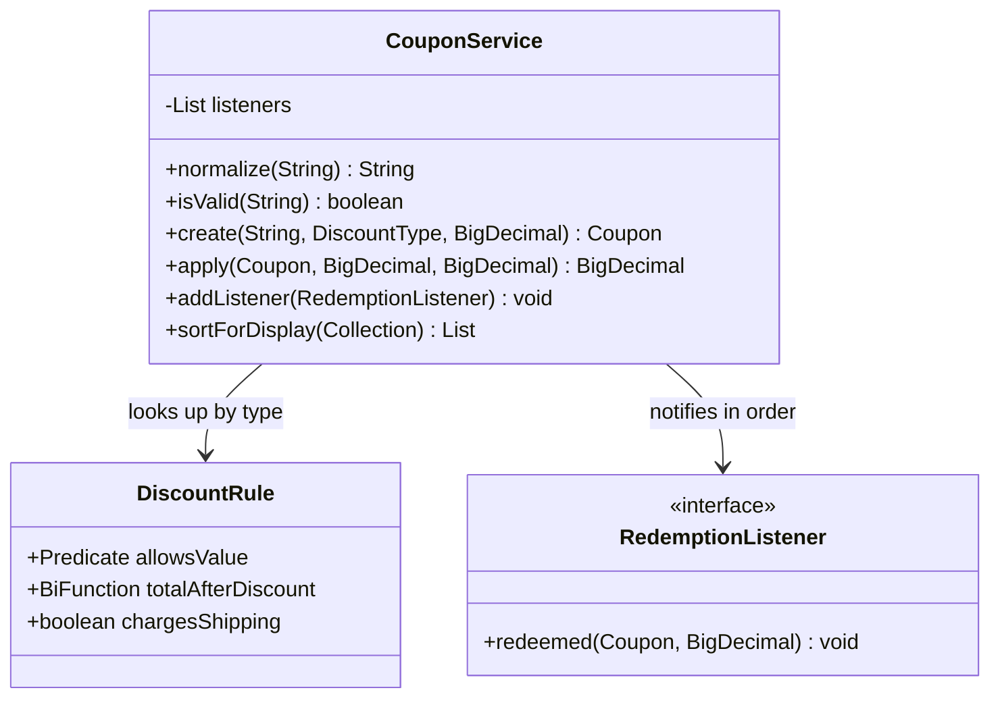
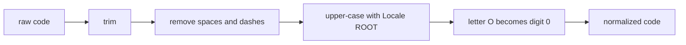

# Task 40 · Retire the anonymous classes: refactoring patterns to lambdas

| Difficulty | Topics | Time box |
|---|---|---|
| 🟢 Easy | Refactoring anonymous classes to lambdas and method references · Strategy, Template Method, Observer, Chain of Responsibility and Factory with lambdas · `Function.andThen` · `Supplier`-based factories · Characterization tests | 1–1.5 h |

> **Background reading:** *Modern Java in Action* ch. 9 ("Refactoring, testing, and debugging": 9.1 refactoring for readability, 9.2 refactoring object-oriented design patterns with lambdas) · *Effective Java* 3rd ed. Item 42 ("Prefer lambdas to anonymous classes"), Item 43 ("Prefer method references to lambdas"), Item 44 ("Favor the use of standard functional interfaces") · Michael Feathers, *Working Effectively with Legacy Code*, the chapter on characterization tests

---

## The situation

Our shop's [`CouponService`](../src/main/java/io/github/chris013/practice/task40/CouponService.java) was written when Java 6 was the latest version. It validates and normalises coupon codes, computes what a customer pays and tells listeners about each redemption. It works, and it has been in production for years without a bug report.

But it is about 230 lines, and most of them are scaffolding:

* the normalisation steps are four anonymous `ProcessingStep` subclasses, linked by hand with `setSuccessor`,
* the validation rules are four anonymous `ValidationRule` implementations in a static list,
* the discount logic is an abstract `AbstractDiscountCalculator` template class with three anonymous subclasses, created by a `switch`,
* the display order is an anonymous `Comparator` with nested `if` statements.

Every one of these is a single function wearing a class costume. The team wants the code in today's idiom, but nobody wants to change what the shop charges customers. So the job is a **behaviour-preserving refactoring**: same results, fewer moving parts, and no new class per rule.

The starter is the legacy code, and it is complete and correct. The tests in `CouponServiceTest` are **characterization tests**: they describe what the code does today, and they are already green. Your job is to refactor until the code reads well, keeping them green after every step. The one test that is red on purpose is `NoAnonymousClassesTest`. It turns green when the anonymous classes are gone.

## The domain

| Term | Meaning |
|---|---|
| **Coupon** | A normalised code, a discount type and that discount's value. Created only through `create`. |
| **Discount type** | `PERCENT` (1 to 100), `FIXED` (more than 0, an amount off) or `FREE_SHIPPING` (value 0, shipping waived). |
| **Normalisation** | Turns what a customer typed into the canonical code. `" summer-sale 2O "` becomes `SUMMERSALE20`. |
| **Redemption** | A coupon applied to an order. Every registered listener hears about it. |

### Before: objects for every step

```mermaid
classDiagram
    class ProcessingStep {
        <<abstract>>
        -ProcessingStep successor
        +setSuccessor(ProcessingStep) ProcessingStep
        +process(String) String
        +doProcess(String) String
    }
    class TrimStep {
        anonymous subclass
    }
    class RemoveSpacesStep {
        anonymous subclass
    }
    class UpperCaseStep {
        anonymous subclass
    }
    class LetterOStep {
        anonymous subclass
    }
    ProcessingStep <|-- TrimStep
    ProcessingStep <|-- RemoveSpacesStep
    ProcessingStep <|-- UpperCaseStep
    ProcessingStep <|-- LetterOStep
    class ValidationRule {
        <<interface>>
        +holds(String) boolean
    }
    class LengthRule {
        anonymous implementation
    }
    class CharacterRule {
        anonymous implementation
    }
    class FirstCharacterRule {
        anonymous implementation
    }
    class BlocklistRule {
        anonymous implementation
    }
    ValidationRule <|.. LengthRule
    ValidationRule <|.. CharacterRule
    ValidationRule <|.. FirstCharacterRule
    ValidationRule <|.. BlocklistRule
    class AbstractDiscountCalculator {
        <<abstract>>
        #BigDecimal value
        +apply(BigDecimal, BigDecimal) BigDecimal
        #discountedTotal(BigDecimal) BigDecimal
        #chargesShipping() boolean
        #allowsValue() boolean
    }
    class PercentCalculator {
        anonymous subclass
    }
    class FixedCalculator {
        anonymous subclass
    }
    class FreeShippingCalculator {
        anonymous subclass
    }
    AbstractDiscountCalculator <|-- PercentCalculator
    AbstractDiscountCalculator <|-- FixedCalculator
    AbstractDiscountCalculator <|-- FreeShippingCalculator
```



### After: functions, data and one record



The normalisation is a pipeline of plain functions, which reads top to bottom:



## What I want from you

**The starter is the legacy code and already works.** The tests in [`CouponServiceTest`](../src/test/java/io/github/chris013/practice/task40/CouponServiceTest.java) are characterization tests and they pass on the starter. They must still pass after every refactoring step. [`NoAnonymousClassesTest`](../src/test/java/io/github/chris013/practice/task40/NoAnonymousClassesTest.java) fails on the starter on purpose; it is your target. Do not change the behaviour. Change the shape.

1. Keep the public API of [`CouponService`](../src/main/java/io/github/chris013/practice/task40/CouponService.java) exactly as it is: `normalize`, `isValid`, `create`, `apply`, `addListener` and `sortForDisplay`. [`Coupon`](../src/main/java/io/github/chris013/practice/task40/Coupon.java), [`DiscountType`](../src/main/java/io/github/chris013/practice/task40/DiscountType.java) and [`RedemptionListener`](../src/main/java/io/github/chris013/practice/task40/RedemptionListener.java) are given and must not change.
2. `normalize` applies these steps in this order: trim; remove all spaces and dashes; upper-case with `Locale.ROOT`; replace the letter `O` with the digit `0`. Customers mistype one for the other, so `" summer-sale 2O "` becomes `SUMMERSALE20`.
3. `isValid` expects an already normalised code. All of these rules must hold: the length is 6 to 12 characters inclusive; only `A` to `Z` and `0` to `9` are allowed; the first character is not a digit; the code is not on the blocklist `TEST00` or `ADMIN0`. Lower-case input is rejected, because `isValid` does not normalise.
4. `create(rawCode, type, value)` normalises the code and then validates it. An invalid code throws `IllegalArgumentException` whose message contains the normalised code. Then the value is checked against the rule of the type: `PERCENT` 1 to 100 inclusive, `FIXED` greater than 0, `FREE_SHIPPING` exactly 0. A value that breaks its rule also throws `IllegalArgumentException`.
5. `apply(coupon, orderTotal, shippingCost)` returns the amount the customer pays, with scale 2, rounded `HALF_UP`. For `PERCENT` the discount is the total times the value divided by 100, rounded `HALF_UP` to 2 decimals, and it is subtracted from the total. For `FIXED` the result is the total minus the value, but never below 0. For `FREE_SHIPPING` the total is unchanged. Then the shipping cost is added, except for `FREE_SHIPPING`, where shipping is waived.
6. `apply` calls every registered listener once, in registration order, with the coupon and the final amount it returned.
7. `addListener` appends a listener. A `null` listener is rejected with a `NullPointerException`.
8. `sortForDisplay` returns a new list sorted by type in enum order, then by value highest first, then by code. It does not change the collection it was given.
9. The refactored solution contains **no anonymous classes** and **no abstract template class**. The classes `ProcessingStep`, `AbstractDiscountCalculator` and `ValidationRule` are gone, and `NoAnonymousClassesTest` is green.

## Constraints & non-goals

* Behaviour must not change. Not a single amount, message or order may differ from the legacy code. The characterization tests are your proof.
* Do not add new public methods, and do not change any signature.
* Do not add libraries. Plain Java 25.
* Work in small steps. Refactor one private structure, run the tests, then go on. Do not rewrite the whole class in one go.
* Non-goal: a configurable pipeline, logging, or metrics. These are stretch goals below.
* Non-goal: fixing the wording of the messages or the code format. The tests check what the code does, and they should keep doing that.

## How I'd approach it

Start by reading the tests, not the code. They tell you what must not move. Then go one structure at a time, in this order, and run the tests after each step.

**1. Normalisation, from a chain of objects to a function.** A `ProcessingStep` chain is a Chain of Responsibility written by hand. Each step is a `Function<String, String>`, and `andThen` links them in order. Ask yourself what the `setSuccessor` method is for once every step is a function. Pick between `Function<String, String>` and `UnaryOperator<String>`. `UnaryOperator` says "the input and output types are the same", which is true here. Note that `andThen` returns a plain `Function`, not a `UnaryOperator`, so the declared type of the result matters.

**2. Validation, from a list of rule objects to predicates.** Each `ValidationRule` is a `Predicate<String>`. A list of predicates, combined with `and`, is the same rule set. Be careful with the empty string. If a predicate calls `charAt(0)` on it, you get an exception where the legacy code returns `false`. `and` short-circuits, so the order of the chain can protect you, but a predicate that guards itself is safe in any order. Your test for `isValid` will tell you.

**3. Discounts, from a template class to a rule per type.** The template class `AbstractDiscountCalculator` fixes the steps "discount, then shipping, then round" and asks subclasses for three hooks. The same thing can be a small value object that holds three functions, one per hook. `Predicate` for the value check, `BiFunction` for the discount, and a `boolean` for shipping. Where do you keep the mapping from `DiscountType` to that object? A `switch` returning new objects works. A `Map` built once, with an `EnumMap`, works too. Think about what happens when someone adds a new `DiscountType` and forgets its rule. The `switch` tells you at compile time only if you use a switch expression with no `default`. A `Map` tells you at run time, when the lookup returns `null`. Choose one and write down why.

**4. The comparator, from anonymous to combinators.** `Comparator.comparing` with `thenComparing` says the same thing as the nested `if` blocks in fewer lines. Watch the direction of the value comparison, because the legacy code sorts values highest first.

**5. Listeners.** `RedemptionListener` is already a functional interface. A `forEach` with a lambda is the Observer pattern in its modern form. You need no class for an observer that has one method.

### Pattern to lambda, at a glance

| Pattern | Legacy form | Lambda form |
|---|---|---|
| Strategy | An interface and one class per algorithm | A `Function`, `Predicate` or `BiFunction` passed in or stored in a map |
| Template Method | An abstract class with hook methods | A method that takes the varying step as a lambda parameter, or a record of functions |
| Observer | A listener interface and an anonymous class per listener | A functional interface and a lambda per listener |
| Chain of Responsibility | Step objects linked by `setSuccessor` | Functions combined with `andThen` |
| Factory | A `switch` that returns new anonymous subclasses | A `Map` or switch expression from the type to a `Supplier` or `Function` |

### Anonymous classes and lambdas are not the same thing

Item 42 of *Effective Java* says to prefer lambdas, and most of the time that is right, but not for the reason people think. Know the differences, because they matter in review.

* **`this` means something else.** In an anonymous class `this` is the anonymous instance. In a lambda `this` is the enclosing instance. That is why a lambda can call an outer method without a qualifier.
* **Shadowing.** An anonymous class can declare fields and methods that hide the outer ones. A lambda cannot declare a parameter with the same name as a local variable of the enclosing method, so a shadowing bug that compiles in one form fails in the other.
* **No class file per lambda.** Each anonymous class is a `CouponService$1.class` file on disk. A lambda is created at run time through `invokedynamic`, and the JVM generates a hidden class for it. The source does not get one class per rule. You can see the difference with `javap` or by listing `target/classes`.
* **A lambda is one method and no fields.** An anonymous class can keep mutable fields between calls and can have several methods that share them. When a rule needs that, an anonymous class, or a small named class, is still the right tool. Here no rule keeps state, so every rule can be a lambda.

**Method references or lambdas?** Item 43 says to use whichever is clearer. `String::trim` is clearer than `s -> s.trim()`. A lambda that does two things, or that calls a method with a non-obvious argument order, reads better as a named private method and a method reference to it. Do not write `x -> x` nor long one-line expressions that need a comment to understand.

**Debugging lambdas.** A stack trace through a lambda shows a synthetic name like `lambda$normalize$0`. That is normal. Name the lambdas by extracting them into private methods when the trace matters. To see a value between two steps, put a `peek` in a stream, or wrap a `Function` with a logging function. Do not add `System.out` to library code you are about to ship.

**When an anonymous class is still right.** Keep the class if the instance has state that changes, if it has more than one method that the implementation shares, or if it must be a subclass of something. Those are good reasons. The legacy code has none of them, so you can remove all of them.

## Tests

Run them with:

```bash
mvn test -Dtest='**/task40/**'
```

The characterization tests are in [`CouponServiceTest`](../src/test/java/io/github/chris013/practice/task40/CouponServiceTest.java). [`NoAnonymousClassesTest`](../src/test/java/io/github/chris013/practice/task40/NoAnonymousClassesTest.java) checks the class files by name. On the starter `CouponServiceTest` passes and `NoAnonymousClassesTest` fails. When you are done, everything passes.

<details>
<summary>Show the tests</summary>

<!-- embed: src/test/java/io/github/chris013/practice/task40/CouponServiceTest.java -->
**[`CouponServiceTest.java`](../src/test/java/io/github/chris013/practice/task40/CouponServiceTest.java)**

```java
package io.github.chris013.practice.task40;

import static org.assertj.core.api.Assertions.assertThat;
import static org.assertj.core.api.Assertions.assertThatCode;
import static org.assertj.core.api.Assertions.assertThatThrownBy;

import java.math.BigDecimal;
import java.util.ArrayList;
import java.util.List;
import org.junit.jupiter.api.Nested;
import org.junit.jupiter.api.Test;
import org.junit.jupiter.params.ParameterizedTest;
import org.junit.jupiter.params.provider.CsvSource;

/**
 * Characterization tests. They describe what the code does today and must stay green through the whole refactoring.
 * Every expected number was worked out by hand, not copied from the implementation.
 */
class CouponServiceTest {

    private final CouponService service = new CouponService();

    @Nested
    class Normalize {

        @ParameterizedTest
        @CsvSource(delimiter = '|', value = {
                "' summer-sale 2O '|SUMMERSALE20",
                "'winter-o-2024'|WINTER02024",
                "'abc def'|ABCDEF",
                "'  o0-1  '|001",
                "'already-OK1'|ALREADY0K1"
        })
        void turns_raw_input_into_the_canonical_form(String raw, String expected) {
            assertThat(service.normalize(raw)).isEqualTo(expected);
        }
    }

    @Nested
    class IsValid {

        @ParameterizedTest
        @CsvSource({
                "ABCDE, false",          // 5 characters: too short
                "ABCDEF, true",          // 6 characters: the shortest allowed
                "ABCDEFGHIJK1, true",    // 12 characters: the longest allowed
                "ABCDEFGHIJKL1, false",  // 13 characters: too long
                "1ABCDE, false",         // starts with a digit
                "AB12CD, true",          // digits are fine after the first character
                "TEST00, false",         // on the blocklist
                "ADMIN0, false",         // on the blocklist
                "ADMIN1, true",          // only exact matches are blocked
                "summer20, false",       // lower case: isValid expects normalized input
                "AB-CDEF, false",        // dashes are removed by normalize, so they are not allowed here
                "ABCDE!, false",         // only upper-case letters and digits
                "'', false"              // empty: the first-character check must not run on it
        })
        void accepts_or_rejects_a_normalized_code(String code, boolean expected) {
            assertThat(service.isValid(code)).isEqualTo(expected);
        }
    }

    @Nested
    class Create {

        @Test
        void normalizes_the_code_and_keeps_the_value() {
            Coupon coupon = service.create(" summer-sale 2O ", DiscountType.PERCENT, new BigDecimal("15"));

            assertThat(coupon).isEqualTo(new Coupon("SUMMERSALE20", DiscountType.PERCENT, new BigDecimal("15")));
        }

        @Test
        void rejects_an_invalid_code_and_names_the_normalized_code_in_the_message() {
            assertThatThrownBy(() -> service.create("admin-0", DiscountType.FIXED, new BigDecimal("5")))
                    .isInstanceOf(IllegalArgumentException.class)
                    .hasMessageContaining("ADMIN0");
        }

        @ParameterizedTest
        @CsvSource({
                "PERCENT, 1",
                "PERCENT, 100",
                "FIXED, 0.01",
                "FREE_SHIPPING, 0",
                "FREE_SHIPPING, 0.00"
        })
        void accepts_values_inside_the_rule_for_the_type(DiscountType type, String value) {
            assertThatCode(() -> service.create("CODE12", type, new BigDecimal(value)))
                    .doesNotThrowAnyException();
        }

        @ParameterizedTest
        @CsvSource({
                "PERCENT, 0",
                "PERCENT, 101",
                "FIXED, 0",
                "FIXED, -1",
                "FREE_SHIPPING, 5"
        })
        void rejects_values_outside_the_rule_for_the_type(DiscountType type, String value) {
            assertThatThrownBy(() -> service.create("CODE12", type, new BigDecimal(value)))
                    .isInstanceOf(IllegalArgumentException.class);
        }
    }

    @Nested
    class Apply {

        @ParameterizedTest
        @CsvSource(delimiter = '|', value = {
                // 15% of 33.33 is 4.9995, rounded to 5.00; 33.33 - 5.00 = 28.33; + 4.90 shipping = 33.23
                "PERCENT|15|33.33|4.90|33.23",
                "PERCENT|100|33.33|4.90|4.90",
                // 10% of 10.25 is 1.025: HALF_UP gives 1.03 (HALF_EVEN would give 1.02); 10.25 - 1.03 = 9.22
                "PERCENT|10|10.25|0.00|9.22",
                // 10% of 20.00 is 2.00; 18.00 + 4.90 = 22.90
                "PERCENT|10|20.00|4.90|22.90",
                // 20.00 - 5 = 15.00; + 4.90 = 19.90
                "FIXED|5|20.00|4.90|19.90",
                // 20.00 - 20 = 0.00; + 4.90 = 4.90
                "FIXED|20|20.00|4.90|4.90",
                // 20.00 - 25 is negative, so the total becomes 0.00; + 4.90 = 4.90
                "FIXED|25|20.00|4.90|4.90",
                // shipping is waived, so the total is unchanged
                "FREE_SHIPPING|0|20.00|4.90|20.00"
        })
        void computes_the_amount_to_pay(DiscountType type, String value, String total, String shipping, String expected) {
            Coupon coupon = new Coupon("CODE12", type, new BigDecimal(value));

            BigDecimal amount = service.apply(coupon, new BigDecimal(total), new BigDecimal(shipping));

            assertThat(amount).isEqualTo(new BigDecimal(expected));
        }

        @Test
        void always_returns_two_decimal_places() {
            Coupon coupon = new Coupon("CODE12", DiscountType.FIXED, new BigDecimal("5"));

            BigDecimal amount = service.apply(coupon, new BigDecimal("20"), new BigDecimal("5"));

            assertThat(amount).isEqualTo(new BigDecimal("20.00"));
        }
    }

    @Nested
    class Listeners {

        @Test
        void notifies_every_listener_in_registration_order_with_the_coupon_and_the_final_amount() {
            List<String> calls = new ArrayList<>();
            service.addListener((coupon, total) -> calls.add("first " + coupon.code() + " " + total));
            service.addListener((coupon, total) -> calls.add("second " + coupon.code() + " " + total));
            Coupon coupon = new Coupon("SUMMERSALE20", DiscountType.PERCENT, new BigDecimal("15"));

            service.apply(coupon, new BigDecimal("33.33"), new BigDecimal("4.90"));

            assertThat(calls).containsExactly("first SUMMERSALE20 33.23", "second SUMMERSALE20 33.23");
        }

        @Test
        void rejects_a_null_listener_without_adding_it() {
            assertThatThrownBy(() -> service.addListener(null))
                    .isInstanceOf(NullPointerException.class)
                    .hasMessageContaining("listener");
        }

        @Test
        void returns_the_amount_even_when_nobody_listens() {
            Coupon coupon = new Coupon("FREESHIP1", DiscountType.FREE_SHIPPING, new BigDecimal("0"));

            assertThat(service.apply(coupon, new BigDecimal("20.00"), new BigDecimal("4.90")))
                    .isEqualTo(new BigDecimal("20.00"));
        }
    }

    @Nested
    class SortForDisplay {

        @Test
        void sorts_by_type_then_value_highest_first_then_code() {
            Coupon tenPercentZulu = new Coupon("TENPCT", DiscountType.PERCENT, new BigDecimal("10"));
            Coupon tenPercentAlpha = new Coupon("ALPHA", DiscountType.PERCENT, new BigDecimal("10"));
            Coupon fifteenPercent = new Coupon("FIFTEEN", DiscountType.PERCENT, new BigDecimal("15"));
            Coupon fixedFive = new Coupon("FIVEOFF", DiscountType.FIXED, new BigDecimal("5"));
            Coupon fixedHundred = new Coupon("BIGFIXED", DiscountType.FIXED, new BigDecimal("100"));
            Coupon freeShipping = new Coupon("SHIPPING", DiscountType.FREE_SHIPPING, new BigDecimal("0"));

            List<Coupon> sorted = service.sortForDisplay(
                    List.of(tenPercentZulu, freeShipping, fixedFive, fifteenPercent, fixedHundred, tenPercentAlpha));

            // 100 comes before 5: a plain string comparison of the values would get this wrong
            assertThat(sorted).extracting(Coupon::code)
                    .containsExactly("FIFTEEN", "ALPHA", "TENPCT", "BIGFIXED", "FIVEOFF", "SHIPPING");
        }

        @Test
        void does_not_change_the_list_it_was_given() {
            Coupon fixed = new Coupon("FIVEOFF", DiscountType.FIXED, new BigDecimal("5"));
            Coupon percent = new Coupon("TENPCT", DiscountType.PERCENT, new BigDecimal("10"));
            List<Coupon> input = new ArrayList<>(List.of(fixed, percent));

            service.sortForDisplay(input);

            assertThat(input).containsExactly(fixed, percent);
        }
    }
}
```
<!-- /embed -->

<!-- embed: src/test/java/io/github/chris013/practice/task40/NoAnonymousClassesTest.java -->
**[`NoAnonymousClassesTest.java`](../src/test/java/io/github/chris013/practice/task40/NoAnonymousClassesTest.java)**

```java
package io.github.chris013.practice.task40;

import static org.assertj.core.api.Assertions.assertThat;

import java.util.List;
import java.util.Optional;
import java.util.stream.IntStream;
import java.util.stream.Stream;
import org.junit.jupiter.api.Test;

/**
 * Checks the refactoring result on the compiled classes. Anonymous classes compile to {@code Outer$1},
 * {@code Outer$2}, ...; lambdas and method references do not create class files. So if no anonymous class is
 * left, the code uses lambdas.
 */
class NoAnonymousClassesTest {

    private static final String PACKAGE = "io.github.chris013.practice.task40.";

    @Test
    void coupon_service_has_no_anonymous_classes() {
        // The legacy file has 12 anonymous classes. javac may also emit synthetic classes with the same
        // CouponService$N names (for example the lookup table of a switch on an enum); those are not ours.
        List<String> found = IntStream.rangeClosed(1, 20)
                .mapToObj(n -> load("CouponService$" + n))
                .flatMap(Optional::stream)
                .filter(c -> c.isAnonymousClass() && !c.isSynthetic())
                .map(Class::getName)
                .toList();

        assertThat(found).as("anonymous classes still compiled from CouponService").isEmpty();
    }

    @Test
    void no_chain_or_template_classes_remain() {
        List<String> found = Stream.of("ProcessingStep", "AbstractDiscountCalculator", "ValidationRule")
                .filter(name -> load(name).isPresent())
                .toList();

        assertThat(found).as("classes that the lambda version replaces").isEmpty();
    }

    private static Optional<Class<?>> load(String simpleName) {
        try {
            return Optional.of(Class.forName(PACKAGE + simpleName, false, NoAnonymousClassesTest.class.getClassLoader()));
        } catch (ClassNotFoundException notThere) {
            return Optional.empty();
        }
    }
}
```
<!-- /embed -->

</details>

## Definition of done

- [ ] `CouponServiceTest` is green (43 tests), and it was green after every step.
- [ ] `NoAnonymousClassesTest` is green (2 tests).
- [ ] `ProcessingStep`, `AbstractDiscountCalculator` and `ValidationRule` are deleted.
- [ ] No anonymous class and no abstract template class is left in `CouponService`.
- [ ] Every multi-line lambda that has a name in the trace is a private method referenced with `::`.
- [ ] You can explain why the mapping from `DiscountType` to rule is a `switch` or a `Map`, and what happens when a new type is added.
- [ ] `mvn -B -o clean test-compile` gives no warnings.

## Stretch goals

1. Make the normalisation steps configurable from a `Properties` file. Build the pipeline from a list of step names. Reject an unknown name with an `IllegalArgumentException` at start-up, not at the first call.
2. Log each step of the normalisation pipeline with a decorating `Function`. Write a small method `logging(String name, Function<String, String> step)` that returns a function that logs the input and the output and then returns the output. Do not change the pipeline's results.
3. Measure the number of class files before and after. Use `javap` or count the files in `target/classes/io/github/chris013/practice/task40`. Write the two numbers in a comment at the top of `CouponService`.
4. Make `apply` return a `Map` of the three amounts (discount, shipping, payable) for display. Keep `apply` as it is and add a second method. Do not break the old one.

---

## Reference solution

<details>
<summary>Spoiler: open only after you have made a serious attempt</summary>

### Key decisions

1. **Normalisation is a `Function<String, String>` built with `andThen`.** The legacy chain of `ProcessingStep` objects did the same job with more code and more classes. The alternative, a `UnaryOperator` field, was rejected because `andThen` returns a `Function`, which cannot be assigned to a `UnaryOperator` without `::apply` or a cast.
2. **Validation is a `Predicate<String>` built with `and`.** The first-character check guards against the empty string itself, so it is safe in any order; the length check also comes first, which keeps the cheap checks in front. The alternative was a `List` of predicates with `allMatch`. It works too, but the `and` chain names each rule in one place and keeps the short-circuit order visible.
3. **The discount rule is a private record of three functions.** `DiscountRule` holds the value check, the discount function and the shipping flag. It replaces the abstract class and its three anonymous subclasses. Records are for values, and a rule is a value that happens to hold functions. The alternative, an interface with three lambdas, was rejected because a record has the right constructor and the fields are named.
4. **The rules come from a switch expression without `default`, not from an `EnumMap`.** The switch is exhaustive, so adding a `DiscountType` without a rule is a compile error. An `EnumMap` works too, but a missing rule then shows up only at run time, as a `null` from `get`. (javac compiles a switch on an enum with a small synthetic `CouponService$N` lookup class. That is not an anonymous class anyone wrote, and `NoAnonymousClassesTest` ignores synthetic classes.)
5. **The comparator is `comparing` then `thenComparing`.** The value comparison uses `Comparator.reverseOrder()`, so the highest value comes first. The alternative was a lambda with nested `if` statements, which is the legacy code in new clothes.
6. **Listeners are notified with `forEach`.** The listener list stays in registration order. The amount is computed once and passed to every listener, so the listeners cannot disagree.

### Code

<!-- embed: solutions/src/main/java/io/github/chris013/practice/task40/CouponService.java -->
**[`CouponService.java`](../solutions/src/main/java/io/github/chris013/practice/task40/CouponService.java)**

```java
package io.github.chris013.practice.task40;

import java.math.BigDecimal;
import java.math.RoundingMode;
import java.util.ArrayList;
import java.util.Collection;
import java.util.Comparator;
import java.util.List;
import java.util.Locale;
import java.util.Objects;
import java.util.Set;
import java.util.function.BiFunction;
import java.util.function.Function;
import java.util.function.Predicate;

/**
 * Validates and normalizes coupon codes, computes discounts and notifies listeners about redemptions.
 *
 * <p>Every rule is a small function. The class composes them with {@code andThen}, {@code and} and
 * {@code Comparator} combinators instead of subclassing a template or chaining step objects.
 */
public final class CouponService {

    private static final BigDecimal HUNDRED = BigDecimal.valueOf(100);
    private static final Set<String> BLOCKLIST = Set.of("TEST00", "ADMIN0");

    private static final Function<String, String> TRIM = String::trim;
    private static final Function<String, String> NORMALIZE = TRIM
            .andThen(s -> s.replace(" ", "").replace("-", ""))
            .andThen(s -> s.toUpperCase(Locale.ROOT))
            .andThen(s -> s.replace('O', '0'));

    private static final Predicate<String> LENGTH_6_TO_12 = code -> code.length() >= 6 && code.length() <= 12;
    private static final Predicate<String> ONLY_UPPER_CASE_AND_DIGITS =
            code -> code.chars().allMatch(CouponService::isUpperCaseLetterOrDigit);
    private static final Predicate<String> NOT_STARTING_WITH_DIGIT =
            code -> !code.isEmpty() && !isDigit(code.charAt(0));
    private static final Predicate<String> NOT_BLOCKLISTED = code -> !BLOCKLIST.contains(code);
    // The isEmpty() guard above makes NOT_STARTING_WITH_DIGIT safe on its own, whatever the order here.
    private static final Predicate<String> VALID_CODE = LENGTH_6_TO_12
            .and(ONLY_UPPER_CASE_AND_DIGITS)
            .and(NOT_STARTING_WITH_DIGIT)
            .and(NOT_BLOCKLISTED);

    private static final Comparator<Coupon> DISPLAY_ORDER = Comparator.comparing(Coupon::type)
            .thenComparing(Coupon::value, Comparator.reverseOrder())
            .thenComparing(Coupon::code);

    private final List<RedemptionListener> listeners = new ArrayList<>();

    /** Trims, removes spaces and dashes, upper-cases, and replaces the letter O with the digit 0. */
    public String normalize(String raw) {
        Objects.requireNonNull(raw, "raw");
        return NORMALIZE.apply(raw);
    }

    /** Expects an already normalized code. Lower-case input is rejected on purpose. */
    public boolean isValid(String normalizedCode) {
        Objects.requireNonNull(normalizedCode, "normalizedCode");
        return VALID_CODE.test(normalizedCode);
    }

    /**
     * Normalizes and validates the code, then checks the value against the rules of the discount type.
     *
     * @throws IllegalArgumentException if the code or the value is not acceptable
     */
    public Coupon create(String rawCode, DiscountType type, BigDecimal value) {
        Objects.requireNonNull(rawCode, "rawCode");
        Objects.requireNonNull(type, "type");
        Objects.requireNonNull(value, "value");
        String code = normalize(rawCode);
        if (!isValid(code)) {
            throw new IllegalArgumentException("Invalid coupon code: " + code);
        }
        if (!ruleFor(type).allowsValue().test(value)) {
            throw new IllegalArgumentException("Value " + value + " is not allowed for " + type);
        }
        return new Coupon(code, type, value);
    }

    /** Returns the amount the customer pays, with scale 2, and notifies every listener with it. */
    public BigDecimal apply(Coupon coupon, BigDecimal orderTotal, BigDecimal shippingCost) {
        Objects.requireNonNull(coupon, "coupon");
        Objects.requireNonNull(orderTotal, "orderTotal");
        Objects.requireNonNull(shippingCost, "shippingCost");
        DiscountRule rule = ruleFor(coupon.type());
        BigDecimal discounted = rule.totalAfterDiscount().apply(orderTotal, coupon.value());
        BigDecimal payable = rule.chargesShipping() ? discounted.add(shippingCost) : discounted;
        BigDecimal amount = payable.setScale(2, RoundingMode.HALF_UP);
        listeners.forEach(listener -> listener.redeemed(coupon, amount));
        return amount;
    }

    public void addListener(RedemptionListener listener) {
        listeners.add(Objects.requireNonNull(listener, "listener"));
    }

    /** Sorts by type (enum order), then value (highest first), then code. The input is not changed. */
    public List<Coupon> sortForDisplay(Collection<Coupon> coupons) {
        Objects.requireNonNull(coupons, "coupons");
        return coupons.stream().sorted(DISPLAY_ORDER).toList();
    }

    /**
     * The behaviour of one discount type, as data: a record of functions instead of a subclass per type.
     *
     * @param allowsValue          is this value acceptable for the type?
     * @param totalAfterDiscount   (order total, coupon value) to the total before shipping
     * @param chargesShipping      is the shipping cost added?
     */
    private record DiscountRule(
            Predicate<BigDecimal> allowsValue,
            BiFunction<BigDecimal, BigDecimal, BigDecimal> totalAfterDiscount,
            boolean chargesShipping) {
    }

    /**
     * One rule per type. A switch expression without {@code default} is exhaustive: if someone adds a
     * {@code DiscountType} constant, this method stops compiling until the new type has a rule.
     */
    private static DiscountRule ruleFor(DiscountType type) {
        return switch (type) {
            case PERCENT -> new DiscountRule(
                    percent -> percent.compareTo(BigDecimal.ONE) >= 0 && percent.compareTo(HUNDRED) <= 0,
                    (total, percent) -> total.subtract(percentOf(total, percent)),
                    true);
            case FIXED -> new DiscountRule(
                    amount -> amount.signum() > 0,
                    (total, amount) -> total.subtract(amount).max(BigDecimal.ZERO),
                    true);
            case FREE_SHIPPING -> new DiscountRule(
                    value -> value.signum() == 0,
                    (total, ignored) -> total,
                    false);
        };
    }

    private static BigDecimal percentOf(BigDecimal total, BigDecimal percent) {
        return total.multiply(percent).divide(HUNDRED, 2, RoundingMode.HALF_UP);
    }

    private static boolean isDigit(char c) {
        return c >= '0' && c <= '9';
    }

    private static boolean isUpperCaseLetterOrDigit(int c) {
        return (c >= 'A' && c <= 'Z') || (c >= '0' && c <= '9');
    }
}
```
<!-- /embed -->

### What I typically flag in first attempts

| Finding | Why it matters |
|---|---|
| An `EnumMap` or `Map` of rules with a `default`-style fallback for missing types | A forgotten rule becomes a silent default or a run-time `null`. A switch expression without `default` makes it a compile error. |
| `charAt(0)` without an emptiness guard | An empty code throws `StringIndexOutOfBoundsException` where the legacy code says `false`. The `''` row of the `isValid` table catches it. |
| `UnaryOperator` for a pipeline built with `andThen` | It does not compile, because `andThen` returns `Function`. You would need `::apply` or a cast. Declare the field as `Function<String, String>`. |
| A large multi-line lambda in a static field | It is hard to read and its stack frame is anonymous. Give it a name as a private method and reference it with `::`. |
| Keeping `AbstractDiscountCalculator` "just in case" | Dead code is not insurance. The tests describe the behaviour, and the record is the behaviour. |
| Changing the rounding while "cleaning up" | `HALF_UP` is what the shop charges. `HALF_EVEN` gives 1.02 for 10 percent of 10.25, not 1.03. The characterization test catches this. |
| A `Map` of rules keyed by a `String` name instead of the enum | A typo in the key is a run-time bug. The enum key is checked by the compiler. |

</details>
